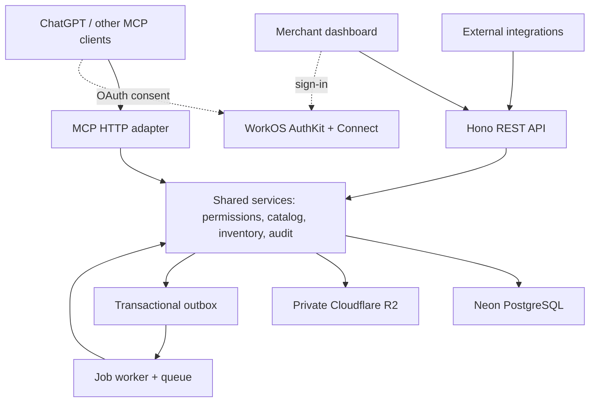

# Commerce Catalog and Inventory Platform

## Product requirements, operating behavior, and architecture

**Version:** 0.5 — review draft with Phase 0 findings  
**Date:** 14 November 2026  
**Audience:** Product owner, designers, developers, and future implementation agents  
**Product name:** To be decided  
**Repository visibility:** PUBLIC until the product owner explicitly instructs otherwise  
**Purpose:** A single reference for what to build, how it should behave, and how its components fit together.

This document combines the PRD and the detailed operating specification. Keeping them together makes product behavior, inventory rules, API access, and audit requirements easier to review without conflicting descriptions in separate files.

**Decision labels**

- **Confirmed:** A requirement explicitly stated by the product owner, including later corrections.
- **Selected direction:** A technology or approach developed in the discussion and used for this plan.
- **Proposed default:** A concrete recommendation that makes the draft implementable; it is not presented as an instruction already given by the owner.
- **Open:** A decision that remains genuinely unresolved. Repository visibility is not open.

Requirements describe intended behavior. Where Phase 0 built or measured something, the text says so and points to the [Phase 0 report](phase-0-report.md); everything else is not yet implemented. Prices and vendor allowances are reference information checked on the date above, not permanent guarantees.

## Contents

1. [Vision and confirmed requirements](#1-vision-and-confirmed-requirements)
2. [Users, shop boundaries, and permissions](#2-users-shop-boundaries-and-permissions)
3. [Product experience and navigation](#3-product-experience-and-navigation)
4. [Catalog, variants, fields, and media](#4-catalog-variants-fields-and-media)
5. [Warehouses, locations, and stock definitions](#5-warehouses-locations-and-stock-definitions)
6. [Inventory workflows and invariants](#6-inventory-workflows-and-invariants)
7. [Complete activity history](#7-complete-activity-history)
8. [API behavior and integration contract](#8-api-behavior-and-integration-contract)
9. [MCP and the ChatGPT connection](#9-mcp-and-the-chatgpt-connection)
10. [Architecture and technology](#10-architecture-and-technology)
11. [Conceptual data model](#11-conceptual-data-model)
12. [Reliability, security, and performance](#12-reliability-security-and-performance)
13. [Public repository and economical CI](#13-public-repository-and-economical-ci)
14. [Free development and operating costs](#14-free-development-and-operating-costs)
15. [Delivery sequence and launch scope](#15-delivery-sequence-and-launch-scope)
16. [Acceptance scenarios and measurement](#16-acceptance-scenarios-and-measurement)
17. [Decisions still required](#17-decisions-still-required)
18. [Sources and architecture rationale](#18-sources-and-architecture-rationale)

## 1. Vision and confirmed requirements

### 1.1 Product vision

Build a simple visual database for ecommerce products, with an Airtable-like editing experience and a reliable inventory system. Merchants should be able to organize products, enrich their data, manage stock across locations, and use their own ChatGPT account to inspect or operate the platform through MCP.

The product must support apparel, furniture, food, spare parts, and other categories. It starts with a small understandable set of fields and grows through custom fields, product families, relationships, and optional capabilities. It must not force the business into a single vertical.

The product is intended to manage actual inventory operations, including movements, reservations, returns, and stock updates. A catalog demonstration alone does not fulfill the agreed scope.

### 1.2 Confirmed requirements

| ID | Requirement | Consequence |
| --- | --- | --- |
| C01 | A visual product database with fewer general-purpose features than Airtable. | Prioritize fast catalog work and clear commerce terminology. |
| C02 | Support many ecommerce categories, including apparel, furniture, food, and spare parts. | Use a common core with extensible attributes and category capabilities. |
| C03 | Simple by default, capable of many parameters and fields. | Hide optional complexity while keeping the underlying model extensible. |
| C04 | Store SKUs, prices, variants, weights, multiple sizes, pictures, and picture types. | Product and variant data, units, packaging, and media roles are first-class concepts. |
| C05 | One shop can have multiple stocks, locations, and warehouses. | Stock is tracked per SKU and location; totals are calculated without duplicating products. |
| C06 | Include rented or paid warehouses and external storage providers. | Warehouses can record an operator, ownership arrangement, contract, and fee information. |
| C07 | Track movements, reservations, returns, and stock updates. | Maintain a transactional inventory history and explicit workflow states. |
| C08 | Every action, however small, produces a log. | Log reads, writes, failed attempts, admin operations, automation, and discrete interface actions. |
| C09 | Shop owners and the platform admin can inspect logs. | Provide shop-scoped and platform administration history views. |
| C10 | APIs are available by default. | Build the application around documented, permission-controlled APIs from the beginning. |
| C11 | MCP is available from day one. | Each released business capability has corresponding AI access; no later retrofit. |
| C12 | Shop owners can easily connect their ChatGPT to the platform. | Provide remote MCP, OAuth account linking, clear consent, and merchant-oriented tools. |
| C13 | Keep initial cost as close to free as practical. | Use free allowances deliberately; expose limits and avoid promises of unlimited free production. |
| C14 | GitHub Actions must not consume the owner's private usage unnecessarily. | Use standard public-repository runners, short workflows, bounded storage, and no duplicate deployment builds. |
| C15 | The repository is public until the owner says otherwise. | Public is the default and a binding requirement, not an unresolved preference. |
| C16 | Shopify is the first sales-channel connector and ships in V0. | Shopify orders drive reservations and fulfillments; stock is pushed back to Shopify. See Section 8.5. |
| C17 | Everything the owner has specified ships in V0. | The scope in this document is not cut to reach a first release. Phases order the build; they do not split the first merchant release. |
| C18 | Pack sizes are supported. | Variants can be bought, counted, and sold in packs (for example, a case of 24) while stock is held in a base unit. See Section 4.6. |
| C19 | The end price is at least 10 times cheaper than Sortly. | Each plan costs at most one tenth of Sortly's comparable plan. Per-shop infrastructure cost must stay far below that. See Section 14.4. |
| C20 | The platform is hosted in the EU and serves EU merchants. | EU database and storage regions, GDPR processor obligations, and EU VAT handling apply. See Section 12.4. |
| C21 | Cloudflare Workers Paid is the baseline plan. | The owner already pays for it. The free plan's 10 ms CPU limit is not a design constraint. |
| C22 | Barcode/QR scanning with a phone camera for warehouse work. | Look up, receive, count, move, and pick by scanning in a mobile web app. Section 3.4. |
| C23 | Barcode and QR label printing. | Generate and print item, pack, and location labels. Section 4.7. |
| C24 | Reorder points and low-stock alerts per variant and location. | Alerts in-app, by email, by webhook, and through MCP. Section 6.9. |
| C25 | Purchase orders with partial receiving, on-order quantities, and creation from the low-stock list. | Suppliers and POs are first-class records; receiving uses the inventory engine. Section 6.8. |
| C26 | Bundles and kits. | A bundle's availability comes from its components, which are reserved and consumed together. Section 4.8. |
| C27 | Lot/expiry and serial-number tracking. | Moved from the specialist phase into V0, including expiry-aware allocation and lot traceability. Section 6.7. |
| C28 | Inventory valuation at moving average cost. | Every inventory event carries its unit cost; value and cost-of-goods reports. Not accounting. Section 6.11. |
| C29 | Standard reports with scheduled email delivery. | Saved, filterable reports emailed on a schedule to permitted members. Section 3.5. |
| C30 | Pick lists built from reservations. | Sorted by location path and workable by scanning. Section 6.10. |
| C31 | Permissions limited to specific locations. | Any role can be scoped to chosen warehouses or locations. Section 2.4. |
| C32 | Duplicate warning when creating items. | Same SKU or barcode is blocked; similar names are flagged on every create path. Section 4.9. |

C22–C32 come from a review of Sortly, inFlow, and Zoho Inventory (14 November 2026). They cover the features all three sell and that reviewers rely on most. All of them ship in V0.

### 1.3 Selected direction

- WorkOS AuthKit for application sign-in and as the OAuth authorization server for MCP clients. MCP consent uses WorkOS standalone Connect: the platform's own consent page chooses the shop and access and creates the connection grant, and WorkOS issues tokens carrying the grant's ID (Section 9.4, [ADR 0007](adr/0007-mcp-connection-binding.md)).
- Google, Microsoft, and email sign-in for the initial experience.
- Cloudflare for hosting, R2 file storage, and standard DDoS protection.
- PostgreSQL hosted through Neon for the main database.
- TypeScript, Hono, Zod, and OpenAPI for the API.
- The official MCP TypeScript SDK with Cloudflare's current stateless HTTP serving approach.
- One shared implementation of business rules for the dashboard, API, and MCP.
- One operation registry as the single source of truth for REST routes, MCP tools, permissions, and audit action names (Section 9.3).
- TanStack Table with TanStack Virtual for the product grid.
- EU regions for PostgreSQL and R2, with the Worker placed near the database.

Apple sign-in is deferred from the initial free-oriented web release. It is supported by WorkOS, but Apple's developer membership and web integration requirements add cost and setup. This is a release recommendation, not a permanent exclusion.

### 1.4 Product outcomes

- A merchant can understand what a product is, where its units are, and what can actually be sold.
- An inventory action remains correct when multiple people or integrations act at the same time.
- A merchant can answer who did what, through which client, and with what result.
- A new category can be represented without redesigning the entire catalog.
- An AI client can discover the shop's schema and execute authorized workflows without bypassing stock rules.

## 2. Users, shop boundaries, and permissions

### 2.1 Canonical terms

| Term | Meaning |
| --- | --- |
| Shop | The tenant or merchant business whose data, members, catalog, and stock are isolated. |
| Storefront or sales channel | A selling surface, such as a website or marketplace. It is separate from the shop's tenant identity. |
| Warehouse or site | A physical storage facility, retail backroom, rented warehouse, or third-party fulfillment site. |
| Location | A storage address within a site, optionally subdivided into zones, rooms, racks, shelves, or bins. |
| Product | The shared identity and descriptive information for an item or product family sold by the merchant. |
| Variant | An individually identified sellable item, normally carrying its own SKU and inventory. A simple product still has a default variant. |
| Inventory position | A variant's quantity at a location, in a condition, optionally identified by lot or serial number. |
| Stock pool | A logical grouping of eligible inventory positions for reporting or fulfillment. It does not create additional physical units. |
| Reservation | A claim on sellable stock that reduces availability without moving the units physically. |
| Movement | A recorded change in physical custody, location, or stock condition. |
| Adjustment | A reasoned correction to recorded stock, represented by a new inventory event. |
| Return | A workflow for receiving previously shipped units and deciding their condition and disposition. |
| Audit event | An attributable record of an attempted or completed application action, including reads and unsuccessful actions. |
| Platform admin | An authorized operator of the service with a separate administration surface and logged access. |

### 2.2 Shop isolation

- Every tenant-owned record belongs to exactly one shop.
- A user may belong to multiple shops; switching the active dashboard shop must not switch an existing AI connection's authorization silently.
- Membership and permissions are checked on every request, including background job execution and MCP calls.
- Foreign keys and database access rules must prevent references to another shop's products, warehouses, fields, or files.
- Two merchants may use the same physical third-party warehouse provider. Their warehouse records and stock remain isolated.
- Global platform configuration must be distinct from shop data.

Supporting multiple memberships per user is a proposed default. The confirmed requirement is multiple stock locations within each shop.

### 2.3 Proposed permission model

| Role | Intended capabilities |
| --- | --- |
| Shop owner | Manage the shop, members, permissions, integrations, and all shop operations; inspect all shop history. |
| Manager | Manage the catalog and inventory with delegated administrative permissions. |
| Catalog editor | Edit permitted product information and media. |
| Inventory operator | Receive, transfer, reserve, fulfill, inspect returns, and adjust stock as allowed. |
| Viewer | Read authorized catalog, stock, and history views. |
| Platform admin | Inspect and support authorized shops through a separate administration path; sensitive actions require a recorded reason. |

These are starter roles, not a confirmed final list. Implement granular permissions beneath them so the UI, API, and MCP do not rely on hard-coded role names. Any role can be limited to specific locations (Section 2.4).

Only authorized roles see costs and inventory value, commercial warehouse fees, integration credentials, member administration, or sensitive administrative context. The platform admin's real identity must remain visible in history, including when using a support or impersonation feature.

### 2.4 Location-scoped permissions

Confirmed requirement C31.

- A member's role applies either to the whole shop or to a chosen set of warehouses or locations.
- The scope covers inventory reads: positions, availability, movements, and history entries about those locations.
- It also covers inventory commands. A command is allowed only if every location it touches is in scope. For transfers, dispatch needs the source in scope and receipt needs the destination in scope.
- Catalog records are shop-wide and visible to anyone with catalog read permission. Stock figures and history for out-of-scope locations are hidden. Totals shown to a scoped member cover only their locations and are labelled as partial.
- API credentials and MCP connections inherit the member's location scope, intersected with the connection's grant.
- Report emails apply the recipient's scope when each email is generated (Section 3.5).
- Scope changes are logged and take effect on the next request.

## 3. Product experience and navigation

### 3.1 First use

1. Sign in with Google, Microsoft, or an enabled email method.
2. Create a shop or accept an invitation.
3. Choose the shop's currency, display units, and timezone.
4. Start with one default storage site and location named Main stock.
5. Create products manually or import a CSV.
6. Enable optional fields, product families, additional warehouses, and specialist inventory capabilities as needed.
7. Connect ChatGPT from the integrations area or the published ChatGPT plugin.

Currency, units, timezone, and email sign-in method are proposed setup defaults. Do not infer them from the developer's location.

### 3.2 Main navigation

- Products: spreadsheet view, gallery view, saved views, product details.
- Inventory: stock by variant, warehouse, location, condition, and optional tracking identifiers.
- Operations: receipts, transfers, reservations, pick lists, shipments, returns, counts, and adjustments.
- Purchasing: suppliers and purchase orders.
- Alerts: low stock, expiring lots, shortages, and sync problems.
- Reports: standard reports, saved reports, and email schedules.
- Warehouses: sites, storage locations, providers, commercial details, and labels.
- Mobile: scan-driven lookup, receiving, counting, moving, and picking.
- Activity: searchable shop-wide history and exports.
- Integrations: API credentials, OAuth connections, MCP setup, and webhooks.
- Settings: shop details, members, roles, product families, field definitions, and enabled capabilities.
- Administration: separate platform operator area.

### 3.3 Editing behavior

- Use a spreadsheet-like grid with inline editing, keyboard navigation, column selection, sorting, filtering, and saved views. Build it on TanStack Table (headless) with TanStack Virtual, so only visible rows and columns render. Sorting, filtering, and pagination run on the server; the grid never loads the whole catalog.
- Offer a product detail panel for variants, media, dimensions, packaging, stock, related records, and history.
- Distinguish saved values, unsaved edits, pending changes, errors, and version conflicts.
- One cell edit receives the same validation, permissions, and audit treatment as a large import.
- Rejected edits preserve the user's draft where possible and explain how to resolve the problem.
- Concurrent edits must not silently replace another person's changes. Return a conflict and offer a refresh or a reviewed retry.
- Inventory quantities are changed through inventory commands. Typing a counted quantity into a grid initiates an adjustment workflow with a reason and an expected stock version.
- Desktop is the main workspace for catalog editing. Warehouse work (scanning, receiving, counting, moving, picking) is designed for phones first (Section 3.4).

No general-purpose formula engine, arbitrary application builder, or unrestricted database schema designer is needed for the first release.

### 3.4 Mobile warehouse work and scanning

Confirmed requirement C22.

- Deliver a mobile web app that can be installed as a PWA. No native app in V0.
- Scan 1D barcodes (EAN/UPC, Code 128) and QR codes with the phone camera. Use the browser's BarcodeDetector where it exists and a WebAssembly decoder elsewhere, because browser support is uneven, notably on iOS.
- Hardware scanners that type like a keyboard work in every scan field.
- Scan to look up a variant or pack (Section 4.6), receive (including against a purchase order), count, move between locations, pick (Section 6.10), and capture lot or serial numbers.
- Scanning a location label sets the current location for the following scans.
- Scanning an unknown code offers to attach it to an existing variant or create a new one, with the duplicate check (Section 4.9).
- Every scan-driven change is an ordinary command with the same validation, idempotency, and audit as the dashboard. A scan that only looks something up is a read and is logged as one.
- Use large touch targets and one-handed flows. Show the quantity and pack clearly before each commit.
- Offline mode is not in V0. If added later, it queues only counts and receipts, which are reconciled against the expected stock version (Section 6.6).

### 3.5 Reports

Confirmed requirement C29. Standard reports in V0:

| Report | Contents |
| --- | --- |
| Stock on hand | Quantity by variant, location, condition, and lot, in base units with a pack breakdown. |
| Low stock | Variants at or below their reorder point, with on-order quantities and a suggested reorder. |
| Movements | Receipts, transfers, fulfillments, and adjustments over a period, by variant or location. |
| Inventory value | Quantity × moving average cost by location and category, at any date (Section 6.11). |
| Cost of goods | Cost of fulfilled units over a period. |
| Purchasing | Open purchase orders, on-order quantities, and overdue receipts. |
| Expiring lots | Lots expiring within a chosen window. |
| Shortages | Open shortages from externally accepted orders (Section 8.5). |

- Reports accept filters, can be saved, and export to CSV.
- A saved report can be emailed on a schedule (daily, weekly, or monthly) to members allowed to see its contents. The recipient's location scope and cost permission apply when each email is generated.
- Confirmed (v0.4): the email contains a summary and a link, not attached data. If attachments are added later, each counts as an export and is logged as one.
- Reports run as background jobs. Viewing, running, scheduling, and emailing a report are audit events.
- Every report is available through the API and MCP via the operation registry.

## 4. Catalog, variants, fields, and media

### 4.1 Product and variant model

- Products hold shared descriptions, category information, tags, media, and defaults.
- Variants hold SKU identity, option combinations, barcode identifiers, price overrides, measurements, and inventory settings.
- A SKU is unique within a shop under a documented normalization rule.
- Internal IDs are stable and separate from editable SKUs.
- An item with no visible options has one default variant, so inventory always uses the same model.
- Variants can override inheritable product defaults. The interface and API must distinguish an inherited value, an explicit value, and an explicitly cleared value.
- Changing descriptive data does not rewrite historical inventory events.
- Archive products and variants with history. Do not allow hard deletion to break movements or reservations.
- Product lifecycle status is separate from inventory condition and warehouse operating status.

### 4.2 Initial field coverage

| Area | Coverage |
| --- | --- |
| Identity | Product name, description, SKU, barcodes per variant and pack, supplier identifiers, brand, category, tags. |
| Commercial | Price, currency, moving average cost (Section 6.11), tax classification reference, suppliers and supplier SKUs. |
| Variants | Size, color, material, capacity, dimensions, or other merchant-defined option sets. |
| Measurements | Product weight, product dimensions, shipping weight, package dimensions, units, and pack sizes (Section 4.6). |
| Media | Images, roles, ordering, alt text, variant associations, and attachments. |
| Inventory | Tracking mode (none, lot, lot with expiry, serial), base quantity unit, stock positions, reorder rules, reservations, and operation references. |
| Logistics | Sites, locations, provider references, transfer status, and external fulfillment references. |
| Extensibility | Typed custom fields, product families, controlled option lists, and related records. |

Price and quantity values use exact decimal representations. Avoid floating-point arithmetic for money or inventory. Record currencies and units explicitly; display conversion must not change the stored stock base unit.

The initial pricing proposal is one shop currency with currency-aware money fields. Price lists, market-specific prices, and automatic exchange rates are later capabilities unless brought into launch scope explicitly.

### 4.3 Custom fields and product families

Support text, rich text, integer, decimal, boolean, date, timestamp, single-select, multi-select, money, measurements with units, file references, and relationships.

Field definitions have a stable ID, label, type, validation rules, applicability, default, visibility, and lifecycle state. Field values refer to definitions; renamed labels must not break integrations.

Product families define the applicable fields and variant options for a category of products. A shop can use many families at once and extend them. A merchant does not need to select one industry for the whole shop.

Validate custom fields on the server for dashboard, API, import, and MCP writes. Version definitions and preserve the interpretation of historical changes. Changing a field type requires a preview and an explicit conversion plan.

Many fields are allowed, subject to visible and measured payload, indexing, and performance limits. Do not promise physically unlimited fields or create a database column for every merchant-defined attribute.

### 4.4 Examples across industries

| Industry | Example representation | Optional operational capability |
| --- | --- | --- |
| Apparel | Product with size/color variants, per-variant SKUs and images. | Barcode scanning, bundles, or size-specific fulfillment rules. |
| Furniture | Material and finish options; assembled dimensions; multiple shipping packages. | Component kits, assembly relationships, or made-to-order workflows. |
| Food | Ingredients, allergens, net contents, storage requirements, and a base quantity unit. | Lots, expiry dates, stock eligibility, and first-expiring-first-out allocation. |
| Spare parts | Manufacturer number, replacements, compatibility references, measurements. | Structured fitment datasets and serialized inventory. |

Representing a category's attributes is distinct from completing all its operational rules. For example, a product expiry field alone does not provide lot-based expiry management. The delivery plan must describe which specialist workflows are actually available.

### 4.5 Pictures and attachments

- Support merchant-defined picture roles, with initial suggestions such as primary, lifestyle, detail, packaging, dimension diagram, and swatch.
- Associate media with a product, one or more variants, or both.
- Store explicit ordering and primary-image selection at the correct scope.
- Record file metadata, ownership, upload state, content type, size, checksum, and storage object key.
- Keep binary files in private R2 storage; keep their relationships and descriptions in PostgreSQL.
- Log upload initiation, finalization, failure, replacement, download or access, role change, reorder, and removal.
- Validate file size and supported content; failed uploads must not leave a completed catalog attachment.
- Use an upload intent and finalization workflow because a file upload and a PostgreSQL transaction cannot be committed atomically together.
- Use authorized media delivery for access that must produce a shop audit event. Public image distribution is a later explicit policy, not an accidental consequence of using a CDN.
- Thumbnail generation and image processing are background work with their own measured resource budget.

### 4.6 Pack sizes and units of measure

Confirmed requirement C18. Stock is always held and recorded in the variant's **base unit**, such as each, kg, or metre. **Packs** let people buy, count, move, and sell in larger units without a second inventory record.

- Each variant has one base unit with its permitted precision (Section 6.7).
- A variant can define any number of packs, for example inner pack, 6-pack, case, or pallet. Each pack has a name, an exact quantity of base units, and optionally its own barcode/GTIN, dimensions, and weight.
- Packs can nest, for example a pallet of 40 cases of 24. The system resolves nested packs to an exact base quantity.
- Each pack can be marked for one or more uses: purchasing/receiving, counting, transfer, and sales.
- Receipts, counts, transfers, and adjustments accept a quantity in any permitted pack. The command converts it to base units exactly when it is accepted. Reject a conversion that would break the base unit's precision.
- Inventory events store the pack, the quantity entered, the conversion factor used, and the resulting base quantity. Changing a pack's definition later must not reinterpret history.
- Displays can show base quantity or a pack breakdown, for example "3 cases + 5 each". The stored balance stays in base units.
- A **sales pack** is a sellable unit that uses more than one base unit, for example a Shopify variant "6-pack" that uses 6 base units. Its availability is floor(available base quantity ÷ pack quantity). A sales pack is not a separate stock position.
- Scanning or importing a pack barcode resolves to the variant and pack.
- A pack can carry its own price; otherwise the price comes from the variant.
- Packs are different from **shipping packages** (Section 4.2: for example, a sofa shipped in three boxes). A pack changes the quantity of units. A shipping package describes the physical boxes for one unit.

### 4.7 Barcodes and labels

Confirmed requirement C23.

- A variant and each of its packs can hold several barcodes: supplier GTIN/EAN/UPC codes and internal codes.
- Generate an internal Code 128 barcode or QR code for items without one. QR codes encode an internal identifier, not a public URL that exposes data.
- Barcodes are unique per shop across variants and packs. Creating a duplicate is rejected, with a link to the existing record.
- Label templates cover A4 sheet layouts and common thermal label sizes. Each template chooses its fields: name, SKU, variant options, price, barcode, lot, and expiry.
- Print item, pack, and location labels. Location labels drive scanning (Section 3.4).
- Labels render as PDF and print through the browser's print dialog. Direct printer drivers are not in V0.
- Label generation is an audit event.

### 4.8 Bundles and kits

Confirmed requirement C26.

- A bundle is a sellable variant made of component variants with exact quantities, for example a gift set of one candle and two soaps.
- In V0 a bundle holds no stock of its own. Its availability is the smallest result, over its components, of floor(component available ÷ quantity per bundle), for the requested fulfillment scope.
- Reserving or fulfilling a bundle reserves or consumes all its components in one transaction, in the documented lock order. If any component is short, the whole reservation fails. The exception is an externally accepted order, which records a shortage per component (Section 8.5).
- Components can be packs (Section 4.6). Bundles cannot contain other bundles in V0.
- A bundle can map to a Shopify variant. Any change in a component's availability triggers a push for the bundle.
- Bundle definitions are versioned, and reservations record the version used, so editing a bundle does not change open reservations.
- Pre-assembled kits, where components are assembled into stocked kit units and can be disassembled again, come later (Phase 4).

### 4.9 Duplicate detection

Confirmed requirement C32.

- Every create path checks for existing records: the dashboard, imports, the API, MCP, scanning, and the Shopify import.
- The same normalized SKU or the same barcode is blocked (Sections 4.1 and 4.7).
- A similar name, by PostgreSQL trigram similarity within the shop, produces a warning listing the likely matches, with "use existing" and "create anyway" choices.
- Import previews flag likely duplicates before commit.
- Confirmed (v0.4) for API and MCP: a create call without an explicit acknowledgment flag returns the likely matches instead of creating. An AI client therefore cannot skip the warning silently.
- Receiving stock for a scanned or typed item that resembles an existing one shows the match before anything is created.
- The warnings shown and the choice made are logged.

## 5. Warehouses, locations, and stock definitions

### 5.1 Warehouse records

Each warehouse or site can store its name, address, timezone, operator, contact details, external provider IDs, operating status, ownership arrangement, and fulfillment eligibility.

Ownership arrangements include owned, rented, and third-party operated. Paid warehouse records can include contract dates, fee descriptions, currency, storage or handling rate references, and attachments.

**Proposed boundary:** Record commercial warehouse details first. Automated warehouse billing, invoice matching, and detailed cost allocation are additional capabilities requiring their own rules. Merely storing a rate must not be presented as an accounting system.

### 5.2 Locations and pools

- Locations belong to a warehouse and can form an optional hierarchy.
- Stock is held at unambiguous leaf locations; parent quantities are sums, not separate copies.
- System-controlled in-transit positions represent dispatched stock not yet received.
- Stock pools group eligible positions for a channel or fulfillment purpose. A unit can appear in several reports but is only owned once.
- Archived locations cannot receive new operations, while their history remains available.
- A warehouse with stock or outstanding reservations cannot be silently removed.

### 5.3 Quantity vocabulary

| Quantity | Definition |
| --- | --- |
| On hand | Units physically present at a warehouse, across its recorded conditions. |
| Sellable on hand | On-hand units whose condition and applicable rules permit sale. |
| Reserved | Sellable units allocated to active claims at eligible positions, including order reservations and transfer holds. |
| Available | Eligible sellable on hand minus all active allocations against those positions for the requested fulfillment scope. |
| In transit | Dispatched units awaiting receipt, loss resolution, or another explicit outcome. |
| Quarantined | Physically present units awaiting inspection or release. |
| Damaged | Physically present units recorded as damaged and unavailable for sale. |
| Owned stock total | Stock still owned by the merchant, including physical and in-transit stock as defined by the workflow. |
| On order | Quantity on open purchase order lines not yet received, by destination. Never sellable. |
| Shortage | Demand from externally accepted orders that could not be allocated. Availability shown and pushed never goes below zero; the shortage is reported separately. |

Availability is evaluated for a specified shop, variant, and fulfillment scope. All claims against a position count, including claims created through another overlapping pool. A global stock total is not a promise that every unit can fulfill every order.

### 5.4 Example

| Site | Sellable on hand | Reserved | Available |
| --- | ---: | ---: | ---: |
| Store | 20 | 3 | 17 |
| Rented warehouse | 80 | 10 | 70 |
| Fulfillment partner | 50 | 5 | 45 |
| Total | 150 | 18 | 132 |

This table describes one variant. It does not create three copies of the product. Quarantined or damaged units are reported separately and do not increase sellable availability.

## 6. Inventory workflows and invariants

### 6.1 Fundamental rules

1. Record inventory changes as append-only events linked to an operation and its actor.
2. Keep current stock balances as a transactionally maintained projection that can be reconciled against the inventory history.
3. Model reservations separately from physical movements.
4. Preserve quantities through transfers; do not count the same units at origin, in transit, and destination simultaneously.
5. Prevent negative sellable availability under the proposed initial policy. The exception is an order an external channel has already accepted, such as a Shopify order. Record it with an explicit shortage instead of rejecting it (Section 8.5).
6. Use database transactions, conditional updates or row locks, and documented lock ordering. A read-then-write sequence without concurrency protection is insufficient.
7. Repeated delivery of the same command must not repeat its stock effect.
8. Every adjustment has a reason; every external operation can carry a stable external reference.
9. Keep the successful stock command, balance changes, reservation changes, business audit event, and outgoing event reference in one database transaction where applicable.
10. Correct history through compensating operations. Do not edit an earlier movement to hide the correction.

Negative-stock or backorder support is an open business policy, not an implied capability of custom fields.

### 6.2 Receive stock

1. Select the site, leaf location, variant, exact quantity, unit, and condition.
2. Add supplier or inbound reference and optional lot, expiry, or serial details.
3. Validate the variant's tracking configuration and the destination.
4. Commit the receipt, inventory entries, current balances, and audit event together.
5. Return operation IDs and the resulting relevant stock balances.

Opening stock follows the same rules and is labeled as an opening adjustment or receipt. A CSV import of initial stock must not bypass the inventory engine.

### 6.3 Reserve, release, expire, and fulfill

- A reservation identifies its shop, variant, quantity, external purpose, allocation, and optional expiry.
- Creating a reservation atomically checks eligible availability and allocates stock.
- The initial implementation should allocate concrete positions during reservation. An unallocated promise across a pool requires an additional allocation model and must not be simulated by ignoring location constraints.
- When the caller does not name a position, as with a Shopify order, the shop's **allocation rule** chooses one. Proposed default: an ordered priority list of fulfillment-eligible locations per channel. Within a location, use the oldest received stock first, or the first to expire when lot tracking is enabled. Record the chosen positions on the reservation.
- Support partial release and partial fulfillment.
- Reservation purposes include an external order and an internal transfer. Both use the same allocation accounting, so a transfer hold reduces availability for every other caller.
- States include active, partially fulfilled, fulfilled, released, and expired, with quantities recording the actual remaining amount.
- Expiry and fulfillment can race; exactly one valid transition wins for the relevant quantity.
- Fulfillment reduces physical stock and the corresponding reserved quantity in the same transaction.
- Cancellation or expiry releases the claim without creating a physical stock movement.
- A late background expiry job must not keep already-expired stock unavailable. Commands account for expiration when calculating availability and reconcile state safely. The expiry sweep runs every 30 minutes, not every minute, so the database can scale to zero (Section 14.2); correctness never depends on it running on time.

### 6.4 Transfer between locations or warehouses

Proposed states: draft, ready, partially dispatched, dispatched, partially received, received, cancelled, and exception. Quantities are authoritative; a summary status must not hide a mixture of dispatched and received lines.

1. Prepare a transfer and identify source, destination, variants, quantities, and tracking identifiers.
2. Create typed transfer reservation allocations for eligible source stock when the transfer becomes ready.
3. Dispatch a specified quantity atomically consumes that amount of the source allocation, removes the units from origin, and places them in a transfer-specific in-transit position.
4. An undispatched remainder stays held at origin until a later dispatch, explicit cancellation, or other allowed resolution.
5. Receipt moves actual quantities out of transit and into destination positions. Partial receipts leave only the outstanding dispatched quantity in transit.
6. Track planned, cancelled-before-dispatch, cumulatively dispatched, cumulatively received, and exception-resolved quantities per line. Dispatch cannot exceed the eligible held remainder; receipt and exception resolution together cannot exceed dispatched quantity.
7. Losses, damage, and shortages require an explicit exception resolution and recorded adjustment.
8. Cancellation before dispatch releases the relevant allocation. A partly dispatched transfer can release its undispatched remainder, while dispatched units still require an explicit recovery, return, receipt, or exception resolution.

Draft transfer creation alone does not move stock. Transfers within a warehouse follow the same conservation rules even if dispatch and receipt are combined into one authorized operation.

### 6.5 Returns and inspection

Proposed states: requested, authorized, in transit, received, inspecting, and completed, with cancellation and exception outcomes.

- Link a return to the relevant external shipment or fulfillment when available.
- Support partial returns and receipt at a different warehouse.
- An authorization or return request does not increase stock.
- Receiving units places them in quarantine or another explicitly configured inspection condition.
- Inspection can split units into sellable, damaged, repair, supplier return, or disposal dispositions.
- Only units released to a sellable position increase availability.
- Restocking physical units does not issue a customer refund. Refunds belong to an external commerce or future order system.

### 6.6 Counts and adjustments

- A stock count records the observed quantity, counted position, counting time, counter, and expected stock version.
- A concurrent movement invalidates the initial count basis unless a reviewed reconciliation accounts for it.
- The system calculates the delta and records an adjustment with a reason.
- A count below reserved stock requires an explicit reservation shortage resolution; the system must not silently create negative availability or delete reservations.
- Reversal is a new operation linked to the original operation.

### 6.7 Lot, expiry, and serial tracking

Confirmed requirement C27, in V0. Tracking is set per variant: none, lot, lot with expiry, or serial.

**Lots and expiry**

- A lot has a code, an optional expiry date, an optional production date, and the supplier and purchase order it came from. Lot codes are unique per variant within the shop.
- Receipts of lot-tracked variants require the lot, plus the expiry when configured. Stock positions are kept per lot.
- Expired units stop being sellable at the moment of expiry. Commands compute this when they run, so a late background job cannot keep expired stock available. Optionally, units become ineligible a set number of days before expiry (a sell-by margin).
- Allocation is first-expiring-first-out by default (Section 6.3).
- Expiry alerts fire a configured number of days ahead (Section 6.9).
- **Traceability:** for any lot, show where it came from (supplier, purchase order, receipt) and where it went (transfers, external orders and fulfillments, returns, disposals). This supports product recalls. The trace is exportable.

**Serial numbers**

- Each serialized unit has a serial number, unique per variant within the shop (proposed scope), and a quantity of exactly one.
- Receipts, transfers, fulfillments, and returns of serialized variants record which serials moved. Scanning is the normal input.
- A serial's full history is searchable.
- A returned serial must match one previously fulfilled from this shop, or it is flagged for review.

**General**

- Expiry eligibility is calculated the same way in the UI, API, MCP, reports, and Shopify availability.
- Shopify does not track lots or serials. The allocation rule chooses lots when the reservation is made, and the pick list shows them. A picker who scans a different eligible lot updates the allocation (Section 6.10).
- Fractional quantities require an explicit base unit and permitted precision.
- Product dimensions and shipping-package dimensions remain separate.

### 6.8 Purchase orders and receiving

Confirmed requirement C25.

- Suppliers are reference records with contact details, lead time, and supplier SKUs per variant.
- A purchase order has a supplier, a destination warehouse, an expected date, and lines (variant, pack, quantity, unit cost).
- States: draft, sent, partially received, received, closed, and cancelled. The ordered, received, and cancelled quantities per line are authoritative.
- Sending a PO produces a PDF and can email it to the supplier. The send is logged. A PO does not change stock.
- Open PO lines count as **on order** for their destination (Section 5.3). They appear in low-stock and availability views and are never sellable.
- Receiving against a PO uses the receipt workflow (Section 6.2): scan or enter quantities by pack, with lots, expiry, or serials where required. A partial receipt keeps the remainder open. Over-receipt needs confirmation and is recorded.
- Closing a PO with an open remainder cancels that remainder explicitly.
- The receipt carries the PO line's unit cost into valuation (Section 6.11).
- **Create from low stock:** select low-stock lines, and the system drafts one PO per preferred supplier. The suggested quantity is the reorder quantity, or the amount needed to reach the maximum level, minus what is already on order. The user reviews the draft before saving.
- V0 POs use the shop currency. Foreign-currency POs, approval chains, supplier portals, and automatic sending come later.

### 6.9 Reorder points and alerts

Confirmed requirement C24.

- A reorder rule applies to a variant at a warehouse. It has a reorder point, either a reorder quantity or a maximum level, and an optional preferred supplier. Confirmed (v0.4): rules per warehouse, with per-location rules optional.
- A low-stock alert fires when available plus on-order stock falls to or below the reorder point. Counting on-order stock stops the alert repeating after a PO is placed.
- Alerts are deduplicated: one open alert per rule until stock recovers above the reorder point.
- Channels: in-app, email to subscribed members, webhook, and MCP (an AI client can list open alerts). Members choose which alerts they receive, within their location scope.
- Alerts also cover lots nearing expiry, new shortages from external orders, and Shopify sync failures.
- The rule check runs in the transaction that changes stock, as a cheap comparison, and the notification goes through the outbox. An alert therefore never fires for stock that did not commit.
- Rule changes and alert state changes are audit events.

### 6.10 Picking

Confirmed requirement C30.

- Generate a pick list from open reservations, filtered by channel, warehouse, date, or order.
- Lines are grouped by location and sorted by location path (zone, aisle, shelf, bin) for a short walk. Each line shows the variant, quantity in base units and packs, the allocated lot or serial, and the external order reference.
- Print the list as PDF, or work it on a phone by scanning location, then item, then confirming the quantity.
- Picking records picked quantities per line; it does not change stock. Physical stock decreases when the fulfillment is recorded. For Shopify orders, that is when Shopify reports the fulfillment (Section 8.5).
- A short pick asks the picker to record what was found. That starts a count or adjustment (Section 6.6) and can reallocate the reservation to another position.
- Scanning a different eligible lot or position updates the allocation in one command.
- Creating Shopify fulfillments from this platform comes later; V0 reads them from Shopify.

### 6.11 Inventory valuation

Confirmed requirement C28. This is stock valuation, not accounting: no general ledger, journals, or tax reporting.

- Each variant has a moving average unit cost in the shop currency. Confirmed (v0.4): one average per variant per shop; per-warehouse costing comes later.
- A receipt with a unit cost updates the average: (current quantity × current average + received quantity × unit cost) ÷ new quantity. A receipt without a cost uses the current average, or a merchant-entered default cost when there is no stock.
- Transfers do not change cost. Fulfillments, adjustments, and disposals remove units at the current average.
- Every inventory event stores the unit cost applied. Value and cost-of-goods reports for any past date are therefore reproducible without recalculation.
- Costs are calculated in base units; pack costs convert exactly (Section 4.6). A bundle's cost is the sum of its components' costs at fulfillment.
- Costs are exact decimals with a documented rounding rule.
- Cost and value are visible only to roles with cost permission.
- Landed costs (freight, duties) and FIFO valuation come later.

## 7. Complete activity history

### 7.1 Coverage

The requirement is complete application activity logging, including minimal actions. Do not restrict history to stock movements or changed database rows.

| Category | Examples |
| --- | --- |
| Catalog changes | One cell edit, variant creation, field rename, image reorder, archive, and restore. |
| Inventory | Receipt, reservation, release, expiry, fulfillment, dispatch, partial receipt, inspection, and adjustment. |
| Purchasing and planning | PO creation, sending, receipt against a PO, closing, reorder rule changes, alert firing and acknowledgment. |
| Warehouse work | Scan lookups, label generation, pick-list creation, and pick confirmations. |
| Reports | Report runs, saved-report changes, schedules, and each emailed report. |
| Reads and exports | Product view, list request, search, filter application, stock lookup, media access, history access, export request, and download. |
| Interface actions | Shop switch, saved-view selection, sort change, column visibility change, and operation cancellation. |
| Access and configuration | Login, logout, failed sign-in (from the identity provider's verified events, Section 7.3), invitation, role change, API credential lifecycle, OAuth consent, connection revocation, and webhook configuration. |
| Automation | Scheduled processing, imports, job retries, reconciliation, webhook delivery outcomes, and MCP calls. |
| Administration | Shop inspection, support access, administrative changes, and changes to the administrator's own access. |
| Unsuccessful actions | Validation rejection, conflict, denied access, no-op update, duplicate command replay, and failed operation. |

**Proposed event boundary:** Log each discrete application action and accepted field change. Do not record raw passwords, OAuth secrets, the contents of keystrokes, or continuous pointer motion. This defines event granularity; it must not become a reason to omit small reads or edits.

Browser-local actions use a first-party activity endpoint with event IDs, client sequence numbers, and acknowledged delivery. The browser batches them, flushing every few seconds, at a size threshold, and when the page is hidden, rather than sending one request per action. They are labeled as client-reported. Server-side read and mutation events are authoritative and must not depend on browser telemetry.

### 7.2 Event envelope

An audit event should contain:

- Event ID, schema version, shop ID or platform scope, server timestamp, and optional client timestamp.
- Actor type and immutable actor ID; original administrator identity when acting for someone else.
- Client or integration identity and delegated user identity for OAuth/MCP.
- Action name, target type, target ID, and related operation IDs.
- Source: dashboard, REST API, MCP, import, scheduled process, or administration.
- Outcome: received/started, succeeded, failed, denied, cancelled, conflict, no change, replayed, or outcome unknown until reconciliation establishes a terminal result.
- Before-and-after values for changed fields, or a clear change set.
- Reason, external reference, request/trace ID, batch or job ID, and idempotency reference.
- Authorized shop or connection grant and relevant permission context.
- Redacted error context sufficient to explain a failure.

Never store credentials or unrestricted request bodies as audit context. Do not capture unrelated conversation content from ChatGPT. AI attribution comes from verified connection and user identities, not an unverified claim supplied in tool arguments.

### 7.3 Durability and failure contract

Mutations and reads use different durability paths. Both are durable before the caller gets a result; only mutations write to PostgreSQL synchronously.

**Authentication first (confirmed by the owner)**

- Only authenticated callers are served. Authentication runs before anything else: a request without a valid session, API credential, MCP token, or webhook signature gets 401 before anything is sent to the audit queue, and it is not a shop audit event. Otherwise anonymous traffic would cost queue operations and make running up the bill cheap. Built in Phase 0, including Shopify webhooks: a bad signature is a 401 before anything is recorded or queued.
- Failed sign-ins are recorded by the identity provider and reach the history through its verified events (below). Successful sign-ins and sign-outs are platform events.
- A Cloudflare rate-limiting rule in front of the Worker bounds the cost of unauthenticated traffic.

**Mutations**

- After authorization and input validation, and before executing a mutation, send a minimal attempt event to the audit queue (Cloudflare Queues) and wait for the queue to acknowledge it. A denied or invalid request sends one outcome event instead. Unverified client identifiers must not be treated as authorized context. Background operations use the same attempt/outcome pattern.
- The attempt record sits outside the business transaction. A stable attempt ID links it to the eventual transactional success event or independent failure event.
- Successful mutations and their change events commit in the same PostgreSQL transaction.
- Failed or rolled-back mutations need a separate failure event, sent to the audit queue. An event rolled back with the mutation is not enough.

**Reads and access events**

- Before returning protected data, the Worker sends **one queue message per read**, carrying the read's outcome (its access event), and waits for the acknowledgment. A read has no separate attempt event, because two messages would double its queue cost. If the send fails, the read fails. This keeps the rule that no protected data is returned without a durable record, without a PostgreSQL write per read. Built in Phase 0.
- **Before launch:** batch the access events of API and MCP clients, several per queue message, without weakening the rule above. At three queue operations per message, an integration polling once a second would otherwise cost about $3 a month on its own (Section 14.2).
- A queue consumer writes audit events to PostgreSQL in batches (one multi-row insert per batch), deduplicated by event ID.
- Client-reported interface events arrive in batches (Section 7.1) and follow the same queue path.

**Outages and delivery**

- If PostgreSQL is unavailable, protected reads and mutations fail. Their attempt and failure events are still accepted by the audit queue. Queue retention, configurable up to 14 days on the paid plan, bounds how long an outage the log can cover. An outage longer than that is a documented gap until the R2 spool exists.
- **Deferred until after the pilot (owner decision):** a private R2 audit spool as a second durable fallback, with a scheduled reconciler that replays unprocessed spool objects independently of queue retention.
- Queue delivery is at least once. Event IDs are UUIDv7, and an event's ID and timestamp are both fixed when it is created, not when it is ingested. PostgreSQL requires a unique constraint on a partitioned table to include the partition key, so history is partitioned on that creation time and redelivery is deduplicated by `UNIQUE (occurred_at, event_id)`. Built in Phase 0. A queue acknowledgment does not mean the event is already searchable in PostgreSQL. Show ingestion delay and degraded operation explicitly in the activity views.
- Reconcile started attempts without terminal events against committed operation/idempotency records after a crash. Do not call an operation failed merely because the client did not receive a response.
- If commit acknowledgement is lost, expose an outcome-unknown result and require a retry with the original idempotency key. Append a reconciliation event when the outcome is established; do not overwrite earlier evidence.
- Provider login and authorization events arrive through verified provider events and are reconciled when delivery is delayed.
- Browser actions that have not been durably acknowledged must be shown as pending or failed delivery; the system cannot claim completeness for an offline or crashed browser.
- A simultaneous loss of every durable store cannot be described as lossless logging. Production readiness includes an explicit outage contract and recovery test.
- Reading the activity timeline generates the normal single access event for that request. Writing or processing audit events does not recursively create infinite audit events.

### 7.4 Views and integrity

- Show a shop-wide timeline and contextual history on products, variants, sites, inventory positions, and operations.
- Filter by actor, source, date, target, action, outcome, warehouse, integration, or batch.
- Bulk operations have a parent event and a change event for each affected record. Request attempts and successful effects remain distinguishable.
- Shop owners see their shop's history. Platform admins use authorized cross-shop views with their own access recorded.
- Application roles cannot edit or delete individual events. Reversals and corrections create new entries.
- Application-level append-only controls do not mean a privileged database operator is physically incapable of alteration. Independent archive manifests and storage retention controls strengthen tamper evidence.
- Proposed retention default: no silent expiry. The owner must select a published policy before automatically deleting or expiring any history.
- History is partitioned by month on each event's creation time (Section 7.3), so archiving detaches whole months without rewriting rows.
- Archive partitions older than a hot window (proposed: 90 days) to R2 as compressed files, keeping a searchable index and an authorized retrieval/export path. This is a V0 requirement, not something to add later as volume grows: logging every read makes history the largest per-shop storage cost, and the price target (Section 14.4) depends on keeping it out of PostgreSQL. Archived history must remain discoverable to owners and admins.
- Retention, privacy redaction, and recovery are separate policies; none may silently change the promise of complete history.

## 8. API behavior and integration contract

### 8.1 API-first requirement

The dashboard uses the same versioned application API that integrations use. Every released business operation is available programmatically, subject to the same permissions. UI-only shortcuts must not bypass validation, inventory transactions, or logging.

Use REST/JSON with an OpenAPI description. Publish request and response schemas, examples, pagination behavior, errors, permissions, and change policy. SDK generation can be added from the contract without replacing documentation.

Separate infrastructure-only secrets and platform operator functions from ordinary shop APIs. API availability does not mean anonymous access or unrestricted database access.

### 8.2 Proposed route groups

| Area | Example route families under /api/v1 |
| --- | --- |
| Identity and access | /me, /shops, /shops/{shop_id}/members, /roles, /connections |
| Catalog | /shops/{shop_id}/products, /variants, /bundles, /packs, /barcodes, /product-families, /field-definitions, /reference-records, /duplicate-checks |
| Purchasing | /shops/{shop_id}/suppliers, /purchase-orders, /purchase-orders/{po_id}/receipts |
| Planning and alerts | /shops/{shop_id}/reorder-rules, /alerts, /alert-subscriptions |
| Warehouse work | /shops/{shop_id}/scan-lookups, /pick-lists, /labels, /lots/{lot_id}/trace, /serials |
| Reports | /shops/{shop_id}/reports, /saved-reports, /report-schedules |
| Media | /shops/{shop_id}/media, /upload-intents, /media/{media_id}/finalize |
| Storage structure | /shops/{shop_id}/warehouses, /locations, /stock-pools |
| Inventory reads | /shops/{shop_id}/inventory/positions, /availability, /movements |
| Inventory commands | /shops/{shop_id}/receipts, /reservations, /transfers, /fulfillments, /returns, /adjustments |
| Long-running work | /shops/{shop_id}/imports, /exports, /jobs, /bulk-previews |
| History | /shops/{shop_id}/activity, /activity-exports |
| Integrations | /shops/{shop_id}/api-credentials, /webhook-subscriptions, /webhook-deliveries |
| Administration | /admin/shops and explicitly authorized support routes |

These are contract sketches, not a frozen endpoint specification. Lifecycle transitions such as dispatch, receive, inspect, release, or fulfill should be explicit commands, not arbitrary status updates.

### 8.3 Shared contract requirements

- Stable IDs and versioned schemas.
- Cursor pagination and selectable response fields for large collections.
- Server-validated filtering and sorting on permitted built-in and custom fields.
- Clear validation errors, forbidden actions, conflicts, rate limits, and retry guidance.
- Expected record or stock versions on concurrency-sensitive changes.
- Idempotency keys for inventory commands, imports, and other retryable mutations.
- Bind each key to its shop, caller/connection, operation, and normalized request hash. Reusing a key for a different command is rejected.
- A replay returns the original successful result without repeating the effect, while logging the replay attempt.
- Atomicity for one inventory command. Large batches use explicit per-item outcomes and checkpoints rather than an implied unlimited all-or-nothing transaction.
- Document API limits and expose relevant usage in the shop settings. Rate-limit each API credential before launch (Section 14.2).
- Use short-lived user tokens for interactive access and scoped, revocable credentials for integrations. Store only appropriate credential hashes or protected provider identifiers.

### 8.4 Imports, exports, and webhooks

Imports map columns to typed fields and variants, preview validation errors, and distinguish create, update, and stock-adjustment operations. Each row has an outcome and traceable history. Large imports are resumable jobs.

Exports respect filters, permissions, and field visibility. Export generation and file access are logged. Temporary export files expire under a disclosed policy while the audit history remains.

Webhooks are a proposed core integration feature: publish signed events after transaction commit through an outbox. Use stable event IDs, retries, delivery status, and idempotent consumers. Never notify an integration about stock that did not commit. Initial outbound event coverage should include catalog changes, inventory changes, operation transitions, and job completion.

Connectors are separate products built on this API; having endpoints does not deliver synchronization. Shopify is the first connector and ships in V0 (Section 8.5). Amazon, ERP, carrier, and warehouse-provider synchronization come later.

### 8.5 Shopify connector (V0)

Confirmed requirement C16. Shopify is where most pilot merchants sell, so V0 inventory must follow Shopify orders automatically. Without that, stock drifts from what the storefront sells.

**Installation and access**

- Distributed as a Shopify app. Use OAuth installation, the GraphQL Admin API, and the narrowest scopes that work (products, inventory, locations, orders, fulfillments, returns).
- Use **expiring offline tokens**: a one-hour access token and a 90-day refresh token, stored encrypted and rotated once even when several jobs refresh at the same time. Shopify requires them for public apps from 2027, so the connector starts with them. Built in Phase 0 ([ADR 0008](adr/0008-shopify-sync.md)).
- The pilot can start as a custom or unlisted app. Publishing on the Shopify App Store requires Shopify's review, its mandatory privacy webhooks (customer data request, customer redact, shop redact), and charging merchants through Shopify's billing. Recheck these requirements before submission.
- Before the app is public, Shopify must approve its access to protected customer data, which order webhooks contain. Development stores do not ask for this approval, so Phase 0 did not need it.
- A Shopify store is active in **one shop at a time**, enforced in the database, so its webhooks have exactly one destination. Store the minimum customer data needed: order and line references, not customer names or addresses.

**Onboarding**

- Import products, variants, SKUs, barcodes, images, and current quantities from Shopify as a resumable job using Shopify's bulk operations. The import uses the normal catalog commands and inventory engine (opening stock), with full history.
- Map each Shopify location to a warehouse or location here. Unmapped Shopify locations are shown and never guessed.
- Map each Shopify variant to a variant here, optionally through a sales pack (Section 4.6) or a bundle (Section 4.8).

**Ownership rules (proposed defaults)**

| Data | Owner after onboarding | Behavior |
| --- | --- | --- |
| Stock quantities | This platform | Push availability per mapped location to Shopify after each committed change, through the outbox, with compare-and-set (see Reliability). A Shopify-side quantity edit that no order explains is shown as a conflict, not silently accepted. |
| Orders, payments, customers | Shopify | Read only. This platform stores references, not a copy of the order system. |
| Storefront content (title, description, storefront price, storefront images) | Per-field setting, default Shopify | Changes made in Shopify arrive by webhook and are logged as connector changes. |
| Extended attributes, custom fields, packs, warehouse data | This platform | Not pushed to Shopify unless a field mapping is configured. |

**Order flow**

| Shopify event | Effect here |
| --- | --- |
| Order created/paid | Create a reservation per line with the Shopify order and line IDs as the external reference, allocated by the shop's allocation rule. |
| Order edited | Adjust the reservation quantities; partial release where lines shrink. |
| Order cancelled | Release the remaining reservation. |
| Fulfillment created | Fulfill the matching reservation quantity at the fulfilling location, reducing physical stock. |
| Refund with restock or return | Start the return workflow (Section 6.5). Shopify's restock flag does not make units sellable here before inspection. |

- **Oversell:** A Shopify order is already accepted by the time it arrives. If available stock is short, do not reject it. Create the reservation with an explicit **shortage** quantity that is visible, counted as demand, alerted, and resolved by a receipt, transfer, or cancellation. Rule 5 in Section 6.1 still applies to every other caller.
- **Sales packs:** Push floor(available base quantity ÷ pack quantity) for each Shopify variant mapped to a pack. A sale of one 6-pack reserves 6 base units.

**Reliability**

- Verify every webhook's HMAC signature. Deduplicate by Shopify's webhook/event ID. Process through durable job records and idempotent commands.
- Webhooks can be delayed or missed. A scheduled reconciler polls recent orders, fulfillments, and refunds, and compares pushed quantities with Shopify's levels.
- Respect Shopify's cost-based GraphQL rate limits with backoff. Use bulk operations for imports.
- **Compare-and-set push.** Send what this platform believes Shopify's quantity is with each write (`changeFromQuantity`), so a quantity changed in Shopify since the last push is detected rather than overwritten.
- **Mismatch handling.** Shopify lowers its own available quantity when it accepts an order, so a refused write often means an order this platform has not processed yet, not a merchant's edit. On a refused write, fetch recent orders, process any not seen yet, recompute, and retry. Only a difference that no order explains is a conflict: record the expected, platform, and Shopify quantities and leave Shopify untouched. Proven on two development stores in Phase 0 ([report Section 3](phase-0-report.md#3-shopify-on-staging-e7), [ADR 0008](adr/0008-shopify-sync.md)).
- Every connector action is a normal audit event with source "Shopify connector", the connection identity, and the Shopify event ID.
- Show sync health per shop: last successful sync, pending pushes, unmapped variants or locations, shortages, and conflicts. Expose the same through MCP.

## 9. MCP and the ChatGPT connection

### 9.1 Merchant experience

Target experience:

1. Find and install the platform's ChatGPT plugin, or add its custom MCP connection during the pilot.
2. Sign in to the platform with Google, Microsoft, or an emailed code.
3. Choose the shop and the access to grant on the platform's consent page, then confirm on WorkOS's screen.
4. Ask questions or request authorized operations in ordinary language.
5. Inspect the same results and history in the dashboard.
6. Review and revoke the connection from the platform.

Example prompts:

- Show low stock across my warehouses and explain which units are reserved.
- Find furniture products missing shipping-package dimensions.
- List food lots expiring within the next thirty days, if lot tracking is enabled.
- Find spare parts compatible with a selected model, using the shop's structured compatibility data.
- Reserve five units for external order 123.
- Prepare a transfer from Main warehouse to Store and show the proposed changes.
- Explain who changed this SKU's price and whether the change came from an AI client.
- Draft purchase orders for everything below its reorder point.
- Trace lot L-2291: where did it come from, and which orders received it?
- What is my stock worth per warehouse today, and what did last month's sales cost?

These examples describe tool-backed workflows. They do not require the platform to run its own language model or accept unrestricted instructions from product descriptions.

### 9.2 Technical shape

- Serve one universal remote MCP endpoint at /mcp, over HTTPS with Streamable HTTP.
- Use the official TypeScript SDK v2 server package and a supported stateless Worker handler.
- Create request-local MCP server context. Durable product data and job state live in PostgreSQL, not process memory or an MCP session.
- Reuse shared Zod-compatible schemas where appropriate, including structured tool output.
- Keep tool descriptions concise, with pagination, field selection, and useful errors.
- Provide tools for field discovery and enabled capabilities so agents can understand each shop's custom schema.
- Use a stable set of tools that accepts field identifiers; do not create a separate tool for every custom field or SKU.
- Rate-limit each MCP connection before launch, as each API credential is (Section 8.3). Every call costs queue operations and database time (Section 14.2).

### 9.3 Tool families and parity

| Tool family | Example capabilities |
| --- | --- |
| Catalog discovery | List product families, field definitions, enabled capabilities, and valid options. |
| Catalog operations | Search/get/create/update products and variants, manage relationships, assign media. |
| Inventory discovery | List warehouses and locations, inspect positions, calculate scoped availability. |
| Inventory commands | Receive, reserve, release, fulfill, prepare/dispatch/receive transfers, inspect returns, adjust stock. |
| Purchasing and planning | List low stock and open alerts, draft POs from low stock, receive against a PO. |
| Warehouse work | Build pick lists, look up a scanned code, trace a lot or serial. |
| Reports | Run standard and saved reports, including inventory value and cost of goods (within cost permission). |
| Batch work | Preview changes, start imports/exports, inspect jobs and per-item errors. |
| History | Search events and explain a record's change or an operation's lifecycle. |
| Shop configuration | Permitted field, location, view, and integration configuration exposed under the appropriate administrative scopes. |

**Operation registry (selected direction).** Each business operation is defined once in a typed registry, which is the single source of truth. An entry declares:

- a stable operation ID and its input and output Zod schemas
- the required permission and connection scope
- the audit action name, and whether an idempotency key or a preview/commit step is required
- the REST method and path
- the MCP exposure: which task-shaped tool includes it, and its read-only/destructive annotations

REST routes, the OpenAPI document, permission checks, and audit naming are generated from the registry, so they cannot drift apart. MCP tools are also built from registry operations, but they are **designed around merchant tasks, not mirrored one-to-one from REST**. For example, one `adjust_stock` tool can cover counts and reasoned adjustments, and one `transfer` tool can cover prepare, dispatch, and receive. Target about 25 MCP tools or fewer at launch, because model clients choose tools less reliably as the list grows.

Parity is checked at the capability level. A CI check asserts that every registry operation is reachable through REST and through at least one MCP tool, or has a documented infrastructure-only exception. A new feature is incomplete until this check passes.

### 9.4 OAuth and tenant authorization

- **WorkOS AuthKit is the OAuth authorization server**: client registration (including Client ID Metadata Documents, which ChatGPT uses), token issuance, and refresh. Consent uses WorkOS **standalone Connect**: WorkOS sends the user to the platform's consent page, where they sign in and choose the shop and access, and the platform creates a connection grant through an audited command. The platform then completes the authorization with the grant's ID, which WorkOS writes into a claim of every token, including refreshed ones. Built in Phase 0 and confirmed with ChatGPT on staging ([ADR 0007](adr/0007-mcp-connection-binding.md)).
- The platform owns the shop chooser, membership mapping, permission descriptions, and application grant enforcement. WorkOS does not automatically know which internal shop a user should access.
- The MCP server publishes protected-resource metadata and validates issuer, audience, expiry, the grant's scopes, and current application permissions.
- **Access lives in the grant, not in OAuth scopes.** WorkOS issues only `openid`, `profile`, `email`, and `offline_access`. What a connection may do is the set of connection scopes stored in its grant, read on every request.
- Support the client identification method required by the actual target ChatGPT connection; prefer current metadata-based discovery when supported.
- Bind consent to an authorized shop. A tool argument naming a shop must never authorize access by itself.
- **Binding on first use.** At consent, neither the OAuth client nor the token subject is known yet. The first MCP request whose verified token carries the grant binds both, and every later request must present the same client and subject. Only the platform chooses which grant ID goes into a token, and only for the signed-in user who approved it, so a grant cannot be attached to anyone else.
- **Unbound grants expire.** If the person abandons WorkOS's consent screen, no client receives a code and the grant is never bound. A grant that no token has bound within 10 minutes of consent can no longer be bound or used; it is listed and recorded as expired. Built after one such grant was seen on staging.
- Map the provider's user identity to the platform's user and memberships.
- Do not infer shop access solely from an email domain or the dashboard's current active shop.
- A connection grants the intersection of its approved capabilities and the user's current permissions.
- Revocation in the application must stop subsequent tool use promptly. Local JWT verification alone can continue to accept an issued token until expiry, so enforce the application's connection state or an appropriate online check.
- Audit the actual client, acting user, shop grant, tool invocation, and resulting domain operation.
- If the MCP server calls a separately protected HTTP API, use a valid token for that API's audience. Do not forward a token intended only for /mcp. Calling the shared service layer within the same trusted application avoids that unnecessary network hop.

### 9.5 Safe and usable writes

Proposed default: Let the owner choose read access and explicit write capabilities at connection time. Do not silently grant stock writes with a generic sign-in.

For bulk price changes, destructive operations, substantial stock adjustments, or similar high-impact actions, offer a preview and a separate commit. Bind the preview to the actor, shop, exact target records, expected versions, requested changes, and expiry; changing the request invalidates the preview.

Ordinary permitted edits can execute directly under the selected policy. Tool annotations help clients describe effects, but the server must enforce permissions and workflow rules itself.

Products and imported content are data. Instructions embedded in a product description must not change the connection's permissions or authorize another shop.

### 9.6 ChatGPT distribution

A custom MCP connection is appropriate for initial testing, subject to ChatGPT account and workspace rules. Broad merchant onboarding should target publication in ChatGPT's plugin directory, which requires packaging, verification, review, and approval.

A published listing and its OAuth connection are separate from the choice of WorkOS. Do not promise automatic listing, universal free-account availability, or a one-click connection before the actual flow has been tested.

The initial plugin can expose tools without a custom interface inside ChatGPT. Optional UI can follow if it improves review or confirmation of catalog and stock operations.

## 10. Architecture and technology

### 10.1 Proposed system shape

Use a modular application with one shared business layer. Start with one codebase and a small number of Worker entry points; do not introduce independent microservices for each product feature.

### 10.2 Components

| Component | Selection | Role |
| --- | --- | --- |
| Language | TypeScript | Shared types and validated contracts across API and MCP. |
| Web UI | React + Vite, proposed; TanStack Table + TanStack Virtual for the grid, selected; TanStack Query for server state, proposed | Spreadsheet, detail panels, operations screens, and administration. |
| Static hosting | Cloudflare Workers Static Assets | Serve the browser application without creating an unnecessary server-rendering dependency. |
| API | Hono | Versioned routes, request context, authentication, and transport errors. |
| Validation and API description | Zod + Hono OpenAPI integration | Shared validation definitions and published API contracts. |
| MCP | Official TypeScript SDK v2 + Cloudflare stateless serving helper | Remote tools, schemas, and request-local authorized context. |
| Application identity | WorkOS AuthKit | Google, Microsoft, and emailed-code sign-in, called from the platform's own sign-in page, because standalone Connect sends every hosted AuthKit sign-in page to the platform ([ADR 0007](adr/0007-mcp-connection-binding.md)). No passwords. |
| Delegated access | WorkOS AuthKit as the OAuth authorization server, with standalone Connect | OAuth for MCP clients; the platform's consent page creates the shop-bound connection grant (Section 9.4). |
| Runtime plan | Cloudflare Workers Paid (confirmed, already subscribed) | Removes the free plan's 10 ms CPU limit and its daily request and Hyperdrive query caps. |
| Main database | PostgreSQL hosted through Neon, in an EU region | Catalog relationships, inventory transactions, permissions, audit history, jobs, and outbox. |
| Database connection | Cloudflare Hyperdrive + a supported PostgreSQL driver | Worker connection management. Run the Worker close to the Neon region, because each SQL statement in a transaction is a network round trip. Smart Placement measured 4–8 ms per statement in Phase 0. Placement moves fetch handlers only (Section 10.5). |
| Operation registry | Typed registry of business operations (selected) | Single source for REST routes, OpenAPI, MCP tool composition, permissions, and audit names. |
| Sales-channel connector | Shopify app (confirmed for V0) | Order-driven reservations and fulfillments, stock push, catalog import. Section 8.5. |
| SQL/data access | Thin typed repositories or a PostgreSQL-focused query builder, proposed | Keep explicit transaction control; choose the specific library during the technical spike. |
| Binary storage | Cloudflare R2, EU jurisdiction buckets | Product media, attachments, exports, and audit archives. |
| Background delivery | Durable database job/outbox records + Cloudflare Queues as the retry path | Imports, exports, thumbnails, retries, webhook delivery, Shopify sync, and reconciliation. Work a merchant waits on runs in the request, after the response (Section 10.5). |
| Audit intake | Dedicated Cloudflare Queue + batch consumer | Durable acceptance of attempt, access, and failure events before a result is returned; batched writes to PostgreSQL (Section 7.3). |
| Audit fallback | Separate private R2 spool + replay, deferred until after the pilot | Durable attempt/failure evidence for PostgreSQL outages longer than queue retention. |
| Scheduled processing | Worker scheduled triggers, every 30 minutes | Safety-net sweeps: reservation expiry, unbound connection grants, lost job messages, undelivered outbox events, and reconciliation; daily maintenance. Not every minute, so the database can scale to zero (Section 14.2). |
| Code hosting and CI | Public GitHub repository + standard GitHub-hosted runners | Source control and economical automated checks. |

The frontend and data-access library are recommendations, not previously confirmed product-owner choices. No framework choice may weaken transactional correctness or increase cost without a clear reason.

### 10.3 Shared command execution

For a successful mutation:

1. Authenticate the caller: session, API credential, MCP token and its connection grant, or webhook signature. A request that fails gets 401 here, before anything is sent to the audit queue (Section 7.3).
2. Resolve actor, shop, and connection context, and check current membership, capability scopes, and record visibility. A denial sends one outcome event to the audit queue.
3. Validate the input, expected version, and idempotency key. An invalid request sends one outcome event.
4. Assign request and attempt IDs, send a minimal attempt event to the audit queue, and wait for the acknowledgment (Section 7.3).
5. Start a database transaction and acquire the necessary stock or record locks.
6. Validate business invariants using fresh authoritative data.
7. Apply domain changes and current-balance projection changes.
8. Append the linked business audit event, idempotency result, and any outbox messages.
9. Commit and return the result with operation and correlation IDs.
10. Right after the response, in the same request and next to the database, deliver the outbox messages and run any jobs the command created. The queue and the scheduled sweep retry whatever fails (Section 10.5).

The API and MCP adapters both call this command path. Failed attempts and ambiguous commit acknowledgments follow the independent outcome and reconciliation path in Section 7. An uncaught termination leaves an already-durable attempt for the reconciler to inspect.

### 10.4 Database design principles

- Relational tables for identities, ownership, products, variants, warehouses, positions, reservations, and operation relationships.
- Typed field definitions plus validated JSONB attributes for flexible descriptive data.
- Indexed relations for compatibility, package membership, and other data that needs relational queries.
- Targeted indexes for commonly filtered attributes, based on measured use.
- Shop identifiers on tenant records, tenant-safe foreign keys, and row-level access policies under non-owner application roles.
- Transaction-local tenant context when using pooled connections; never leak tenant context into the next request.
- Restrict application database roles so ordinary requests cannot bypass tenant policies or alter history.
- PostgreSQL full-text and structured search first; introduce a separate search system only after measuring a real need.
- Partition large append-only histories by a documented strategy and archive without losing discoverability.

Disable Hyperdrive query caching on inventory, authorization, and other reads that require current state. The initial recommendation is a cache-disabled database binding for all transactional paths; add selective catalog caching later with explicit freshness rules.

### 10.5 Jobs and external effects

- Persist job state and outbox rows before queue delivery.
- **Work a merchant waits on runs in the request, after the response, next to the database.** A Shopify order job runs right after the webhook is acknowledged, and a command delivers its outbox events right after it returns. Cloudflare Queues is the retry path, not the first delivery: in Phase 0 queue delivery added 1.5–4.6 s, and running order jobs in the request cut webhook-to-reservation from a median of 4.6 s to 0.26 s.
- **Queue consumers are not placed near the database.** Placement moves only fetch handlers, and a consumer measured about 150 ms per round trip to Neon. A consumer hands its batch to the Worker's own fetch handler through a service binding, so database-heavy work still runs next to the database.
- Treat queues as delivery mechanisms; a temporary queue retention limit must not erase the only record of an unfinished import or webhook.
- Workers may retry or deliver a message more than once. Consumers use durable checkpoints and idempotent commands.
- Keep batches small enough for the actual Worker processing limits.
- Resume failed imports from a durable checkpoint, preserving row outcomes and per-item history.
- Store large input/output payloads in R2 and pass references through the queue.
- Separate local/staging/production credentials, data, object namespaces, and callback URLs.

## 11. Conceptual data model

This is a conceptual schema, not a final migration set. Every tenant-owned entity includes shop ownership and appropriate timestamps/version fields.

| Entity group | Main records and purpose |
| --- | --- |
| Tenancy | Shops, user identity mappings, memberships, roles, permission grants, location scopes. |
| Catalog | Products, variants, variant options, product families, field definitions, attribute values or attribute documents, barcodes per variant and pack, bundle definitions with versions and component lines. |
| Reference data | Tags, suppliers, controlled lists, compatibility records, product/variant relationships. |
| Measurement and packaging | Units, product measurements, pack definitions and nesting (Section 4.6), shipping-package definitions, variant-package relationships. |
| Media | Media assets, upload intents, product/variant associations, media roles, ordered selections. |
| Storage | Warehouses, provider/contract metadata, location hierarchy, stock pools and eligibility rules. |
| Inventory identity | Inventory positions, tracking configuration, optional lots, serial items, and condition definitions. |
| Inventory history | Inventory transactions and append-only entries recording quantity changes and their references. |
| Operations | Receipts, transfers and lines, fulfillments, returns and inspections, counts and adjustments. |
| Reservations | Reservation headers, allocations, shortage quantities, expiry, lifecycle history, and the shop's allocation rules. |
| Channel connections | Shopify connections, encrypted access tokens, location and variant mappings, field ownership settings, sync cursors, received webhook IDs, and sync conflicts. |
| Purchasing | Suppliers, supplier SKUs, purchase orders and lines, and receipts against them. |
| Planning and alerts | Reorder rules, alerts and their state, and alert subscriptions. |
| Valuation | Moving average cost per variant, and the unit cost recorded on each inventory event. |
| Warehouse work | Pick lists and lines, picked quantities, label templates, lot records and traces, serial records. |
| Reporting | Saved reports, schedules, and report runs. |
| Audit | Attempt/outcome activity events, verified context links, bulk-event relationships, archive manifests, archive search references, and durable fallback-spool references. |
| Integration access | Scoped API credentials, OAuth/connection grants, revocation state, verified client identities. |
| Delivery | Idempotency results, jobs, import row outcomes, outbox events, webhook subscriptions and delivery attempts. |
| Experience | Saved views, column preferences, filters, and enabled shop capabilities. |

Important constraints:

- A variant's stock position is unique for the relevant shop, location, condition, and optional lot/serial identity. Handle optional identifiers explicitly rather than allowing duplicate positions through nullable-key behavior.
- Ledger entries reference an immutable operation and explain the quantity change; current balances reconcile with their recorded history.
- External receipts, sales, losses, and disposals cross the owned-stock boundary explicitly. Internal transfers conserve owned quantity.
- A reservation allocation, including a transfer hold, belongs to a valid stock position and cannot exceed its eligible unreserved quantity across all pools.
- Numeric precision and base unit are part of the variant's inventory configuration.
- Serial identities and lot identities use documented uniqueness scopes: lot codes per variant, serials per variant, within the shop.
- Barcodes are unique per shop across variants and packs.
- A purchase order line's received plus cancelled quantity cannot exceed its ordered quantity without a recorded over-receipt.
- Audit targets retain stable identifiers even after the visible product or location is archived.
- Idempotency uniqueness includes tenant and caller context; one tenant's retries cannot retrieve another tenant's result.

Do not make the entire product a single arbitrary JSON document. Flexible attributes and strict operational records have different validation, indexing, and transaction needs.

## 12. Reliability, security, and performance

### 12.1 Required correctness properties

- Cross-shop access is denied in dashboard, API, MCP, jobs, exports, and media delivery.
- Stock commands are atomic and idempotent.
- Conflicting record edits produce a visible conflict.
- Concurrent reservations cannot oversell under the initial no-negative-stock policy.
- Inventory history, balances, reservations, and successful audit entries reconcile.
- A successful mutation cannot be returned without its durable change record.
- Retrying an upload, operation, or webhook does not repeat its business effect.
- Revoking a connection or membership changes subsequent authorization as specified.

### 12.2 Operational safeguards

- Keep credentials out of the public repository and out of user-visible history.
- Verify provider webhook signatures and token audiences.
- Separate browser sessions, API credentials, and MCP OAuth access; a valid login alone is not a write permission.
- Protect state-changing cookie-authenticated browser requests appropriately.
- Limit requests, payload sizes, files, bulk operation size, and expensive queries using visible documented policies.
- Apply tenant authorization before processing or returning tenant data.
- Configure Cloudflare protection so legitimate OAuth callbacks and MCP traffic can connect.
- Keep production data out of public test artifacts, sample fixtures, and preview deployments.
- Supply a recovery procedure for PostgreSQL data and R2 media/archives, and test restoration before live merchants depend on the system.
- Backups are not the audit history, and audit history is not a backup.

### 12.3 Proposed pilot benchmarks

Measure with representative shops and realistic attribute/media/history data. Initial benchmark proposal: three shops, 10,000 variants per shop, 1,000,000 audit events total, and ten simultaneous users. Logging every read means a small pilot produces 100,000 events within weeks, so the benchmark must cover at least several months of history.

Phase 0 measured **732 bytes per audit event** in PostgreSQL, including its indexes ([report Section 4.6](phase-0-report.md#46-bytes-per-audit-event)). A million events therefore take about 700 MB, which leaves too little of Neon Free's storage for the rest of the benchmark. Run the full benchmark in a separate Neon project or a temporary paid tier, then delete it.

Target the 95th percentile of ordinary warm list/search responses below one second at the server for a page of fifty records, and ordinary stock commands below two seconds. Report cold-start behavior separately and include end-to-end user latency in the test results. These are proposed targets, not measured capacity or an SLA.

Use pagination and bounded filters. Keep the grid responsive without loading an entire catalog or its history into the browser.

The free pilot has no promised uptime SLA. Monitor failed writes, audit ingestion delay, outbox age, expired reservation backlog, reconciliation mismatches, Shopify sync lag and shortages, storage, and provider allowances.

### 12.4 EU hosting and data protection

Confirmed requirement C20.

- Create the Neon project in `aws-eu-central-1` (Frankfurt) and the R2 buckets with EU jurisdiction. Neon's European regions include London, which is not in the EU. Keep staging and production in the EU as well. Staging was built this way in Phase 0.
- The pilot's email provider, Resend, sends from Ireland but stores account data, email metadata, and logs in the US. That does not meet C20 as written. Before production, either replace it with a provider that stores email data in the EU or record the owner's acceptance (Section 17).
- Cloudflare runs Workers at edge locations worldwide, so request processing is not confined to the EU. Do not promise EU-only processing unless a data-localization product is actually purchased and configured.
- Cloudflare, Neon, WorkOS, and Shopify are processors or independent services. Each needs a data processing agreement and an appropriate international-transfer basis where relevant. Publish a subprocessor list.
- The platform is a processor for merchants' data and needs a merchant-facing DPA.
- Logging every staff read and interface action is employee monitoring for EU merchants. Merchants need a clear description of what is logged and why.
- **Deferred by the owner:** the audit retention period, and pseudonymizing a member's identity in history after they are removed. Resolve both before onboarding live EU merchants, because indefinite retention of per-person activity is hard to justify under GDPR's storage-limitation principle.
- Merchants are businesses, so subscriptions normally fall under EU VAT reverse charge with a validated VAT ID. Confirm the billing setup with an accountant before charging.

## 13. Public repository and economical CI

### 13.1 Binding repository requirement

The repository is PUBLIC from creation and remains public until the product owner explicitly changes that instruction.

The public code repository is separate from private merchant data and service credentials. Choosing an open-source license remains a separate decision; public visibility alone does not define redistribution rights.

GitHub currently makes standard GitHub-hosted runner compute free for public repositories. Larger runners are billed, and storage/cache allowances still require attention. This addresses GitHub Actions compute usage; it does not remove hosting costs or development AI usage. See the GitHub source in Section 18.

### 13.2 Proposed pipeline

- Use one standard Linux runner for the normal verification workflow.
- Run type checks, a production build, and meaningful tests for changed code.
- Always cover inventory concurrency, isolation, permissions, audit atomicity, and retry behavior when those components change.
- Use path filters for unrelated changes and a small documentation check for documentation-only changes.
- Cancel superseded runs for the same branch and avoid duplicate runs for a push that already has a pull-request workflow.
- No default operating-system matrix, paid larger runners, GPU jobs, or repeated scheduled full-suite runs.
- Upload test artifacts only when useful, normally on failures; use short retention and bounded cache storage.
- Do not run dependency installation and full build repeatedly in separate jobs without a measured need.
- Prefer local iteration before pushing; do not use CI as an interactive development loop.

### 13.3 Deployment

Proposed default: deploy from a successful trusted main-branch workflow or an explicit release using a limited Cloudflare deployment credential. Reuse the verified build where supported.

Choose one deployment path. Do not also enable a second Cloudflare Git build for the same commit. If Cloudflare's native build service is selected later, track its separate allowances and disable redundant Action deployment builds.

Untrusted fork pull requests run checks without production secrets. Production deployment credentials are only available to the trusted deployment path. Database migrations are reviewed, versioned, and forward-compatible where practical; do not recreate or reset production to deploy a change.

Build efficiency must not be achieved by deleting the tests that establish inventory or tenant correctness.

## 14. Free development and operating costs

### 14.1 Cost objective

Target $0 infrastructure charges during development and a small, measured pilot using free allowances. Do not promise an unlimited, permanently free production platform.

| Service | Reference allowance or behavior checked on 14 November 2026 |
| --- | --- |
| WorkOS AuthKit | First 1 million monthly active users free; ordinary OAuth connections are free. Production requires billing details. |
| WorkOS add-ons | Enterprise SSO, its separate Audit Logs product, and custom authentication domains can be paid. Use the application's own history implementation. |
| Neon Free | 1 GB PostgreSQL storage and 100 CU-hours per project/month; 5 GB public network transfer per project. |
| Workers Paid (already subscribed) | $5/month account minimum. 10 million requests and 30 million CPU-ms included per month, then $0.30 per million requests and $0.02 per million CPU-ms. 30 s default CPU limit per request. |
| Hyperdrive on Workers Paid | No daily query cap and no separate per-query charge. |
| R2 Standard | Free allowance: 10 GB-month storage, 1 million Class A and 10 million Class B operations/month. Beyond it: $0.015 per GB-month, $4.50 per million Class A, $0.36 per million Class B. No egress fee. |
| Cloudflare Queues on Workers Paid | 1 million operations/month included, then $0.40 per million. Each 64 KB written, read, or deleted is one operation, so a small message costs about three. Retention 4 days by default, configurable up to 14 days. |
| Standard Cloudflare DDoS protection | Available without a separate metered DDoS traffic charge. |
| Public GitHub standard runners | Free runner compute; still bound storage and cache use. |
| API and MCP code | No extra hosted API gateway or MCP hosting subscription is needed in this design. Their work consumes Worker/database/storage resources. |
| Resend (transactional email) | Free: 3,000 emails a month, 100 a day, 3 domains. Pro: $20 a month for 50,000 emails and 10 domains, then $0.90 per 1,000. |

Measured in Phase 0: one audit event takes 732 bytes in PostgreSQL, including its indexes, so storage for history grows by about 0.7 GB per million events until they are archived (Section 7.4).

Vendor pricing and quotas must be rechecked before provisioning and launch. The references are linked in Section 18.

### 14.2 Limits and upgrade triggers

- Monitor allowances across the shared deployment; do not advertise every shop as having an independent free infrastructure quota.
- Audit writes, access events, indexes, and retained archives consume resources even when product counts stay constant.
- Avoid paid auth add-ons unless their actual benefit and budget have been chosen.
- Compress and resize media deliberately; do not assume transformation services are free.
- Database quota exhaustion can block writes or suspend compute. Upgrade or reduce nonessential workload before live inventory depends on exhausted capacity.
- Proposed alerts at 70% and 85% of relevant free allowances, with an operational decision before 100%.
- Never drop required audit events or weaken inventory validation merely to stay under a quota.
- Workers Paid is the baseline (C21). Usage beyond its included amounts, plus PostgreSQL, R2, and other metered services, is billed separately.
- Each queue message uses about three queue operations. A read sends one message, its access event (Section 7.3). A command also sends one, its attempt event, because its success event is written in the transaction. At 1 million included operations per month, that covers roughly 300,000 reads or commands. Beyond that, the cost is about $1.20 per million. Batch client-reported events (Section 7.1) so they don't multiply this.
- **Rate limits and batched access events before launch.** Rate-limit each API credential and MCP connection (Sections 8.3 and 9.2), and batch the access events of API and MCP clients (Section 7.3). One API client polling availability every second costs about 7.8 million queue operations a month, about $3 for that shop alone, against a per-shop budget of $0.49.
- **Let the database scale to zero.** In Phase 0 an every-minute scheduled sweep kept Neon's compute awake: about 180 CU-hours a month against the free plan's 100, which would have suspended staging mid-month. Sweeps run every 30 minutes, and commands deliver their own events (Section 10.5). A compute that has scaled to zero adds about 0.7 s to the first request after an idle period.
- A custom product domain, production recovery needs, and email delivery configuration may introduce costs outside the initial allowance table.
- Transactional email (member invitations now; alerts, scheduled reports, and PO emails later) uses **Resend** for the pilot, by the owner's choice ([ADR 0009](adr/0009-transactional-email.md)), from a dedicated sending subdomain per environment. Resend Pro costs about $0.02 per shop a month at 1,000 shops. The free plan's three domains are already in use, so the staging subdomain needs Pro or a freed slot. Resend stores email data in the US (Section 12.4).

The platform does not need to buy model tokens just to expose its tools to a merchant's ChatGPT. If built-in AI generation, enrichment, or chat is later added to the platform, those model calls require a separate budget.

Merchants' ChatGPT access and the developer's coding-tool subscription are separate from the platform hosting budget. Test the intended customer account types instead of promising every free account the same connection capabilities.

### 14.3 Recovery implications

Neon's checked Free plan has a limited restore history. Production recovery objectives, backup frequency, retention, and restore testing must be chosen before merchants rely on the system.

Audit archives must remain accessible even if their storage tier changes. Do not make indefinite free storage a prerequisite for delivering complete history.

### 14.4 Merchant price target

Confirmed requirement C19: each plan costs at most one tenth of Sortly's comparable plan.

Sortly's plans, checked on 14 November 2026 (USD, list monthly price):

| Sortly plan | List price/month | Main limits | Ceiling for our comparable plan |
| --- | ---: | --- | ---: |
| Free | $0 | 1 user, 100 items, 1 custom field, 1 month of history | A free plan at least as generous |
| Advanced | $49 | 2 users, 500 items, 5 custom fields, 1 year of history | $4.90 |
| Ultra | $149 | 5 users, 2,000 items, 10 custom fields, purchase orders, 3 years of history | $14.90 |
| Premium | $299 | 8 users, 5,000 items, 20 custom fields, custom roles, QuickBooks Online, unlimited history | $29.90 |
| Enterprise | Quote | 12+ users, 10,000+ items, API and webhooks | — |

- **Benchmark (confirmed, v0.4):** Sortly's list price. The entry paid plan costs at most $4.90 a month, and the ceilings in the table above apply. Sortly gives new customers 50% off the first year and 20% off annual plans after that; the promise is measured against list price, not those discounts.
- Set EUR prices at or below the USD ceiling at the current exchange rate.
- API, webhooks, MCP, custom roles, and complete history are confirmed for every shop (C08, C10, C11). Sortly reserves them for its Premium and Enterprise plans. For a merchant who needs them, the real price gap is far larger than 10×.
- **Payment fees matter at this price.** On a monthly charge under $5, a fixed per-transaction card fee takes a large share. Default to annual billing, or bill Shopify-installed merchants through Shopify. Shopify's docs list 0% revenue share on the first $1 million of app revenue, plus a separate processing fee. Recheck both before choosing a billing path.
- **Proposed per-shop infrastructure budget:** no more than 10% of the plan price, so under $0.49 per month on the lowest paid plan. The largest variable cost is audit history. That is why the hot window stays in PostgreSQL and older history moves to R2 (Section 7.4), which charges $0.015 per GB-month.
- Measure actual cost per shop per month during the pilot (Section 16.2) before publishing prices.

## 15. Delivery sequence and launch scope

**V0, the first merchant release, is Phases 0 to 3: foundation, catalog, core inventory, and the Shopify connector (C16, C17).** The phases order the build; nothing in them is cut from V0. They also do not replace the broad product scope with a single-industry catalog, or defer API/MCP until after the UI.

### Phase 0 — Prove the foundation

- Public repository and bounded standard-runner CI.
- Worker, PostgreSQL, Hyperdrive, private R2, and separate test credentials.
- WorkOS sign-in using Google, Microsoft, and the selected email method.
- End-to-end ChatGPT MCP sign-in, shop-bound authorization, token refresh, and revocation.
- The operation registry, with REST and MCP generated or composed from it for that first command.
- One representative inventory command exercised through REST and MCP with concurrency, idempotency, tenant isolation, and complete audit coverage, including the queue-based audit intake.
- A development Shopify app installed on a development store, turning one Shopify order into a reservation and pushing the resulting availability back.
- Neon and R2 in the EU; Worker placed near the database. Measure CPU time, SQL statements, and round-trip latency per operation on Workers Paid.
- Camera barcode scanning tested in current iOS Safari and Android Chrome.
- Transactional email provider chosen.

Exit: the real integrations (ChatGPT and Shopify) work against two isolated test shops; the stack and permission model are demonstrated, not assumed.

### Phase 1 — Universal catalog foundation

- Products, default variants, variant options, typed custom fields, product families, and relationships.
- SKUs, prices, currencies, weight/dimension units, pack sizes, and shipping-package records.
- Barcodes, label printing, bundle definitions, suppliers, and duplicate detection.
- Product and variant media with picture roles, ordering, and contextual history.
- TanStack-based grid, detail panel, gallery, search, saved views, CSV import/export.
- Multiple sites and locations, including rented and third-party warehouses.
- API and MCP coverage alongside each feature.

### Phase 2 — Complete core inventory pilot

- Receipts and opening stock.
- Per-position balances, conditions, availability, and reservations.
- Release, expiry, fulfillment, partial dispatch/receipt, transfers, returns, inspection, counts, and adjustments.
- Reconciliation and retry-safe jobs.
- Pack-aware receipts, counts, transfers, and adjustments; allocation rules; shortage handling for externally accepted orders.
- Lot, expiry, and serial tracking with expiry-aware allocation and lot traceability.
- Bundle reservation and fulfillment.
- Purchase orders, on-order quantities, reorder rules, and alerts.
- Moving average valuation, pick lists, standard and scheduled reports, and location-scoped permissions.
- Mobile scanning flows for lookup, receiving, counting, moving, and picking.
- Full owner/admin activity views, access-event capture, exports, and R2 archiving with retrieval.
- Scoped integration access and initial event/webhook delivery.

### Phase 3 — Shopify connector

- App installation, scopes, encrypted tokens, and the mandatory privacy webhooks.
- Catalog and opening-stock import from Shopify; location and variant mapping, including sales packs and bundles.
- Order, edit, cancellation, fulfillment, refund, and return flows (Section 8.5).
- Availability push through the outbox, conflict detection, reconciliation polling, and sync-health views in the dashboard and MCP.

**V0 is not complete until the Phase 1, 2, and 3 flows work together.** A Phase 1 demonstration must be labeled as a catalog preview.

### Phase 4 — Enable specialist category behavior

Lots, expiry, serials, and bundles moved into V0 in version 0.3 (C26, C27).

- Structured fitment data for spare parts, pre-assembled kits (assembly and disassembly), and other category modules.
- Additional price lists, market data, warehouse charge calculation, landed costs, FIFO valuation, foreign-currency purchase orders, or advanced views where validated.
- Offline mobile counting and receiving; creating Shopify fulfillments from this platform.

The core data model must accommodate these features from the beginning. Merchants needing a specialist rule cannot be told it is supported merely because a custom field exists. Move a capability into the first release when a launch merchant depends on it.

### Phase 5 — Broader distribution and integrations

- Submit and publish the ChatGPT plugin once the real OAuth and workflows pass review preparation.
- Submit the Shopify app to the Shopify App Store.
- Add the R2 audit spool (Section 7.3).
- Add further marketplace, ERP, carrier, or third-party warehouse connectors based on defined merchant needs.
- Provide sync ownership, conflict, reconciliation, and retry rules for every connector.
- Improve scale, observability, recovery, and optional in-ChatGPT UI based on measured use.

### Proposed boundaries for the initial core release

Full accounting, payment processing, customer refunds, carrier label purchase, purchasing automation beyond reviewed purchase orders (approval chains, supplier portals, automatic sending), demand forecasting, a general-purpose automation builder, and a complete order management system are not implied by the inventory requirement. Inventory valuation (Section 6.11) is included; accounting is not.

Inventory operations can reference external orders, shipments, suppliers, and returns without implementing those entire business systems. Any expansion into them should be stated and costed explicitly.

## 16. Acceptance scenarios and measurement

### 16.1 Required acceptance scenarios

| ID | Scenario | Required result |
| --- | --- | --- |
| A01 | Apparel, furniture, food, and spare-parts products exist in one shop. | Families and custom fields represent each category without rebuilding the database. |
| A02 | Create a simple product, then add size/color variants. | Stable product identity, correct variant SKUs, prices, images, and stock ownership. |
| A03 | One SKU exists in a store, a rented warehouse, and a fulfillment partner. | One catalog identity with correct per-location totals and reserved/available breakdowns. |
| A04 | Multiple callers try to reserve the last ten units. | Exactly ten units can be successfully reserved; no negative availability. |
| A05 | Replay a receipt, reservation, or fulfillment command fifty times with the same key. | One business effect and original result, plus attributable replay-attempt history. |
| A06 | Dispatch ten units and receive six. | Six at destination, four in transit, no duplicate ownership at origin. |
| A07 | Receive a return of six units and release four after inspection. | Four sellable, two in the chosen nonsellable condition, with no automatic refund. |
| A08 | Expiry and fulfillment act on the same reservation concurrently. | A valid quantity outcome with no double release or double shipment. |
| A09 | Two users edit the same price from the same version. | One succeeds; the conflicting edit is surfaced and logged. |
| A10 | Change one field, reorder an image, search, apply a filter, and read history. | Each discrete application action has an attributable event. |
| A11 | A stock transaction rolls back. | No stock effect survives; the failed attempt is recorded independently. |
| A12 | Audit persistence fails during a protected mutation. | No successful unlogged mutation is returned; the failure contract is visible and exercised. |
| A13 | A valid user or job supplies another shop's product, file, or warehouse ID. | No cross-shop data or effect; appropriate denied-access history. |
| A14 | A shop owner connects ChatGPT and asks about stock. | OAuth selects the authorized shop and returns the same scoped result as the dashboard. |
| A15 | A connected client requests a write beyond its grant. | The server rejects it regardless of tool annotations or prompt wording. |
| A16 | Revoke membership or an MCP connection while tokens still exist. | Subsequent requests obey current application authorization. |
| A17 | A bulk preview's records change before commit. | The stale preview is rejected or re-reviewed; no silent overwrite. |
| A18 | Archive older events to R2. | Owners and admins can still find and retrieve them through the history experience. |
| A19 | Retry a queued import or webhook delivery. | Durable progress and deduplication prevent repeated business effects. |
| A20 | Review a standard code pull request. | CI uses standard public-repository runners with no duplicate build/deploy and bounded artifacts. |
| A21 | Reconcile stock history and current balances after mixed operations. | Quantities and reservation totals agree; mismatches produce an alert and a reviewed repair path. |
| A22 | Restore a backup and recover media/archive references. | Documented recovery succeeds to the chosen recovery point. |
| A23 | Run the registry parity check in CI. | Every registry operation has generated REST access, membership in at least one MCP tool, a permission, and an audit action, or a documented exception. |
| A24 | Ready a transfer, then reserve through an overlapping stock pool. | Transfer-held units are unavailable to the new claim; dispatch or cancellation releases/consumes the hold atomically. |
| A25 | Dispatch four of ten units, receive three, and cancel the undispatched remainder. | Six source units become unheld, one remains in transit, three are received, and repeated commands cannot exceed the line's remaining quantities. |
| A26 | Terminate a Worker before outcome logging, or lose its commit acknowledgement. | A durable attempt survives; reconciliation finds committed effects or preserves an explicit unknown outcome; retries do not duplicate stock. |
| A27 | PostgreSQL is unavailable for less than the audit queue's retention. | Protected requests fail without an unlogged success; their attempt and failure events are accepted by the queue and written exactly once when PostgreSQL recovers. The R2-spool version of this scenario moves to Phase 5. |
| A28 | Receive 3 cases of 24; Shopify sells 5 singles and one 6-pack. | 61 base units remain; the Shopify 6-pack shows 10 available; history shows each entered pack, its factor, and the base quantity. |
| A29 | A Shopify order arrives for more units than are available. | The order is not rejected; a reservation with an explicit shortage is created, alerted, and later resolved by a receipt, transfer, or cancellation. |
| A30 | Shopify delivers the same webhook twice, and a different webhook never arrives. | The duplicate has no second effect; the reconciler finds the missed order and applies it once. |
| A31 | A read's audit event cannot be accepted by the audit queue. | The protected data is not returned; the failure is visible. |
| A32 | Scan a product EAN, then a case barcode, with a phone camera on iOS Safari and Android Chrome. | Each resolves to the right variant and pack; an unknown code offers attach-or-create with the duplicate check. |
| A33 | Print labels for 50 variants and their locations. | The PDF's barcodes scan back to the same records. |
| A34 | Fulfill orders until a variant falls below its reorder point, then receive stock. | One alert fires (not one per order), in-app and by email, and clears when stock recovers. |
| A35 | Draft POs from the low-stock list, receive half of one line, then close the PO. | One PO per supplier; on-order shows the remainder until closing; the receipt adds stock and updates the average cost. |
| A36 | Try to reserve 3 gift sets when the soap component has 5 units and each set needs 2. | Only 2 sets can be reserved; components are reserved atomically; Shopify shows the bundle's correct availability. |
| A37 | Receive two lots with different expiry dates, sell, and let one lot expire. | Allocation takes the earliest expiry first; expired units stop being sellable at expiry even if the background job is late; the lot trace lists every order that received it. |
| A38 | Receive, transfer, fulfill, and return one serialized unit. | The serial's history shows each step; an unknown or duplicate serial is rejected or flagged. |
| A39 | Receive 10 units at €4 and 10 at €6, then fulfill 5. | Average cost €5; inventory value €75; cost of goods €25, reproducible for that date later. |
| A40 | Schedule a weekly low-stock email to a member scoped to one warehouse without cost permission. | The email covers only that warehouse and shows no costs; each send is logged. |
| A41 | Generate a pick list for 20 Shopify orders and short-pick one line. | Lines are sorted by location path; the short pick starts a count and reallocation; stock changes only at fulfillment. |
| A42 | A member scoped to the Store location requests another warehouse's stock through the API and MCP. | Denied or filtered, with history; their totals are labelled as covering only their locations. |
| A43 | Import a CSV with a duplicate barcode and a near-duplicate name, then create the same name through MCP. | The barcode row is rejected; the near-duplicate is flagged in the preview; the MCP create without acknowledgment returns the match instead of creating. |

Use property and concurrency tests for stock conservation, allocation limits, idempotency, and state transitions. Use browser/API/MCP integration tests for complete user flows. Test provider and storage failure behavior deliberately.

### 16.2 Proposed product and operating measurements

- Time to import and validate a representative catalog.
- Time to locate a SKU, identify its stock, and explain its most recent change.
- Percentage of released operations covered by REST, MCP, and audit events.
- Failed or delayed audit ingestion and archive retrieval.
- Stock reconciliation mismatches and reservation/transfer exceptions.
- OAuth connection completion, refresh success, revocation behavior, and permission rejections.
- Database, Worker, queue, and storage use per active shop and per operation, and total infrastructure cost per shop per month against the budget in Section 14.4.
- Shopify sync lag, shortages created, conflicts, and orders found only by reconciliation.
- CI runtime, run count, artifact/cache storage, and actual billed amount.

Business targets and pilot size remain to be selected. Do not invent conversion, revenue, or adoption commitments.

## 17. Decisions still required

These decisions do not prevent drafting or building the foundation. Resolve them before the affected feature or production commitment.

| Decision | Proposed starting point | Resolve before |
| --- | --- | --- |
| Product name and domain | Use the working title until selected. | Public branding and directory submission. |
| Open-source license | Choose deliberately; public visibility is already confirmed. | Public code publication with licensing claims. |
| Pilot merchants and data volume | Select representative merchants from more than one category. | Capacity and launch acceptance planning. |
| Stock ownership with external systems | This platform is authoritative for stock; Shopify is authoritative for orders (Section 8.5). | Any further bidirectional connector. |
| Reservation and expiry policies | Explicit allocations; optional expiry; no negative availability. | Core inventory release. |
| Transfers and return policy details | Use the explicit states and partial-quantity rules in this draft. | Workflow implementation. |
| Specialist tracking beyond V0 | Lots, expiry, serials, and bundles are confirmed for V0. Promote fitment or assembled kits when a pilot merchant needs them. | Declaring the affected category operationally supported. |
| Transactional email provider and sending domain | Resend for the pilot, by the owner's choice ([ADR 0009](adr/0009-transactional-email.md)), from `mail.airstock.deletecookies.dev` on staging once a Resend domain slot exists (Pro, or remove a domain). Open: whether Resend's US data storage is acceptable, or an EU-storing provider replaces it (C20, Section 12.4). | Domain: the staging send. Provider: production. |
| Field inheritance, primary currency, and units | Defined product defaults, explicit variant overrides, exact quantities. | Schema and import contract freeze. |
| Final role matrix and MCP write defaults | Granular permissions with explicit write consent. | Inviting live staff or connecting live AI clients. |
| Audit retention and privacy treatment | Deferred by the owner. No silent event expiry; searchable archives; pseudonymize removed members (Section 12.4). | Onboarding live EU merchants. |
| Warehouse commercial functions | Record provider and contract/rate information first. | Advertising automated warehouse billing. |
| Pricing and merchant billing | Ceiling fixed at one tenth of Sortly's list price: $4.90, $14.90, and $29.90 (C19, Section 14.4). Open: plan limits, and Shopify billing vs Stripe annual billing. | Charging customers. |
| Shopify field ownership | Platform owns stock; Shopify owns orders; storefront content per field, default Shopify (Section 8.5). | Shopify connector implementation. |
| Production budget and recovery objectives | Free development, measured pilot, upgrades before quotas affect live stock. | Live inventory dependence. |
| Postgres query library | Use a small library with explicit transaction control after the integration spike. | Main data-access implementation. |
| Connectors after Shopify | Select from real workflows; API availability alone is not synchronization. | Connector development beyond Shopify. |

**Not open:** The repository is public until the owner says otherwise. Complete application logging, multiple warehouses per shop, day-one API/MCP access, Shopify in V0, pack sizes, the full V0 scope, EU hosting, the 10× price ceiling, and C22–C32 in V0 are required.

## 18. Sources and architecture rationale

These primary sources support the vendor behavior and architecture constraints described above. Product-specific workflows, state machines, roles, benchmarks, and release sequencing are proposals in this document, not promises made by the vendors.

- [PostgreSQL transactions](https://www.postgresql.org/docs/current/tutorial-transactions.html): transaction boundaries for related inventory, audit, and outbox writes.
- [PostgreSQL JSON types](https://www.postgresql.org/docs/current/datatype-json.html): flexible descriptive attributes alongside relational operational data.
- [Neon with Cloudflare Workers](https://neon.com/docs/guides/cloudflare-workers): supported connection choices and Hyperdrive integration.
- [Neon plans](https://neon.com/docs/introduction/plans): current computing, storage, transfer, and recovery allowances.
- [Hono on Cloudflare Workers](https://hono.dev/docs/getting-started/cloudflare-workers): the proposed HTTP framework/runtime combination.
- [Hono Zod/OpenAPI integration](https://hono.dev/examples/zod-openapi): validation and contract generation.
- [Official MCP TypeScript SDK v2](https://ts.sdk.modelcontextprotocol.io/v2/): the current SDK direction.
- [Cloudflare remote MCP guide](https://developers.cloudflare.com/agents/model-context-protocol/guides/remote-mcp-server/): stateless serving and Streamable HTTP deployment.
- [WorkOS MCP authorization](https://workos.com/docs/authkit/mcp): OAuth discovery, resource audiences, token verification, and revocation considerations.
- [WorkOS Connect](https://workos.com/docs/authkit/connect): delegated third-party access.
- [WorkOS social login](https://workos.com/docs/authkit/social-login): Google and Microsoft provider setup.
- [WorkOS environments](https://workos.com/docs/authkit/environments): staging, production billing details, and free AuthKit/OAuth behavior.
- [WorkOS pricing](https://workos.com/pricing): auth allowances and optional paid products.
- [Cloudflare React and Vite](https://developers.cloudflare.com/workers/framework-guides/web-apps/react/): the proposed browser application and Worker combination.
- [Workers Static Assets](https://developers.cloudflare.com/workers/static-assets/): static frontend delivery.
- [Workers pricing](https://developers.cloudflare.com/workers/platform/pricing/): processing limits, request allowances, Hyperdrive, and paid minimum.
- [Hyperdrive caching](https://developers.cloudflare.com/hyperdrive/concepts/query-caching/): freshness constraints for operational queries.
- [R2 pricing](https://developers.cloudflare.com/r2/pricing/): storage and operation allowances.
- [Cloudflare Queues pricing](https://developers.cloudflare.com/queues/platform/pricing/): delivery operation allowances.
- [Cloudflare Queues limits](https://developers.cloudflare.com/queues/platform/limits/): retention, payload, and processing constraints.
- [Cloudflare DDoS FAQ](https://developers.cloudflare.com/ddos-protection/frequently-asked-questions/): standard unmetered DDoS protection.
- [GitHub Actions billing](https://docs.github.com/en/billing/concepts/product-billing/github-actions): public standard-runner compute and other billing categories.
- [GitHub runner selection](https://docs.github.com/en/actions/how-tos/write-workflows/choose-where-workflows-run/choose-the-runner-for-a-job): standard runner choices.
- [Cloudflare build limits and pricing](https://developers.cloudflare.com/workers/ci-cd/builds/limits-and-pricing/): avoid assuming a second build system has no limits.
- [OpenAI MCP authentication](https://developers.openai.com/plugins/build/auth): authorization discovery and client compatibility.
- [Connect an MCP plugin to ChatGPT](https://developers.openai.com/plugins/deploy/connect-chatgpt): testing and account/workspace constraints.
- [Publish a ChatGPT plugin](https://developers.openai.com/plugins/deploy/submission): directory submission, review, and publication.
- [Apple developer enrollment](https://developer.apple.com/help/account/membership/program-enrollment/): membership pricing.
- [Apple web authentication setup](https://developer.apple.com/documentation/signinwithapple/configuring-your-environment-for-sign-in-with-apple): additional requirements behind the initial Apple deferral.
- [Sortly pricing](https://www.sortly.com/pricing/): plans, limits, and discounts behind the price ceiling in Section 14.4.
- [About the Shopify App Store](https://shopify.dev/docs/apps/store): App Store distribution, billing, and revenue-share terms.

### Change history

| Version | Date | Change |
| --- | --- | --- |
| 0.1 | 14 November 2026 | Combined the product requirements, detailed operating behavior, architecture, cost constraints, and confirmed public-repository instruction. |
| 0.2 | 14 November 2026 | Owner decisions: Shopify connector in V0 (8.5); full scope in V0; pack sizes (4.6); price ceiling of one tenth of Sortly (14.4); EU hosting (12.4); Workers Paid baseline. Reads logged through a durable queue and written to PostgreSQL in batches; R2 audit spool deferred until after the pilot (7.3). Operation registry generating REST and task-shaped MCP tools (9.3). TanStack grid. Allocation rule and shortage handling. Benchmark raised to 1 million audit events. Acceptance scenarios A27–A31. |
| 0.3 | 14 November 2026 | Added competitor must-haves C22–C32 to V0: mobile scanning (3.4), reports with scheduled email (3.5), location-scoped permissions (2.4), labels (4.7), bundles (4.8), duplicate detection (4.9), lots/expiry/serials moved into V0 (6.7), purchase orders (6.8), reorder points and alerts (6.9), picking (6.10), moving average valuation (6.11). Acceptance scenarios A32–A43. |
| 0.4 | 14 November 2026 | Owner confirmed the V0 limits: bundles without their own stock (kits later), shop-currency purchase orders, one average cost per variant per shop, reorder rules per warehouse, an installable web app without offline mode, picking that does not create Shopify fulfillments, report emails with a link only, and duplicate acknowledgment for API/MCP creates. Price benchmark confirmed as Sortly's list price ($4.90 entry ceiling). |
| 0.5 | 14 November 2026 | Phase 0 findings P1–P15 ([report Section 7](phase-0-report.md#7-proposed-prd-v05-changes)). Shopify: compare-and-set push where only an unexplained difference is a conflict (8.5); expiring offline tokens (8.5); one shop per store at a time and protected customer data approval before going public (8.5); bundles wording (8.5). Audit: authentication before the audit queue (7.3, 10.3); one queue message per read (7.3, 14.2); UUIDv7 event IDs, monthly partitions on creation time, `UNIQUE (occurred_at, event_id)` (7.3, 7.4); 732 bytes per event and a separate project for the 1-million-event benchmark (12.3, 14.1). MCP: WorkOS AuthKit with standalone Connect and the platform's consent creating the grant (1.3, 9.4, 10.2); unbound grants expire after 10 minutes (9.4). Runtime: waited-on work runs in the request next to the database, with queues as the retry path (10.2, 10.3, 10.5); sweeps every 30 minutes (6.3, 10.2, 14.2); rate limits and batched access events before launch (7.3, 8.3, 9.2, 14.2). Neon in `aws-eu-central-1` (12.4). Email: Resend for the pilot, US data storage noted against C20 (12.4, 14.1, 14.2, 17). |
