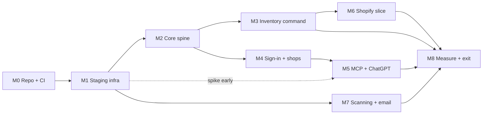

# Phase 0 build plan — prove the foundation

**Version:** 0.2 — owner decisions recorded, build started  
**Date:** 14 November 2026  
**Based on:** [PRD and architecture v0.4](ecommerce-platform-prd-and-architecture.md), Section 15, Phase 0  
**Audience:** Product owner and implementation agents

Phase 0 builds the thinnest slice of the real system that touches every risky integration. One inventory command runs end to end through the dashboard, REST, MCP from ChatGPT, and a Shopify order. Tenant isolation, idempotency, concurrency safety, and the queue-based audit path are all in place.

This is not a throwaway prototype. Everything built here is the production spine that Phases 1–3 extend.

Decision labels follow the PRD: **Confirmed**, **Selected direction**, **Proposed default**, **Open**.

## Contents

1. [Outcome and exit criteria](#1-outcome-and-exit-criteria)
2. [Issues found in the current docs and repository](#2-issues-found-in-the-current-docs-and-repository)
3. [Scope](#3-scope)
4. [Decisions Phase 0 must make](#4-decisions-phase-0-must-make)
5. [What gets built](#5-what-gets-built)
6. [Milestones](#6-milestones)
7. [MCP and ChatGPT slice](#7-mcp-and-chatgpt-slice)
8. [Shopify slice](#8-shopify-slice)
9. [Test plan](#9-test-plan)
10. [Measurement plan](#10-measurement-plan)
11. [Risks and fallbacks](#11-risks-and-fallbacks)
12. [Accounts, environments, and secrets](#12-accounts-environments-and-secrets)
13. [Deliverables and handoff to Phase 1](#13-deliverables-and-handoff-to-phase-1)

## 1. Outcome and exit criteria

PRD exit statement: *the real integrations (ChatGPT and Shopify) work against two isolated test shops; the stack and permission model are demonstrated, not assumed.*

Phase 0 is done when every row below has evidence: a passing test, a recorded run, or a figure in the Phase 0 report.

| ID | Exit criterion | Evidence |
| --- | --- | --- |
| E1 | The repository is public. CI runs on one standard runner, and there is one deploy path to staging. | Repository settings, workflow history (A20) |
| E2 | Neon (EU) through Hyperdrive, R2 (EU jurisdiction), two queues, and cron triggers are bound to a staging Worker placed near the database. | Staging smoke test, placement measurements |
| E3 | Sign-in works with Google, Microsoft, and email. There are two shops with different owners, plus one user who belongs to both. | Recorded run |
| E4 | The operation registry generates REST routes, OpenAPI, permission checks, and audit names. MCP tools are composed from it. The parity check runs in CI. | A23 |
| E5 | `receive_stock`, `reserve_stock`, `release_reservation`, and `get_availability` stay correct under concurrency, replay, rollback, audit failure, and cross-shop attempts. | A04, A05, A11, A12, A13, A21 (partial), A26 (partial), A27, A31 |
| E6 | ChatGPT connects through OAuth and is bound to one shop. It reads availability and reserves within its grant, is refused beyond it, survives token refresh, and stops working after revocation. | A14, A15, A16 |
| E7 | On a Shopify development store, an order becomes a reservation and the resulting availability is pushed back. A duplicate webhook has no second effect, and the other shop is untouched. | A30 (duplicate half), A13 |
| E8 | Camera decode results are recorded for current iOS Safari and Android Chrome. | Scan test matrix |
| E9 | A transactional email provider is chosen. One email is sent from staging once the owner picks a sending domain (deferred, P6). | ADR; delivered message when the domain exists |
| E10 | The measurement report covers CPU time, SQL statements, round trips, latency, queue operations, bytes per audit event, and projected cost per shop. | Phase 0 report |

## 2. Issues found in the current docs and repository

Review of `README.md`, the PRD v0.4, and the repository on 14 November 2026.

### 2.1 Repository

| ID | Finding | Action |
| --- | --- | --- |
| R1 | ~~The GitHub repository `raduvlad92/airstock` is PRIVATE.~~ C15 says it must be public. C14's free Actions compute only applies to public repositories. | **Resolved 14 November 2026:** made public on the owner's instruction. Secret scanning, push protection, and Dependabot alerts are on. |
| R2 | Both earlier commits have a local machine address as the author email, now public. | **Resolved:** this clone commits with the GitHub noreply address. History is not rewritten. |
| R3 | There is no `.gitignore`, and an untracked `.DS_Store` sits at the root. | Add in M0. |
| R4 | The README is the generated placeholder. | Replace in M0 with a short summary and links to the docs. |
| R5 | There is no LICENSE. Public code without a license stays all rights reserved. Section 17 does not make this blocking. | Owner decision; track it. |

### 2.2 PRD v0.4

| ID | Finding | Section | Proposed resolution |
| --- | --- | --- | --- |
| P1 | Shopify lowers its own `available` quantity when it commits an order. A push that fails compare-and-set may therefore mean an order this platform has not processed yet, not a merchant's edit. Section 8.5 treats every mismatch as a Shopify-side edit conflict. | 8.5 | On a mismatch, process pending orders first, then recompute and retry. Only a difference that remains unexplained becomes a conflict. Prove this in M6 and write it into v0.5 (Section 8 below). |
| P2 | Section 7.3 says a read sends "the request's access event", but its last bullet mentions "attempt/access outcome events". Two messages per read would double queue cost, at about three operations each. | 7.3, 14.2 | Proposed default: one queue message per read, carrying the outcome. |
| P3 | The attempt event is sent before authentication (10.3, step 1). Anonymous requests therefore cost queue operations, which makes running up the bill cheap. | 7.3, 10.3 | **Confirmed by the owner:** requests must come from authenticated callers. Authentication runs first; a request that fails it is rejected with 401 before any queue send and is not a shop audit event (Section 5.5). Failed sign-ins still arrive as verified WorkOS events. A Cloudflare rate-limiting rule sits in front. |
| P4 | PostgreSQL requires a unique constraint on a partitioned table to include the partition key. Deduplicating audit events by ID only works if the ID and the partition time are fixed when the event is created, not when it is ingested. | 7.3, 7.4 | UUIDv7 event IDs, partitions on creation time, and `UNIQUE (occurred_at, event_id)`. Lock this in M2, because it is expensive to change later. |
| P5 | The pilot benchmark's 1 million audit events plus indexes may exceed Neon Free storage, and the R2 archive that relieves this only arrives in Phase 2. | 12.3, 14.1 | Measure bytes per event in M8. Run the full benchmark in a separate Neon project or a temporary paid tier, then delete it. |
| P6 | Sending email needs a domain, but the product name and domain are still open. | 14.2, 17 | **Deferred by the owner.** Phase 0 chooses the provider; the first real send waits for a domain (E9). OAuth and Shopify use the `workers.dev` hostname meanwhile. |
| P7 | Neon's European regions include London, which is not in the EU. C20 says EU. | 12.4 | Use `aws-eu-central-1` (Frankfurt). |
| P8 | Section 8.5 says "or, once supported, a bundle", but bundles have been in V0 since v0.3 (Section 4.8). | 8.5 | Wording fix in v0.5. |
| P9 | Section 1.3 names WorkOS Connect for MCP authorization, while Section 18 links the AuthKit MCP guide. Which WorkOS product issues MCP tokens and hosts consent is the main question for the M5 spike. | 1.3, 9.4 | Resolve in M5 (Section 7). |

## 3. Scope

| In Phase 0 | Not in Phase 0 (phase) |
| --- | --- |
| Public repository, CI, and a staging deploy | Production environment, production WorkOS environment, and billing |
| Staging infrastructure in the EU | The R2 audit spool (5) and the R2 audit archive (2). The partition design for them is in scope. |
| Tenancy, memberships, granular permissions, location scope checks on the Phase 0 operations | The final role matrix (open), the admin UI (2) |
| The operation registry, REST, OpenAPI, MCP composition, the parity check | Most of the operation catalog (1–3) |
| Minimal catalog (product with a default variant) and storage (warehouse, location) | Custom fields, families, media, grid, imports, packs, bundles, barcodes, labels (1) |
| Receive, reserve, release, lazy expiry, availability | Fulfillment, transfers, returns, counts, lots, serials, POs, alerts, valuation, reports (2) |
| Queue-based audit intake for every Phase 0 request, plus an activity list | Activity views with filters, exports, client-reported interface events (2) |
| ChatGPT over OAuth, bound to a shop, with refresh and revocation | Publishing to the ChatGPT directory (5) |
| Shopify: install, one mapping, order to reservation, availability push, duplicate webhook | Catalog import, edits, cancellation, fulfillment, refunds, reconciler, sync health (3) |
| A camera scanning decode spike and an installable PWA shell | Scan-driven workflows (2) |
| Choosing the email provider and sending one email | Alert, report, and PO emails (2) |
| Measurements and a cost projection | The pilot benchmark at full scale (before launch) |

Schema columns that later phases need are added now, so Phase 1–3 work does not require reshaping core tables. These are pack, lot, serial, unit cost, and shortage columns (Section 5.3).

## 4. Decisions Phase 0 must make

Each decision gets a short ADR in `docs/adr/`. Proposed defaults may be overturned by the spike that tests them.

| Decision | Proposed default | Settled by | Milestone |
| --- | --- | --- | --- |
| Workspace and tooling | pnpm workspaces, TypeScript strict, Biome (lint and format in one fast tool), Vitest. Node LTS and every dependency pinned to exact versions. | Setup | M0 |
| Postgres driver | `pg` (node-postgres) through Hyperdrive | Smoke test | M1 |
| Query layer | **Decided:** plain parameterized SQL behind a small `Tx` interface; Kysely stays the candidate for Phase 1 filtering (ADR 0002) | M2 | M2 |
| Migrations | Plain forward-only SQL files and a small runner, applied by the owner role | Setup | M2 |
| IDs | UUIDv7 everywhere. The time order helps audit partitioning and index locality. | ADR | M2 |
| Decimal representation | PostgreSQL `numeric(20,6)` for quantities and costs, decimal strings on the wire, a decimal library in TypeScript, rounding rule in an ADR | ADR | M2 |
| Error format | RFC 9457 problem details with a stable `code` field, shared by REST and MCP | ADR | M2 |
| Neon region | `aws-eu-central-1` (Frankfurt), PostgreSQL 17 | P7 | M1 |
| Worker placement | A placement hint for the Neon region, compared with Smart Placement and no placement | M1 measurement | M1 |
| Email sign-in method | **Confirmed:** WorkOS Magic Auth (email code), so no passwords are stored | Owner, 14 Nov 2026 | M4 |
| MCP shop binding | Option A, the platform consent step (Section 7.2) | M5 spike | M5 |
| Read audit message | One message per read, sent after the query and before the response | P2, M8 latency | M2 |
| Shopify reserve trigger | **Confirmed:** `orders/create`, which mirrors when Shopify commits inventory | Owner, 14 Nov 2026 | M6 |
| Barcode decoder fallback | `zxing-wasm` as first candidate, compared with one alternative | M7 matrix | M7 |
| Transactional email provider | Evaluate Cloudflare Email Service, Scaleway Transactional Email, Brevo, Mailjet, and Amazon SES in `eu-central-1` | M7 ADR | M7 |

## 5. What gets built

### 5.1 Runtime shape

One Worker, `airstock-staging`, with three handlers:

- **fetch:** dashboard static assets, `/api/v1/*`, `/mcp`, `/.well-known/oauth-protected-resource`, `/auth/*` (AuthKit callback), `/shopify/install`, `/shopify/callback`, `/shopify/webhooks`.
- **queue:** the `audit-intake` consumer (batched inserts) and the `jobs` consumer (Shopify webhook processing and outbox delivery). Each queue has a dead-letter queue. `audit-intake` retention is set to the 14-day maximum.
- **scheduled:** an outbox sweeper for anything not delivered promptly, a sweeper that marks expired reservations (lazy expiry inside commands is what keeps availability correct), and creation of future audit partitions.

### 5.2 Repository layout

```text
apps/
  web/        React + Vite dashboard shell, PWA manifest, scan test page
  worker/     The single Worker: fetch, queue, and scheduled handlers; wrangler config
packages/
  core/       Operation registry, command pipeline, domain services, audit envelope and producer
  db/         SQL migrations, roles and RLS, typed repositories, test fixtures
  shopify/    Install, webhook verification, mapping, availability push
scripts/
  parity-check.ts   Registry ↔ REST ↔ MCP coverage
  bench/            Measurement harness for staging
docs/
  adr/
  phase-0-report.md (written in M8)
```

`packages/core` does not depend on the Workers runtime. It takes a database interface and a queue producer interface, so concurrency tests can run in Node against a real PostgreSQL.

### 5.3 Phase 0 schema

Conventions:

- Every tenant table has `shop_id`. Foreign keys between tenant tables are composite, `(shop_id, x_id)` → `(shop_id, id)`, so a row cannot refer to another shop's record (PRD 2.2).
- Row-level security is enabled on every tenant table. The policy compares `shop_id` with `current_setting('app.shop_id')`, which is set with `set_config(..., true)` at the start of each transaction. The runtime role owns nothing, so the policies always apply to it (ADR 0002).
- Two roles. The owner role runs migrations. The app role is used by Hyperdrive: it does not own any table, has no `BYPASSRLS`, and has only `INSERT` and `SELECT` on audit tables.
- Mutable records have an integer `version` for expected-version checks.
- Times are `timestamptz` in UTC.
- Optional identity on positions uses `UNIQUE NULLS NOT DISTINCT` (PostgreSQL 15+), so a missing lot or serial cannot create duplicate positions (PRD 11).

| Group | Tables | Notes |
| --- | --- | --- |
| Tenancy | `users`, `shops`, `memberships`, `role_permissions`, `membership_location_scopes` | `users` maps WorkOS user IDs. Location scope is enforced from day one (C31). |
| Catalog (minimal) | `products`, `variants` | A default variant per product, `sku_normalized` unique per shop, `base_unit`, `quantity_scale`, `tracking_mode` (only `none` is accepted in Phase 0) |
| Storage | `warehouses`, `locations` | A leaf flag and a materialized path |
| Inventory | `inventory_positions`, `inventory_operations`, `inventory_entries`, `reservations`, `reservation_allocations` | Entries are append-only and carry nullable `unit_cost`, `pack_id`, `entered_qty`, `conversion_factor`, `lot_id`, and `serial_id`. Reservations carry `expires_at`, `external_ref`, and `shortage_qty`. |
| Delivery | `idempotency_records`, `outbox_events`, `jobs`, `webhook_receipts` | Idempotency is unique on `(shop_id, caller_id, operation_id, key)` and stores the request hash and the response |
| Audit | `audit_events`, partitioned by month on `occurred_at` | `UNIQUE (occurred_at, event_id)` (P4) |
| Access | `connection_grants` | User, shop, client, scopes, status, `revoked_at` |
| Shopify | `shopify_connections`, `shopify_location_maps`, `shopify_variant_maps` | Token ciphertext plus the encryption key ID, for rotation |

### 5.4 Operation registry

Each operation is defined once. REST routes, the OpenAPI document (from Zod's JSON Schema output, ADR 0005), permission checks, and audit action names are generated from these entries.

```ts
export const reserveStock = defineOperation({
  id: 'inventory.reservations.create',
  input: ReserveStockInput,            // Zod
  output: ReserveStockOutput,
  permission: 'inventory.reserve',
  connectionScope: 'inventory:write',
  locations: (input) => [input.locationId],   // location-scope check (C31)
  audit: { action: 'inventory.reservation.created' },
  idempotency: 'required',
  preview: 'none',
  http: { method: 'POST', path: '/shops/{shopId}/reservations' },
  mcp: { tool: 'reserve_stock', readOnly: false, destructive: false },
  handler: reserveStockHandler,
});
```

Phase 0 operations and their MCP tools:

| Operation | MCP tool |
| --- | --- |
| `shops.context.get` | `get_shop_context` |
| `catalog.items.create` (a product with its default variant) | `create_item` |
| `storage.warehouses.create`, `storage.locations.create`, `storage.locations.list` | `manage_locations` |
| `inventory.receipts.create` | `receive_stock` |
| `inventory.reservations.create`, `inventory.reservations.release` | `reserve_stock` (`action: reserve \| release`) |
| `inventory.availability.get` | `get_availability` |
| `operations.outcome.get` (look up a result by idempotency key) | `get_operation_outcome` |
| `activity.list` | `search_activity` |
| `shops.create`, `members.invite` | Documented exception: account-level operations, outside a shop-bound grant |
| `connections.list`, `connections.revoke` | Documented exception: a connection may not manage connections |
| `shopify.mappings.set` | Temporary exception, removed in Phase 3 when the sync tool arrives |

`scripts/parity-check.ts` fails CI if any operation lacks a REST route, a permission, an audit action, and either an MCP tool or a listed exception (A23).

### 5.5 Command pipeline for `reserve_stock`

This follows PRD Section 10.3.

1. Authenticate the session cookie, API bearer token, or MCP token. For MCP, also load the connection grant from PostgreSQL. A request that fails authentication gets 401 here, before anything is queued (P3).
2. Assign a request ID and an attempt ID (UUIDv7). Send a minimal attempt event, already carrying the verified actor and shop, to `audit-intake` and wait for the acknowledgment.
3. Check the permission, the connection scope, and that every target location is inside the member's location scope.
4. Validate the input with Zod. Require the idempotency key.
5. `BEGIN`, set the tenant context, and insert the idempotency record. On conflict with the same request hash and a completed result, return the stored result and send a replay event. A different hash is rejected.
6. Lock the target positions in ID order. Release any allocations on them that have already expired (lazy expiry), so a late sweeper never keeps stock unavailable (PRD 6.3).
7. Check that sellable on hand minus active allocations covers the quantity. Insert the reservation and its allocations, and update the reserved totals on the positions.
8. Insert the success audit event (linked to the attempt ID), an `inventory.availability_changed` outbox event, and the stored idempotency response.
9. `COMMIT`. Return the reservation, the resulting availability, and the operation and correlation IDs.
10. The outbox delivers to the Shopify push job when the variant and location are mapped.

If anything fails in steps 5–9, roll back, send a failure event to `audit-intake` and wait for it, then return the error. Nothing successful is ever returned without its durable record.

The only routes served without a user credential are static assets, OAuth metadata, the sign-in callbacks, and Shopify webhooks. A webhook counts as authenticated once its HMAC verifies; one that fails verification is rejected like any unauthenticated request.

Reads such as `get_availability` run in a read-only transaction. They send one access event with the outcome before returning data. If the send fails, they return 503 and no data (A31).

## 6. Milestones

Sizes are relative and for sequencing only, for one developer working with coding agents. S is about a day or two, M under a week, and L one to two weeks. They are not a schedule.



### M0 — Repository and CI (S)

- **Owner action:** make the repository public (R1). Turn on secret scanning with push protection, Dependabot alerts, and branch protection on `main` that requires CI.
- Set up the pnpm workspace, TypeScript, Biome, and Vitest. Add `.gitignore` (`.DS_Store`, `.dev.vars`, `node_modules`, `.wrangler`, `dist`), a real README, and `.dev.vars.example`, which lists secret names without values.
- Write one workflow, `ci.yml`:
  - It runs on `pull_request` and on `push` to `main` only, so a pushed branch with an open PR does not run twice.
  - `concurrency` cancels superseded runs for the same ref.
  - It is one `ubuntu-latest` job: install (with the pnpm store cached), Biome, typecheck, unit tests, database tests against a `postgres:17` service container, then build.
  - A change-detection step skips the heavy steps for documentation-only changes, so the required check always reports. A workflow-level path filter would leave it pending.
  - Artifacts are uploaded only on failure, with 3-day retention.
  - On `push` to `main`, the same job deploys the build it just verified. The Cloudflare API token lives in a `staging` GitHub environment restricted to `main`. Fork PRs never see it.
- Cloudflare Git builds stay off for this Worker, so there is one deploy path.
- **Done when:** a PR shows one check, a documentation-only PR finishes in about a minute, and a merge deploys a hello-world Worker to staging.

### M1 — Staging infrastructure (S)

- Create a Neon project in `aws-eu-central-1` on PostgreSQL 17, with the owner and app roles.
- Point a Hyperdrive configuration at Neon's direct (non-pooled) endpoint as the app role, with caching disabled (PRD 10.4).
- Create a private R2 bucket with EU jurisdiction, with the binding's jurisdiction set, no public access, and no `r2.dev` URL.
- Create the `audit-intake` and `jobs` queues and their dead-letter queues, and a cron trigger.
- Add an internal smoke route, protected by a staging-only secret, that performs one database round trip, an R2 put/get/delete, and a queue send.
- Measure database round-trip time with a placement hint, with Smart Placement, and with no placement.
- **Done when:** the smoke route passes from staging and the round-trip figures are recorded.

### M2 — Core spine (L)

- Migration runner and the Section 5.3 schema, roles, RLS policies, grants, and the first audit partitions.
- `withShopTransaction`: begin, set the tenant context, run, commit. Tenant context must never carry over to the next use of a pooled connection.
- The registry, the Hono adapter, OpenAPI generation, problem-details errors, and middleware for idempotency, permissions, and location scope.
- Audit envelope v1 (PRD 7.2), the producer (awaited queue send), the batch consumer (one multi-row `INSERT ... ON CONFLICT DO NOTHING` per batch), and dead-letter handling.
- The outbox table and its dispatcher.
- Decimal and ID utilities. The query-layer comparison spike (Section 4).
- The parity check in CI.
- **Done when:** `shops.context.get` runs through REST under RLS, its access event travels from the queue to PostgreSQL, and the parity check passes.

### M3 — Representative inventory command (L)

- The minimal catalog and storage operations, so there is something to stock.
- `receive_stock`, `reserve_stock`, `release_reservation`, lazy expiry, `get_availability`, and `get_operation_outcome`.
- The test suite in Section 9 for these operations, with fault injection for rollback, audit insert failure, queue send failure, and a lost commit acknowledgment.
- A reconciliation query that compares ledger sums with position balances and reservation totals.
- **Done when:** E5 is green in CI.

### M4 — Sign-in, shops, memberships, dashboard shell (M)

- A WorkOS staging environment with Google, Microsoft, and Magic Auth.
- The AuthKit callback in the Worker, with a sealed session cookie (`HttpOnly`, `Secure`, `SameSite=Lax`). Requests that change state with a cookie must pass an Origin check and carry a custom header.
- Login, logout, and failed-authentication events from WorkOS's verified events go into the audit path (PRD 7.3).
- Shop creation and member invitation. Starter roles mapped to granular permissions.
- A plain dashboard shell (React, Vite, and TanStack Query): sign in, create or switch shop, locations, availability, receive and reserve forms, an activity list, and a connections page with a revoke button. It calls the same `/api/v1` as everyone else.
- **Done when:** E3 is recorded.

### M5 — MCP and ChatGPT (L, highest uncertainty)

Start the shop-binding spike right after M1, in parallel with M2, because its answer can change the grant schema. Details are in Section 7.

- **Done when:** E6 is recorded.

### M6 — Shopify slice (M–L)

Details are in Section 8.

- **Done when:** E7 is recorded and the P1 race is demonstrated and documented.

### M7 — Scanning and email spikes (S each, in parallel)

- **Scanning:** a `/scan-test` page in the installable PWA shell. It uses `BarcodeDetector` where available and the WebAssembly fallback elsewhere. Test EAN-13, UPC-A, Code 128, and QR codes on current iOS Safari and Android Chrome, both as an installed PWA and in a browser tab, at several distances and in poor light. Also test a keyboard-wedge hardware scanner if one is available. Record the decode rate, time to decode, decoder bundle size, and camera permission behavior in an installed iOS PWA.
- **Email:** score the candidates on:
  - EU data processing and a DPA
  - price at pilot volume and at 1,000 shops (against the Section 14.4 budget)
  - an HTTP API usable from Workers
  - deliverability tooling, bounce and complaint webhooks, and suppression lists

  Write the ADR, then send one member-invitation email from staging using the staging domain (P6).
- **Done when:** E8 and E9 are recorded.

### M8 — Measurement and exit review (M)

The full plan is in Section 10. Write the Phase 0 report, finish the ADRs, draft the PRD v0.5 changes, and hold the exit review with the owner.

## 7. MCP and ChatGPT slice

### 7.1 Server

- A stateless Streamable HTTP endpoint at `/mcp`, using the official TypeScript SDK and Cloudflare's stateless handler, with a server created per request (PRD 9.2).
- Tools are composed from registry operations (Section 5.4). Phase 0 has eight tools.
- Protected-resource metadata at `/.well-known/oauth-protected-resource`.
- Token checks: signature against WorkOS's JWKS, issuer, audience (the `/mcp` resource), expiry, and scopes. After that, look up the connection grant row on **every** request, so revocation takes effect on the next call (PRD 9.4).
- Connection scopes: `catalog:read`, `catalog:write`, `inventory:read`, `inventory:write`, `activity:read`. The consent step starts with read-only access, and the owner switches each write scope on explicitly (PRD 9.5).
- Each tool call is audited with source `mcp`, the verified client ID, the acting user, and the grant ID. Nothing comes from tool arguments.

### 7.2 Shop-binding spike

WorkOS authenticates the user, but it does not know which shop a connection is for (PRD 9.4). The spike tries two options.

- **Option A, platform consent step (preferred):** WorkOS handles sign-in. During authorization, the platform shows its own shop chooser and the scopes being requested, then creates a `connection_grant` row. Every later MCP request resolves the grant from a stable claim in the issued token, such as a grant or session identifier that survives refresh.
- **Option B, one WorkOS organization per shop:** the user picks the organization during authorization, and tokens carry its ID. The platform maps that ID to the shop and keys the grant by user, organization, and client.

Pass criteria for whichever option is chosen:

1. The binding survives token refresh.
2. A token for shop A can never reach shop B, whatever the tool arguments say.
3. Revoking the connection in the platform blocks the next call.
4. Switching shops in the dashboard does not change an existing connection's shop (PRD 2.2).
5. The scopes chosen at consent are the ones stored in the grant.

If neither option meets all five, stop and bring it to the owner before building further. The grant model underpins A14–A16.

### 7.3 ChatGPT test procedure

1. Add the staging `/mcp` URL as a custom MCP connection, using the ChatGPT account type and mode that custom connections require at test time. Record which plan was used.
2. Connect as the owner of shop A with read-only access. Ask for availability and check that it matches the dashboard (A14).
3. Ask it to reserve stock. The server must refuse, whatever the prompt says (A15).
4. Reconnect with `inventory:write` and reserve. The reservation appears in the dashboard and in history with source `mcp` (A14).
5. Leave the connection idle past the access-token lifetime, then call again. It should refresh without asking the user to sign in.
6. Store a product description that tells the AI to reserve stock in shop B. Tool calls must stay bound to shop A (PRD 9.5).
7. As the user who belongs to both shops, switch the dashboard to shop B. The ChatGPT connection still answers for shop A.
8. Revoke the connection in the dashboard. The next tool call fails, while unexpired tokens still exist (A16).

## 8. Shopify slice

### 8.1 Setup

- A Shopify Partners account and **two development stores**, one connected to each test shop, so isolation is tested with real webhooks.
- A development app with only the scopes Phase 0 uses: `read_products`, `read_inventory`, `write_inventory`, `read_locations`, `read_orders`.
- Configure protected customer data access as Shopify requires for order topics, at the minimum level, with no customer fields (PRD 8.5).
- Pin one Admin API version. Recent versions changed the inventory mutation fields for compare-and-set and idempotency, so read the current version's documentation before writing the push.

### 8.2 Flow

1. **Install:** the OAuth authorization-code grant with HMAC and state checks and shop-domain validation. The offline token is encrypted with AES-GCM, using a key held in a Worker secret, and stored with its key ID.
2. **Mapping:** one Shopify location to one location, and one Shopify variant to a variant matched by SKU (`shopify.mappings.set`).
3. **Webhook:** `orders/create` arrives. Verify the HMAC on the raw body. In one transaction, insert a `webhook_receipt` (unique per connection and Shopify event ID) and a job row, then respond 200 immediately.
4. **Job:** call `reserve_stock` as the actor *Shopify connector*, with the external reference `shopify:order/{id}/line/{id}`. The idempotency key is derived from the connection and the order line, so the receipt check and command idempotency both stop duplicates.
5. **Push:** the outbox triggers a job that computes availability for the mapped location and sets it in Shopify with compare-and-set.
6. **Mismatch (P1):** if compare-and-set fails, fetch Shopify's current quantity and recent orders, process any order not seen yet, recompute, and retry. Only a difference that remains unexplained is recorded as a conflict. The conflict UI comes in Phase 3.

### 8.3 Tests

- Happy path: a dev-store order becomes a reservation, and Shopify then shows the reduced availability.
- Duplicate delivery: replaying the same payload and event ID has no second effect (A30, duplicate half).
- Isolation: an order on store B never touches shop A (A13).
- An invalid HMAC is rejected with 401 before anything is queued (P3).
- Race: place an order while a push is pending. Record that the push does not overwrite Shopify with a stale higher number, and record how the mismatch resolves.
- Stretch goals: shortage on oversell (A29), cancellation releasing the reservation, and a reconciler poll that finds a missed webhook (A30, second half).

## 9. Test plan

CI runs core and database tests in Node against the `postgres:17` service container, and Worker-level tests with `@cloudflare/vitest-pool-workers`. Queue and database failures are injected through the producer and database interfaces. Staging checks run by hand and do not use CI secrets or Neon compute.

Concurrency and property tests run against real PostgreSQL, never mocks, because what they test is the locking behavior.

| Scenario | Phase 0 coverage | Test type | Runs in |
| --- | --- | --- | --- |
| A04 | 50 concurrent callers reserving the last 10 units, across one position and across two | Concurrency | CI |
| A05 | 50 replays of a receipt and a reservation. The same key with a different body is rejected. | Integration | CI |
| A11 | Fault after the balance update. Nothing survives, and a failure event is in the queue. | Fault injection | CI |
| A12 | The in-transaction audit insert fails. The command rolls back, and no success is returned. | Fault injection | CI |
| A13 | Another shop's variant, location, or reservation ID, tested at the API layer and at the SQL layer (app role, wrong tenant context) | Integration + SQL | CI |
| A14–A16 | Grant scope, refresh, and revocation | Integration with test tokens + Section 7.3 run | CI + staging |
| A20 | CI behavior | Observed | GitHub |
| A21 (partial) | Random receive/reserve/release/expire sequences. Ledger sums equal balances, reserved equals the sum of allocations, and availability is never negative. | Property | CI |
| A23 | The registry parity check | Script | CI |
| A26 (partial) | The commit acknowledgment is lost. The outcome lookup by idempotency key finds the committed result, and a retry has no second effect. | Fault injection | CI |
| A27 | The database is unavailable. Requests fail, attempt and failure events are queued, and each is written exactly once after recovery. | Simulation + staging drill | CI + staging |
| A30 (duplicate half) | Duplicate webhook | Integration + staging | CI + staging |
| A31 | The queue send fails on a read. The response is 503 with no data. | Fault injection | CI |
| A32 (decode only) | The device matrix | Manual | Devices |

## 10. Measurement plan

Measured on staging with warm and cold Workers and a warm and suspended Neon compute, and reported separately. `scripts/bench` drives the requests. The database layer counts statements per request.

| Measurement | Per | Source |
| --- | --- | --- |
| Worker CPU time and wall time | Operation | Workers observability |
| SQL statements and database round-trip time | Operation | Instrumented database layer |
| Queue send latency to acknowledgment | Request | Instrumented producer |
| Queue operations | Request | Queue metrics |
| Latency p50 and p95: `get_availability`, `reserve_stock`, MCP tool call, Shopify webhook to push | Operation | Bench harness |
| Neon cold-start penalty | First request after suspend | Bench harness |
| Bytes per audit event, including indexes | Event | `pg_total_relation_size` after 100,000 synthetic events in a scratch Neon branch, which is deleted afterwards |
| Projected infrastructure cost per shop per month | Shop | Model below |

The cost model writes down its assumptions: requests per shop per day, the read-to-write mix, the audit events per request, and how long events stay in PostgreSQL. It prices Workers, Queues, Neon, and R2 at the Section 14.1 rates. The result is compared with the $0.49 budget per shop (PRD 14.4). If the projection exceeds the budget, the report says which assumption breaks it.

Targets come from PRD 12.3: list and search p95 under 1 second at the server, stock commands p95 under 2 seconds. Phase 0 reports against them but does not claim capacity.

## 11. Risks and fallbacks

| Risk | Early signal | Fallback |
| --- | --- | --- |
| WorkOS cannot bind a consent to a shop in a way that survives refresh | The M5 spike fails a pass criterion | Try the other option in Section 7.2. If both fail, the owner decides before more is built. |
| Waiting for the queue on every read adds too much latency | Read p95 near the 1-second target | Send the access event concurrently with the query and wait for both before responding. Every round trip still completes before data is returned. |
| Transaction round trips (begin, tenant context, statements, commit) make commands slow | Stock command p95 near 2 seconds | Fold the tenant context into the first statement. Then move hot commands into a single PL/pgSQL function call, which is still one implementation of the rules. |
| Neon scale-to-zero cold starts slow down the first ChatGPT or Shopify call | Cold-start figures in M8 | Accept for the pilot and document it, or move to a paid plan that keeps compute warm. |
| The MCP SDK's stateless serving on Workers is immature | M5 spike errors | Use the SDK's latest stable major with the same stateless pattern, behind the adapter. |
| Shopify inventory mutation fields change between API versions | Push failures after a version bump | Pin the version and keep the push behind `packages/shopify`. |
| Camera decoding on iOS is unreliable | M7 matrix | Try the alternative WebAssembly decoder, larger scan targets, and keyboard-wedge scanners as a supported path. |
| Testing uses up free allowances (Neon compute hours, queue operations) | Usage passes 70% (PRD 14.2) | CI uses local PostgreSQL. Benchmarks run in a separate Neon project or branch, which is deleted afterwards. |
| Anonymous traffic inflates cost (P3) | Worker requests spike without matching shop activity | Unauthenticated requests never reach the queue; a Cloudflare rate-limiting rule limits the Worker cost |

## 12. Accounts, environments, and secrets

| Service | Phase 0 setup | Notes |
| --- | --- | --- |
| GitHub | Public repository and a `staging` environment holding the Cloudflare deploy token | The token is limited to deploying this Worker |
| Cloudflare | Workers Paid (existing). Worker, Hyperdrive, EU R2 bucket, two queues with dead-letter queues, cron. | Git builds off |
| Neon | Free plan, project in `aws-eu-central-1` | A separate project or branch for benchmarks |
| WorkOS | Staging environment only, with Google, Microsoft, and Magic Auth, plus the MCP authorization configuration | Production needs billing details, so it waits |
| Shopify | Partners account, two development stores, one development app | |
| ChatGPT | An account type that allows custom MCP connections | Record the plan used |
| Email | The chosen provider; the sending domain is deferred | P6 |

Environments:

- **Local:** `wrangler dev` with local PostgreSQL in Docker and secrets in `.dev.vars`.
- **CI:** a PostgreSQL service container with no secrets.
- **Staging:** real services in the EU.

There is no production environment in Phase 0.

Secrets are the WorkOS API key and client ID, the Shopify API secret, the token encryption key, the email API key, and the smoke-route secret. They are set with `wrangler secret` for each environment. They never go in the repository, test fixtures, or logs, and `.dev.vars.example` lists only their names.

## 13. Deliverables and handoff to Phase 1

- Code on `main` that deploys to staging, with green CI.
- ADRs for each decision in Section 4.
- `docs/phase-0-report.md`: exit evidence E1–E10, measurements, the cost projection, and the risks that came true.
- A proposed PRD v0.5 change list covering P1–P9 and anything the spikes overturn.
- A Phase 1 starting point. Phase 1 builds on the registry, pipeline, schema conventions, and test harness and does not replace them. Its first tasks are custom fields and product families, which are the next schema-shaping decision.

## Decision log

| Date | Decision | By |
| --- | --- | --- |
| 14 Nov 2026 | Repository made public (R1). | Owner |
| 14 Nov 2026 | Only authenticated callers are served; failed authentication is rejected before the audit queue (P3). | Owner |
| 14 Nov 2026 | Staging email domain deferred (P6). | Owner |
| 14 Nov 2026 | Magic Auth for email sign-in; Shopify reservations on `orders/create`. | Owner |
| 14 Nov 2026 | Build proceeds without owner involvement until accounts are needed (Cloudflare, Neon, WorkOS, Shopify, ChatGPT). | Owner |
| 14 Nov 2026 | Plain SQL query layer, OpenAPI from Zod, RLS enabled without FORCE, API credentials in Phase 0 (ADRs 0002, 0005). Progress is tracked in [Phase 0 status](phase-0-status.md). | Build |
| 14 Nov 2026 | Resend for transactional email for now, on a new subdomain; the owner's real address for the test send (ADR 0009). | Owner |
| 14 Nov 2026 | Shopify: expiring encrypted tokens, compare-and-set push that processes unseen orders first (ADR 0008). | Build |
| 14 Nov 2026 | Merchant-facing jobs run in the request next to the database, queues are the retry path; sweeps every 30 minutes (report, 4.4). | Build |
| 14 Nov 2026 | React shell and dashboard inventory forms move to Phase 1 with the grid. | Build |
