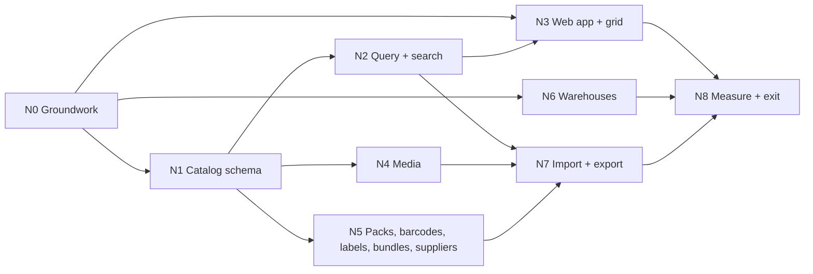

# Phase 1 build plan — universal catalog foundation

**Version:** 0.1 — draft for owner review  
**Date:** 14 November 2026  
**Based on:** [PRD and architecture v0.4](ecommerce-platform-prd-and-architecture.md), Section 15, Phase 1; the proposed v0.5 changes in the [Phase 0 report](phase-0-report.md), Section 7  
**Builds on:** [Phase 0 build plan](phase-0-build-plan.md), [Phase 0 status](phase-0-status.md), [ADRs 0001–0009](adr/README.md)  
**Audience:** Product owner and implementation agents

Phase 1 turns the Phase 0 spine into a real product catalog. A merchant can model apparel, furniture, food, and spare parts in one shop and edit them in a fast spreadsheet grid. They can attach pictures, define packs, barcodes, bundles, and suppliers, set up warehouses, and move data in and out with CSV. Every feature arrives with REST and MCP access and complete history, as in Phase 0.

Phase 1 does not change stock rules. Inventory workflows beyond receive, reserve, and release (transfers, counts, lots, POs, alerts, valuation, picking, reports) are Phase 2. V0 is still not complete until Phases 1–3 work together (PRD 15).

Decision labels follow the PRD: **Confirmed**, **Selected direction**, **Proposed default**, **Open**.

## Contents

1. [Starting point](#1-starting-point)
2. [Outcome and exit criteria](#2-outcome-and-exit-criteria)
3. [Scope](#3-scope)
4. [Decisions and owner questions](#4-decisions-and-owner-questions)
5. [What gets built](#5-what-gets-built)
6. [Milestones](#6-milestones)
7. [Test plan](#7-test-plan)
8. [Measurement plan](#8-measurement-plan)
9. [Risks and fallbacks](#9-risks-and-fallbacks)
10. [Environments, accounts, and dependencies](#10-environments-accounts-and-dependencies)
11. [Deliverables and handoff to Phase 2](#11-deliverables-and-handoff-to-phase-2)

## 1. Starting point

### 1.1 What Phase 0 left in place

- The operation registry, command pipeline, queue-based audit intake, outbox, idempotency, and row-level security (ADRs 0002–0006). Phase 1 adds operations to these and does not change them.
- 24 operations and 9 MCP tools: `get_shop_context`, `create_item`, `find_items`, `manage_locations`, `receive_stock`, `reserve_stock`, `get_availability`, `get_operation_outcome`, `search_activity`.
- A minimal catalog: `products`, and `variants` with a default variant, normalized SKU, `options` JSON, `price`, `base_unit`, `quantity_scale`, and `tracking_mode`. Storage has `warehouses` (with `ownership` and `operator_name`) and `locations` (with a path and `path_ids`).
- Inventory entries already carry `pack_id`, `entered_qty`, `conversion_factor`, `unit_cost`, `lot_id`, and `serial_id` columns, so packs need no change to inventory tables.
- A server-rendered dashboard plus `app.js` under a strict CSP, an EU R2 bucket (`FILES`), and the camera scan test page with vendored `zxing-wasm`.
- 115 tests against PostgreSQL 17, and a staging deploy on every merge to `main`.

### 1.2 Carried over from Phase 0

| Item | From | Where in this plan |
| --- | --- | --- |
| React shell and the dashboard inventory forms | M4, moved by build decision | N0, N3 |
| Duplicate-name warnings (SKU duplicates are already rejected) | Status, Section 5 | N2 |
| Rate limits per API credential and MCP connection | Report P13 | N0 |
| Kysely or another way to build dynamic filters | ADR 0002 "revisit when" | N2, decision D2 |
| PRD v0.5 changes P1–P15, and the P15 fix (expire unbound grants) | Report, Section 7 | Running in a separate session; not part of this plan |

### 1.3 Phase 0 exit

- **E3 and E8:** the owner reported both done on 14 November 2026 (the sign-ins and the phone scan matrix). They are verified on staging and recorded in [Phase 0 status](phase-0-status.md) before Phase 1's exit review.
- **E9:** the owner decided to keep sending from `mail.tracker.deletecookies.dev` for testing. The dedicated `mail.airstock.deletecookies.dev` domain waits until a Resend slot is freed or the plan upgraded, before any real merchant receives email.
- The E8 results feed Phase 2's decoder choice. Phase 1 only renders barcodes; it does not depend on them.

## 2. Outcome and exit criteria

PRD Phase 1: products, default variants, variant options, typed custom fields, product families, relationships, SKUs, prices, units, pack sizes, shipping packages, barcodes, labels, bundle definitions, suppliers, duplicate detection, media, the grid, detail panel, gallery, search, saved views, CSV import and export, and multiple warehouses with API and MCP coverage alongside each feature.

Phase 1 is done when every row below has evidence: a passing test, a recorded run, or a figure in the Phase 1 report.

| ID | Exit criterion | Evidence |
| --- | --- | --- |
| F1 | Apparel, furniture, food, and spare-parts products live in one shop, each with its own family and custom fields, without a migration or code change. | A01 |
| F2 | A simple product becomes a product with size and colour variants. Its ID, its first variant's ID, SKU, stock, and history survive; each variant has its own SKU, price, and images. | A02 |
| F3 | Two people editing the same field from the same value: one wins, the other sees a conflict. Two people editing different fields of one product both succeed. A bulk preview whose records changed before commit is rejected and re-reviewed. | A09, A17 |
| F4 | A field change, image reorder, search, filter, sort, column change, saved-view switch, and history read each leave an attributable event; client-reported ones are labelled as such. | A10 |
| F5 | Every new table and endpoint refuses another shop's IDs: fields, families, media, packs, barcodes, bundles, suppliers, saved views, imports, exports. | A13 |
| F6 | The registry parity check passes. OpenAPI is current. MCP has 16 tools or fewer. | A23 |
| F7 | Packs nest and convert exactly to base units. Barcodes are unique per shop across variants and packs. | A28 (definition half), A33 (uniqueness) |
| F8 | Item, pack, and location labels render as PDF, and every barcode on them decodes back to its record. | A33 |
| F9 | Every create path (dashboard, import, API, MCP) blocks duplicate SKUs and barcodes and flags similar names. An MCP create without acknowledgment returns the matches instead of creating. | A43 |
| F10 | A 10,000-row CSV import is previewed, committed in chunks, survives an interruption, and records per-row outcomes. Opening stock goes through receipts. An export respects permissions and location scope, and its download is logged. | A19 (import half), PRD 8.4 |
| F11 | Images and attachments upload, get derivatives, roles, order, and variant links. A failed upload leaves no attachment. Another shop's media is unreachable. Access is logged per decision D5. | PRD 4.5 |
| F12 | With 3 shops of 10,000 variants each, list and search p95 is under 1 second at the server for 50 rows, including a custom-field filter and sort. The grid never loads the whole catalog. | PRD 12.3 |
| F13 | ChatGPT on staging answers the Phase 1 catalog prompts (Section 7.3) correctly, inside its grant, using the new tools. | Recorded run |
| F14 | Rented and third-party warehouses record their operator and contract; fees and contracts are hidden from roles without permission. Archived locations accept no new stock, and a warehouse with stock cannot be archived. | PRD 5.1, 5.2 |

## 3. Scope

| In Phase 1 | Not in Phase 1 (phase) |
| --- | --- |
| Products, variants, options (up to 3), default-variant rule, archive and restore | Assembled kits, fitment datasets (4) |
| Custom fields (13 types), families, starter family templates | Field-level formulas, a general schema designer (never, PRD 3.3) |
| Inheritance from product to variant (inherited, explicit, cleared) | Price lists and markets (4) |
| Measurements with units, shipping packages, pack definitions | Pack-aware receipts, counts, transfers (2) |
| Barcodes, label PDFs | Scan-driven workflows (2) |
| Bundle definitions and their computed availability (read) | Bundle reservation and fulfillment (2), Shopify bundle mapping (3) |
| Suppliers and supplier items (supplier SKU, cost, lead time, pack) | Purchase orders (2) |
| Duplicate detection on every create path | |
| Media: upload, derivatives, roles, order, variant links, attachments | Public image CDN (later, explicit policy, PRD 4.5) |
| Warehouses with commercial records, location hierarchy, location scope UI | Warehouse billing (never in V0, PRD 5.1) |
| Grid, detail panel, gallery, search, filters, saved views, bulk edit with preview | Activity views with filters and exports (2) |
| React + Vite + TanStack shell replacing the server-rendered dashboard (sign-in and consent pages stay server-rendered) | UI translation (English only; decide before launch) |
| Dashboard receive, reserve, and release forms (moved from Phase 0) | Other inventory forms (2) |
| CSV import (create, update, opening stock) and export | Shopify catalog import (3) |
| Client-reported interface events, batched | |
| Rate limits per user, credential, and connection | R2 audit archive (2), R2 audit spool (5) |
| API and MCP for every new operation | Publishing to the ChatGPT directory (5) |

## 4. Decisions and owner questions

### 4.1 Decisions this phase makes

Each gets a short ADR in `docs/adr/`, numbered when written.

| ID | Decision | Proposed default | Settled by | Milestone |
| --- | --- | --- | --- | --- |
| D1 | Custom field storage | Typed JSONB `attributes` on products and variants, keyed by field ID, with a typed encoding per field type (Section 5.2). Relationships in a relation table. | ADR | N1 |
| D2 | Building dynamic filters | A small typed filter compiler that emits parameterized SQL from a whitelisted grammar, behind the existing `Tx` interface. Kysely only if the compiler grows past what is easy to review. | Spike in N2, ADR | N2 |
| D3 | Edit concurrency | Field-level compare-and-set: each edit carries the expected previous value of each field it changes. The record version still increments and is returned. | ADR | N1 |
| D4 | Bulk edits | Up to 500 records per bulk edit, previewed and then committed all-or-nothing; a stale preview is rejected and re-previewed. Bigger changes go through import. | ADR | N3 |
| D5 | Media access logging | **Owner question Q1.** | Owner | N4 |
| D6 | Media pipeline | Upload through the Worker to R2 with a SHA-256 check while streaming. The browser makes the derivatives (thumbnail and display WebP); the server checks file signatures and sizes. Delivery through short-lived signed URLs served by the Worker. | ADR | N4 |
| D7 | Grid rows | Two modes: **Variants** (one row per variant, the editing workhorse for SKU, price, barcode, stock) and **Products** (one row per product, descriptive fields, variant values summarised). | ADR | N3 |
| D8 | Web app shape | `apps/web`: React, Vite, TanStack Table, Virtual, Query, and Router. It builds into the Worker's static assets and is served at `/app` under the existing CSP. Sign-in, consent, invitation, and scan-test pages stay server-rendered. | ADR | N0 |
| D9 | Labels | A registry operation resolves and logs the label data. The browser renders the PDF (`bwip-js` for barcodes, `pdf-lib` for pages), so the server spends no CPU on rendering. | ADR | N5 |
| D10 | Imports and exports | Files in R2. Jobs run in chunks of 200 rows per transaction through the Worker's own fetch handler, with the queue as the retry path (the Phase 0 job pattern). Per-row outcomes are stored. | ADR | N7 |
| D11 | Rate limits | Workers Rate Limiting binding keyed by user, API credential, and MCP connection. A 429 is counted in one aggregated audit event per caller per minute, not one event per refused request. | ADR | N0 |
| D12 | MCP tool budget | 16 tools or fewer after Phase 1, leaving room for Phase 2 under the 25 in ADR 0005 (Section 5.17). | ADR 0005 update | N1 |
| D13 | Rich text | A Markdown subset stored as text and rendered escaped. Converted to HTML when syncing to Shopify in Phase 3. | ADR | N1 |

### 4.2 Owner questions

| ID | Question | Options | Recommendation |
| --- | --- | --- | --- |
| Q1 | How should picture views be logged (C08)? | **(a)** One access event per list or detail request, naming the images it returned; a separate event for each original download. **(b)** One event per image fetch, including thumbnails: a gallery page of 50 items becomes 50 extra events at about 3 queue operations each. | **(a).** Each view is still logged, and the per-shop cost stays inside the budget. |
| Q2 | Ship starter families? | **(a)** Apparel, Furniture, Food, and Spare parts templates that a merchant adds with one click and then edits. **(b)** Start blank. | **(a).** It shows the product's range on day one and is the A01 test data. |
| Q3 | Upgrade staging Neon to the Launch plan (usage-based, about $10–20 a month) when the Phase 1 benchmark needs it? | **(a)** Yes, when needed. **(b)** No; run the benchmark in a temporary separate project and delete it. | **(a).** The 3 × 10,000-variant benchmark with a million audit events is about 1 GB, past the free plan, and the report already budgets Launch for the pilot. |
| Q4 | When two people edit the same product at once, conflict per field or per record? | **(a)** Per field: different fields both succeed; the same field conflicts. **(b)** Per record: any concurrent change conflicts. | **(a).** Fewer false conflicts in a busy grid; A09 still holds. |

## 5. What gets built

### 5.1 Products, variants, and options

- **Product built-in fields:** name, description (rich text, D13), status (`draft`, `active`, `archived`), family, tags. Brand and category are system single-select fields created with every shop, so they reuse the custom field machinery instead of special tables.
- **Variant built-in fields:** SKU, option values, price, weight, product dimensions, base unit, quantity scale, tracking mode (only `none` is accepted until Phase 2), status.
- **Options:** up to 3 options per product (for example size, colour, material), each with ordered values that have stable IDs, so renaming "Grey" to "Gray" does not touch variants. Up to 2,048 variants per product. Both limits match Shopify's at the time of writing; recheck before Phase 3.
- **Default-variant rule:** a product starts with one default variant. Adding options keeps that variant's ID, SKU, stock, and history and gives it the first option combination. Going back to a single variant requires exactly one active variant.
- **Variant generation:** choose option values and a SKU pattern such as `TS-{color}-{size}`. The preview shows the combinations, the SKUs, and any duplicates before anything is created.
- **Inheritance:** custom fields that apply to both levels, weight, dimensions, and pictures are inherited from the product. A variant attribute is either absent (inherited), JSON `null` (explicitly cleared), or a value (explicit). The API returns all three states.
- **Archive and restore** for products and variants. Hard deletion is not offered once a record has history (PRD 4.1).

### 5.2 Custom fields and product families

**Field definitions** have a stable ID, a key (a slug used in imports and exports), a label, a type, validation rules, a level (`product`, `variant`, or `both`), a default, a visibility (`everyone` or `restricted`), a lifecycle state (`active`, `archived`), and a version. Labels can change freely; IDs and keys do not change.

| Type | Stored as | Filter operators |
| --- | --- | --- |
| text | string, up to 10,000 characters | contains, equals, starts with, is empty |
| rich text | Markdown string, up to 50,000 characters | contains, is empty |
| integer | JSON number within ±2^53 | =, ≠, <, ≤, >, ≥, between, is empty |
| decimal | decimal string, with scale from the definition | same as integer |
| boolean | true or false | is |
| date | `YYYY-MM-DD` | before, after, between, within next or last N days |
| timestamp | ISO 8601 UTC | same as date |
| single select | option ID | is any of, is none of |
| multi select | array of option IDs, up to 50 | has any, has all, has none |
| money | `{ "amount": "12.50", "currency": "EUR" }`; currency is the shop's | same as decimal |
| measurement | `{ "value": "1.2", "unit": "kg", "canonical": "1200" }`; canonical is grams, millimetres, millilitres, or °C | same as decimal, compared on `canonical` |
| file | array of media IDs | has any, is empty |
| relationship | rows in `record_relations` (product or variant targets, with a relation kind such as "compatible with" or "replaces") | has related, is empty |

- Select options have stable IDs, a label, an order, and an archived flag. Archiving an option keeps it on existing records but hides it from new choices.
- **Validation runs on the server** for every write path, from the definition version current at that moment. Every value change is in the audit event with the definition version used.
- **Type changes:** only safe conversions in Phase 1: integer to decimal, single select to multi select, text to rich text, and decimal to money or measurement with a chosen unit or currency. Each shows a preview of affected records first. Anything else means a new field and an import-style copy.
- **Limits (proposed):** 300 active field definitions per shop, 500 options per select field, 32 KB of attributes per record. Each limit is visible in settings and enforced with a clear error.
- **Indexes:** a GIN `jsonb_path_ops` index on `attributes` for equality and option filters. Range filters and sorts on custom fields run without a dedicated index at Phase 1 scale; expression indexes are added only where the benchmark shows a need (PRD 10.4).
- **Product families** list their fields (each optional or required, in a set order and group) and suggested option names and values. A shop can have many families; a product has at most one, and fields outside its family stay available as "other fields".
- **Starter templates (Q2):** Apparel (size, colour, material, care instructions), Furniture (material, finish, assembled dimensions, assembly required, shipping packages), Food (net contents, ingredients, allergens, storage requirements, shelf life), Spare parts (manufacturer number, replaces, compatible with, condition). Adding a template copies it into the shop as ordinary fields and a family.

### 5.3 Measurements, packs, and shipping packages

- **Units:** weight (g, kg, oz, lb), length (mm, cm, m, in, ft), volume (ml, l, fl oz), temperature (°C, °F). Values keep the unit entered; the canonical value is stored alongside for filtering and sorting. The shop chooses metric or imperial for display (PRD 3.1).
- **Packs** (PRD 4.6): name, quantity of base units as an exact decimal, an optional parent pack for nesting, uses (`purchasing`, `counting`, `transfer`, `sales`), optional dimensions, weight, and price, and barcodes. Nested packs resolve to an exact base quantity. A pack whose quantity breaks the variant's quantity scale is rejected. Pack definitions are versioned so Phase 2 inventory events can record the factor used.
- **Shipping packages:** an ordered list of boxes per variant, each with dimensions and weight, for items shipped in several parts (PRD 4.2). They are separate from packs.

### 5.4 Barcodes and labels

- Barcodes belong to a variant or a pack, with a symbology (EAN-13, EAN-8, UPC-A, Code 128, QR, or other) and a normalized form that is unique per shop. EAN and UPC check digits are validated.
- "Generate barcode" creates an internal Code 128 value from a shop-wide sequence, or a QR code encoding an internal identifier, never a URL carrying data (PRD 4.7).
- **Label templates:** A4 sheet layouts (for example 3 × 8 and 4 × 10) and thermal sizes (for example 50 × 25 mm and 100 × 50 mm), with chosen fields: name, SKU, option values, price, barcode, and pack. Location labels carry the location path and a barcode.
- `labels.render` resolves the fields and logs the request (D9); the browser renders the PDF. CI decodes every generated barcode with `zxing-wasm` (F8). The owner can spot-check printed labels with a phone.

### 5.5 Bundles

- A bundle is a variant with versioned component lines: component variant, optional pack, and exact quantity. Components cannot be bundles in V0.
- Phase 1 stores definitions and computes **bundle availability** as a read: the smallest floor(component available ÷ quantity per bundle) for the requested scope.
- Reserving and fulfilling bundles is Phase 2. Shopify mapping is Phase 3.

### 5.6 Suppliers and relationships

- **Suppliers:** name, contact details, currency (shop currency in V0), lead time in days, notes, status.
- **Supplier items:** variant, supplier, supplier SKU, optional pack, last cost, minimum order quantity, preferred flag. Costs are visible only with the new `costs.read` permission.
- **Relationships** are a custom field type (Section 5.2) stored in `record_relations`, so "compatible with" or "replaces" can be queried both ways.

### 5.7 Duplicate detection

- Enable `pg_trgm`. A trigram index on product names.
- Every create path (dashboard, import preview, API, MCP) runs one check: the same normalized SKU or barcode is blocked; a name with similarity above a threshold (0.6 proposed, tuned on the A01 data) returns likely matches.
- API and MCP creates take an `acknowledgeSimilar` flag. Without it, a similar-name match returns the matches instead of creating (PRD 4.9). The warning shown and the choice made are logged.
- `catalog.duplicates.check` is also its own read, used by the grid as the merchant types.

### 5.8 Media

- **Upload intent:** the client declares file name, type, size, and SHA-256. It receives an intent ID and an upload URL on the Worker, valid for 15 minutes.
- **Upload:** the Worker streams the body into R2 at `shops/{shopId}/media/{mediaId}/original`, computing SHA-256 with `crypto.DigestStream`, and rejects a mismatch, a wrong file signature, or an oversize file. Accepted types: JPEG, PNG, WebP, AVIF, and GIF for images; PDF for attachments. Limits (proposed): 20 MB per image, 50 MB per attachment, 50 media per product.
- **Derivatives:** the browser makes a 320 px thumbnail and a 1,600 px display image in WebP before upload and sends them with the same intent. Safari can convert iPhone HEIC photos; other browsers ask for a JPEG instead.
- **Finalize** creates the media record, its links, and the audit event in one transaction. An intent that expires unfinalized is swept and its objects deleted, so a failed upload never leaves an attachment (PRD 4.5).
- **Links:** media attach to a product, to one or more variants, or both, with a role (merchant-defined; starter roles primary, lifestyle, detail, packaging, dimension diagram, swatch), an order, a primary flag per scope, and alt text.
- **Delivery:** list and detail responses include signed URLs valid for 15 minutes, served by the Worker from R2 with `Cache-Control: private`. Downloading an original is its own operation. Logging follows Q1.

### 5.9 Warehouses and locations

- **Warehouse records** (PRD 5.1): name, address, timezone, operator, contact, external provider IDs, operating status, ownership (owned, rented, third party), fulfillment eligibility. Contract dates, fee descriptions, rates, and contract attachments need the new `storage.commercial.read` permission.
- **Locations:** create, rename, change code, archive. Archived locations take no new operations; a location or warehouse with stock or open reservations cannot be archived. Moving a location to a new parent is allowed only while it and its children hold no stock.
- **Location scope UI:** owners choose, per member, all locations or a set of warehouses and locations (C31). Enforcement exists since Phase 0.

### 5.10 Query, search, and saved views

- `catalog.items.query` drives the grid, the gallery, exports, and MCP search. It accepts a mode (variants or products), up to 20 conditions (AND, with one level of OR groups), a sort on any built-in or custom field, selected fields, and a keyset cursor. Page size is up to 200 rows; the grid asks for 50.
- **Search** matches SKU and barcode exactly, supplier SKU, name and description through PostgreSQL full-text search with the `simple` configuration (several EU languages), and names through trigrams for typos.
- Row counts are exact up to 10,000 and shown as "10,000+" above that.
- **Saved views** store the mode, visible columns and their order, widths, sort, filters, view type (grid or gallery), and density. They are private or shared with the shop; changing a shared view needs `catalog.write`.
- Every query is an audited read with its filters in the event context (A10).

### 5.11 Editing and concurrency

- `catalog.items.update` takes a list of field changes, each with the expected previous value (D3, Q4). A mismatch returns a conflict with the current value and who changed it, from history.
- **Grid states per cell:** saved, editing, pending, error (validation message), and conflict (theirs and mine, with "keep mine" and "take theirs"). A rejected edit keeps the draft (PRD 3.3).
- **Bulk edit (D4):** pasting or filling into more than one record, or any multi-record change from MCP, creates a preview. The preview stores the actor, shop, target records, expected values, changes, and a 15-minute expiry. Commit applies all or nothing; if anything changed meanwhile, the preview is rejected and a new one is shown (A17).
- Stock quantities are not editable in grid cells in Phase 1. Typing a counted quantity becomes the Phase 2 count workflow.

### 5.12 Imports and exports

- **Import flow:** upload a CSV (UTF-8, comma or semicolon, up to 20 MB and 50,000 rows proposed); map columns to built-in fields, custom fields by key, option values, packs, barcodes, supplier SKUs, and opening stock per location; then **preview**. The preview validates every row without writing and shows creates, updates (matched by SKU), errors, and likely duplicates.
- **Commit** runs as a job in chunks of 200 rows per transaction (D10). Each chunk writes its records, per-row outcomes, a change event per record, and a checkpoint. The import has a parent audit event (PRD 7.4). An interrupted job resumes from its last checkpoint.
- **Opening stock** rows run `receive_stock` with reason "opening stock" and an idempotency key derived from the import and row, so a resumed import never receives twice (PRD 6.2).
- **Export:** from any query or saved view, as a job that writes CSV to R2 and offers a signed download valid for 24 hours. Files are deleted after 7 days; the audit history stays (PRD 8.4). Exports respect field visibility, location scope, and cost permission. The export format can be imported back.
- **Target (proposed):** a 10,000-row create import committed in under 5 minutes on staging.

### 5.13 Web app

- **Shell:** sign-in state, shop switcher, navigation (PRD 3.2: Products, Inventory, Warehouses, Activity, Integrations, Settings), and the existing dashboard pages (shops, members, connections, API credentials, Shopify) rebuilt in React.
- **Grid** (TanStack Table + Virtual): virtualized rows and columns, server-side sort, filter, and paging, resizable and reorderable columns, frozen first column, keyboard navigation (arrows, Tab, Enter, Escape, Delete, Shift-select ranges, copy and paste, fill down), the cell states in 5.11, and bulk edit with preview.
- **Detail panel:** details grouped by family, variants and option generator, pictures, packs and barcodes, bundle components, suppliers, related records, stock by location (read-only, with the receive, reserve, and release forms moved from Phase 0), and history for that record.
- **Gallery:** cards with primary image, name, SKU, price, and a stock badge, from the same query.
- **Settings:** fields, families and templates, option sets, units, label templates, warehouses and locations, members and location scopes.
- **Smaller screens:** the grid and detail panel stay usable on a phone for reading and simple edits. Scan-driven work is Phase 2.
- The app calls `/api/v1` with the session cookie and the custom header, like `app.js` today. The CSP stays as it is: no inline scripts or style elements.

### 5.14 Audit additions

- **Client-reported events** (PRD 7.1): `POST /api/v1/shops/{shopId}/activity/client-events` takes batches of up to 100 events with event IDs and client sequence numbers. The browser flushes every 5 seconds, at 100 events, and when the page is hidden. One batch is one queue message. Events are labelled client-reported, and duplicates are dropped by event ID.
- **Interface actions logged this way:** column visibility, order, and width; local sorting of a loaded page; switching grid or gallery; opening and closing the detail panel. Saved-view changes, queries, and edits are server operations and are logged as such.
- **New server events:** media upload, finalize, failure, link, role change, reorder, removal, and original download; label rendering; import preview, commit, chunks, and per-row changes; export creation and download; duplicate warnings and the choice made; rate-limit summaries.

### 5.15 Rate limits

Workers Rate Limiting binding (D11), proposed limits:

| Caller | Limit |
| --- | --- |
| Dashboard session | 20 requests per second per user |
| API credential | 10 requests per second per credential |
| MCP connection | 5 requests per second per connection |
| Client-event batches | 1 per second per user |

A refused request gets 429 with `Retry-After`, before any queue send. Limits are listed in shop settings (PRD 8.3).

### 5.16 Schema additions

Same conventions as Phase 0: `shop_id` on every tenant table, composite foreign keys, row-level security, `version` columns, history tables insert-only.

| Group | Tables or columns |
| --- | --- |
| Fields and families | `field_definitions`, `field_options`, `product_families`, `family_fields`, `family_option_suggestions` |
| Catalog | `products`: `family_id`, `status` adds `draft`, `tags text[]`, `attributes jsonb`; `variants`: `attributes jsonb`, `weight`, `dimensions`; `product_options`, `product_option_values`; `record_relations` |
| Packaging | `packs`, `pack_versions`, `shipping_packages` |
| Identification | `barcodes` (unique per shop on the normalized code), `barcode_sequences`, `label_templates` |
| Bundles | `bundles`, `bundle_versions`, `bundle_components` |
| Suppliers | `suppliers`, `supplier_items` |
| Media | `media_assets`, `media_upload_intents`, `media_links` |
| Storage | `warehouses`: `address`, `contact`, `provider_refs`, `fulfillment_eligible`, `contract` (restricted) |
| Experience | `saved_views`, shop `display_units` |
| Jobs | `import_jobs`, `import_rows`, `export_jobs`, `bulk_previews` |
| Extensions and indexes | `pg_trgm`; GIN on `attributes`; trigram on product names; full-text on name and description |

### 5.17 Operations and MCP tools

About 45 new operations. Each has a REST route, a permission, an audit action, and an MCP tool or a documented exception, as today.

New permissions: `catalog.schema.manage` (fields and families; owners and managers), `costs.read`, `storage.commercial.read`, `imports.run`, `exports.run`. Connection scopes stay as they are: schema changes need `catalog:write` plus the permission.

MCP tools after Phase 1 (D12):

| Tool | Covers | Change |
| --- | --- | --- |
| `get_shop_context` | Shop, units, enabled capabilities | Kept |
| `describe_catalog` | Fields, families, options, units, limits | New |
| `manage_catalog_schema` | Create, update, and archive fields, options, and families; add templates | New |
| `search_catalog` | Query, search, item detail, bundle availability, duplicate check | Replaces `find_items` |
| `edit_catalog` | Create and update products, variants, options, packs, barcodes, bundles, relations; bulk preview and commit | Replaces `create_item` |
| `manage_media` | List, link, role, order, alt text, remove (no upload) | New |
| `manage_suppliers` | Suppliers and supplier items | New |
| `manage_storage` | Warehouses (commercial fields within permission) and locations | Replaces `manage_locations` |
| `import_export` | Start an export, job status, per-row results of imports | New |
| `receive_stock`, `reserve_stock`, `get_availability`, `get_operation_outcome`, `search_activity` | As in Phase 0 | Kept |

That is 14 tools. Documented exceptions: file upload (binary; dashboard and API only), label rendering (produces a PDF in the browser), saved views and client events (interface preferences and telemetry), and starting an import (needs an uploaded file).

## 6. Milestones

Sizes as in Phase 0: S is a day or two, M under a week, L one to two weeks, for one developer with coding agents. They are for sequencing, not a schedule.

### N0 — Groundwork (M)

- `apps/web` with React, Vite, and TanStack, built into the Worker's assets and served at `/app` with a fallback limited to `/app/*`, so every other path still reaches the Worker. The CSP is unchanged and checked in a test.
- CI builds the web app in the same job. Component tests with Vitest. One Playwright smoke test in Chromium only, cached, for the grid's keyboard and conflict paths. Target: CI stays under 10 minutes.
- Rate limiting (5.15) and the client-event endpoint (5.14).
- The shell with the existing dashboard pages rebuilt; the server-rendered `/app` page is removed once the React shell covers it.
- **Done when:** staging serves the React shell, rate limits answer 429 in a test, and client events reach `audit_events`.

### N1 — Catalog schema (L)

- The ADRs for D1, D3, and D13. Migrations for fields, families, options, attributes, relations, and units.
- The value encoder and validator shared by every write path; inheritance; field-level compare-and-set updates; archive and restore; the default-variant rule and variant generation.
- Starter templates (Q2). The tool changes for `describe_catalog`, `manage_catalog_schema`, and `edit_catalog`, with an early ChatGPT check that it chooses the right actions (risk R3).
- **Done when:** A01 and A02 pass through REST and MCP.

### N2 — Query, search, duplicates (M)

- The D2 spike and ADR. The filter compiler with per-type operators, keyset cursors, and the sort on custom fields.
- Full-text and trigram search, `pg_trgm`, duplicate detection on every create path, and saved views.
- A benchmark seed of 10,000 variants with realistic attributes, used from here on.
- **Done when:** filters and sorts pass property tests against an in-memory reference implementation, and A43 passes for API and MCP.

### N3 — Grid and detail panel (L)

- Variants and Products modes (D7), editing states, keyboard, copy and paste, fill down, bulk preview and commit (D4), detail panel tabs, gallery, settings pages, and the inventory forms.
- **Done when:** A09, A10, and A17 pass, including the Playwright smoke test, and the grid scrolls 10,000 variants smoothly on a mid-range laptop.

### N4 — Media (M)

- The D6 pipeline, the Q1 logging, roles, order, variant links, attachments, and the orphan sweep.
- **Done when:** F11 passes, including a failed and an expired upload, and cross-shop access is denied.

### N5 — Packs, barcodes, labels, bundles, suppliers (M)

- Packs with nesting and versions, shipping packages, barcodes with check-digit validation and sequences, label templates and PDF rendering (D9), bundle definitions with computed availability, suppliers and supplier items with cost visibility.
- **Done when:** F7 and F8 pass, with every rendered barcode decoded in CI.

### N6 — Warehouses and locations (S–M)

- Warehouse records with restricted commercial fields, the location hierarchy rules, location labels, the default "Main stock", and the location-scope UI.
- **Done when:** F14 passes.

### N7 — Import and export (L)

- The D10 job runner reusing the Phase 0 pattern, the mapping UI, preview, chunked commit with checkpoints and resume, opening stock through receipts, exports with signed downloads and file expiry.
- **Done when:** F10 passes, and the 10,000-row timing is recorded.

### N8 — Measure and exit (M)

- The Section 8 measurements, the ChatGPT run (7.3), the Phase 1 report, the ADRs, and the proposed PRD changes. An exit review with the owner.

## 7. Test plan

### 7.1 Automated

Same setup as Phase 0: core and database tests in Node against `postgres:17`, Worker tests with the Workers Vitest pool, plus component tests for the web app and one Playwright smoke test.

| Scenario | Coverage | Type |
| --- | --- | --- |
| A01 | Four families in one shop, values for each field type, filters on each | Integration |
| A02 | Simple product to variants; IDs, SKU, stock, and history preserved | Integration |
| A09 | Same field from the same value: one succeeds, one conflicts; different fields: both succeed | Concurrency |
| A10 | Each listed action produces its event, client-reported ones labelled | Integration + Playwright |
| A13 | Cross-shop IDs on every new table and route, at the API and SQL layers | Integration + SQL |
| A17 | A preview whose records change before commit is rejected | Integration |
| A19 (import half) | An import interrupted after a chunk resumes without duplicating records or receipts | Fault injection |
| A23 | Parity, OpenAPI, and the tool count of 16 or fewer | Script |
| A28 (definitions) | Nested packs convert exactly; a pack breaking the quantity scale is rejected | Property |
| A33 | Rendered labels decode back to their records | Integration (zxing-wasm) |
| A43 | Duplicate SKU and barcode blocked, similar name flagged on every path; MCP without acknowledgment returns matches | Integration |
| Filters | Random filter and sort combinations give the same results as a reference implementation | Property |
| Field encoding | Random values round-trip through the encoder, validator, and API for every type | Property |
| Media | Wrong checksum, wrong signature, oversize, expired intent, cross-shop fetch, expired signed URL | Integration |
| Rate limits | 429 before any queue send; one summary event per minute | Integration |

### 7.2 Staging

- The 10,000-variant benchmark (Section 8) in a separate Neon project or on the Launch plan (Q3).
- A real browser session per milestone, with the events checked in `audit_events`.

### 7.3 ChatGPT run (F13)

On staging, with the same account type as Phase 0:

1. "Which furniture products are missing shipping-package dimensions?"
2. "Add an Allergens field to the Food family and set it to gluten and nuts for these three products."
3. "Create a T-shirt in black and white, sizes S to XL, SKUs TS-color-size, price 19.90." The tool previews the variants before creating them.
4. "Which items have no primary picture?"
5. "Export all spare parts with their supplier SKUs." The export starts, and the download link is for the dashboard.
6. "Who changed the price of SKU TS-BLACK-M, and was it an AI client?"
7. On a read-only connection, ask it to change a price: refused (A15).

## 8. Measurement plan

| Measurement | Target or purpose |
| --- | --- |
| List and search p95 at the server, 50 rows, 3 shops × 10,000 variants, with a custom-field filter and sort | Under 1 s (PRD 12.3) |
| Grid first load and scroll at the client | Report; no full-catalog load |
| Field edit round trip | Report; under 2 s p95 |
| Import of 10,000 rows: preview time, commit time, statements per row | Commit under 5 minutes |
| Export of 10,000 rows | Report |
| Bytes per variant with realistic attributes; bytes per media item (original plus derivatives) | Feeds the cost model |
| Audit events and queue operations per active grid user per hour | Feeds the cost model |
| Updated cost per shop per month | Against the $0.49 budget (PRD 14.4) |

## 9. Risks and fallbacks

| ID | Risk | Early signal | Fallback |
| --- | --- | --- | --- |
| R1 | JSONB filters and sorts are slow at 10,000 variants | Benchmark p95 near 1 s | Expression indexes on the fields in use, then generated columns for the busiest ones |
| R2 | The grid (editing, keyboard, paste) takes much longer than planned | N3 runs past L | Ship the keyboard and paste features in the order listed in 5.13 and move the tail to Phase 2 with the owner's agreement |
| R3 | `edit_catalog` has too many actions for a flat schema, and ChatGPT picks the wrong one | The N1 ChatGPT check | Split into two tools, or move to per-action nested inputs (ADR 0005's revisit condition) |
| R4 | Import throughput is limited by per-row audit events and statements | Benchmark over 5 minutes | Larger chunks, set-based validation of a staged table, then per-record events written in one multi-row insert per chunk |
| R5 | iPhone HEIC photos cannot be converted outside Safari | Upload errors | A clear message, and accept HEIC as an original without derivatives until a later decision |
| R6 | Grid reads multiply audit events and queue cost | Events per user-hour above the cost model | Larger pages, debounced filters, and a per-user rate limit |
| R7 | The benchmark data exceeds Neon Free | Storage warnings | Q3 |
| R8 | New front-end dependencies arrive too new for the 14-day cooldown (ADR 0001) | Install fails the policy | Pin the newest version older than 14 days |

## 10. Environments, accounts, and dependencies

- **No new accounts.** Cloudflare (Workers Rate Limiting is included in Workers Paid), Neon, WorkOS, Shopify, ChatGPT, and Resend as in Phase 0.
- **Neon:** a separate project or the Launch plan for the benchmark (Q3).
- **New dependencies,** pinned exactly with the 14-day cooldown: `react`, `react-dom`, `vite`, `@vitejs/plugin-react`, `@tanstack/react-table`, `@tanstack/react-virtual`, `@tanstack/react-query`, `@tanstack/react-router`, `bwip-js`, `pdf-lib`, and `@playwright/test` (development only). `zxing-wasm` is already vendored. CSV parsing uses a small RFC 4180 parser in `packages/core`, so the Worker carries no large dependency.
- **No new secrets,** except a signing key for media URLs, set with `wrangler secret put`.

## 11. Deliverables and handoff to Phase 2

- Code on `main` deploying to staging with green CI, and ADRs for D1–D13.
- `docs/phase-1-report.md`: F1–F14 evidence, the measurements, the updated cost model, and what went wrong.
- Proposed PRD changes from what Phase 1 learned.
- A Phase 2 starting point: packs, bundles, suppliers, barcodes, location labels, and the grid are ready for pack-aware inventory commands, bundle reservations, purchase orders, scan-driven workflows, and counts typed into the grid.

## Decision log

| Date | Decision | By |
| --- | --- | --- |
| 14 Nov 2026 | Keep sending email from `mail.tracker.deletecookies.dev` for testing; the dedicated domain waits (Phase 0 E9). | Owner |
| 14 Nov 2026 | Phase 1 plan drafted; Q1–Q4 open. | Build |
