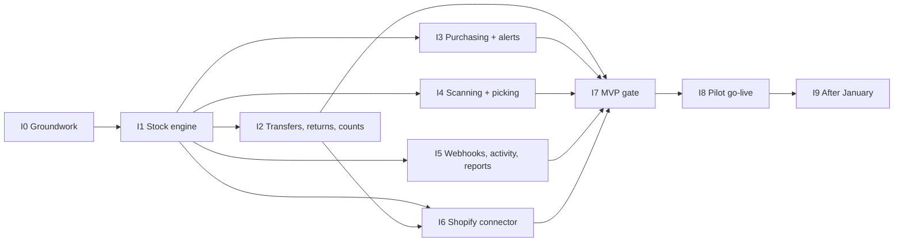

# Phase 2 build plan — core inventory pilot and the Shopify connector

**Version:** 0.2 — owner decisions recorded  
**Date:** 16 November 2026  
**Based on:** [PRD and architecture v0.7](ecommerce-platform-prd-and-architecture.md), Section 15, Phases 2 and 3, and the [Phase 1 report](phase-1-report.md)  
**Builds on:** [Phase 1 build plan](phase-1-build-plan.md), [Phase 1 status](phase-1-status.md), [ADRs 0001–0019](adr/README.md)  
**Audience:** Product owner and implementation agents

Phase 2 turns the catalog into a working inventory system. A merchant can receive stock by the case, hold it per location, lot, and serial number, reserve and fulfill it, move it between locations, take returns through inspection, count and adjust it, order from suppliers, get low-stock alerts, value it at moving average cost, pick orders with a phone, run reports, and send events to their own tools. Everything arrives with REST and MCP access and complete history, as in Phases 0 and 1.

The first pilot shop is the owner's store, from **January 2027**. It sells through Shopify, so this plan also covers the **Shopify connector (PRD Phase 3)**, scheduled as one programme with Phase 2. V0 is complete when the Phase 1, 2, and 3 flows work together (PRD 15).

Decision labels follow the PRD: **Confirmed**, **Selected direction**, **Proposed default**, **Open**.

## Contents

1. [Starting point](#1-starting-point)
2. [Outcome and exit criteria](#2-outcome-and-exit-criteria)
3. [Scope](#3-scope)
4. [Decisions and owner questions](#4-decisions-and-owner-questions)
5. [What gets built](#5-what-gets-built)
6. [Milestones](#6-milestones)
7. [Test plan](#7-test-plan)
8. [Measurement plan](#8-measurement-plan)
9. [Risks and fallbacks](#9-risks-and-fallbacks)
10. [Environments, accounts, and dependencies](#10-environments-accounts-and-dependencies)
11. [Deliverables and handoff](#11-deliverables-and-handoff)

## 1. Starting point

### 1.1 What Phases 0 and 1 left in place

- **The inventory core (Phase 0, [ADR 0006](adr/0006-inventory-concurrency.md)):**
  - `inventory_positions` is the balance table. A position is a variant at a leaf location, in a condition (`sellable`, `quarantine`, `damaged`), optionally for one lot or one serial. Check constraints keep `on_hand >= 0` and `allocated <= on_hand`.
  - `inventory_operations` and the append-only `inventory_entries` ledger. Entries already carry `unit_cost`, `pack_id`, `entered_quantity`, `conversion_factor`, `lot_id`, and `serial_id`. Only `unit_cost` is written today, and nothing reads it.
  - `reservations` (states active, partially fulfilled, fulfilled, released, expired; purposes manual, external order, transfer; `shortage_quantity` unused) and `reservation_allocations` (with an unused `fulfilled` column).
  - Four operations: receive, reserve, release (partial or full), and availability. Expiry is lazy: commands release expired allocations on the positions they lock, and reads subtract them. A sweep tidies up every 30 minutes.
  - Allocation is greedy in location-path order, all or nothing. `variants.tracking_mode` exists, but anything other than `none` is refused with `tracking_not_supported_yet`.
  - Concurrency, idempotency, and property tests reconcile the ledger with the balances after every step (A04, A05, A21).
- **The catalog (Phase 1):**
  - Packs resolve exactly and are versioned.
  - Bundles have versioned definitions, and their availability is computed on read. Receiving or reserving a bundle is refused.
  - Suppliers and supplier items carry packs, minimum order quantities, and last costs behind `costs.read`.
  - Barcodes resolve through `lookup_barcode`.
  - The grid edits with field-level compare-and-set and previews bulk changes.
  - Imports and exports run as chunked jobs.
- **Delivery:**
  - The outbox delivers right after commit, with the queue as the retry path.
  - Two queues (audit and jobs), each with a dead-letter queue.
  - Crons every 30 minutes and daily at 03:00.
  - No outgoing webhooks yet.
- **Audit:**
  - `audit_events` is partitioned by month.
  - `search_activity` filters only by target, attempt, and a cursor.
  - There is no archive to R2.
- **Shopify (Phase 0, [ADR 0008](adr/0008-shopify-sync.md)):**
  - Install with expiring encrypted tokens.
  - `orders/create` and `app/uninstalled` webhooks.
  - Each order line becomes a reservation at the single mapped location.
  - A compare-and-set availability push, and conflict recording.
  - Not yet built: fulfillment, cancellation, edits, refunds, the reconciler, or shortage reservations. Scopes are `read_products`, `read_inventory`, `write_inventory`, `read_locations`, and `read_orders`.
- **Scanning:**
  - `/scan-test` with `zxing-wasm` vendored.
  - A web app manifest, and a service worker that caches nothing.
  - No scanning in the dashboard, whose CSP has no `'wasm-unsafe-eval'`.
- **API surface:**
  - 99 operations in 14 MCP tools: `get_shop_context`, `describe_catalog`, `manage_catalog_schema`, `search_catalog`, `edit_catalog`, `manage_media`, `manage_suppliers`, `manage_storage`, `import_export`, `receive_stock`, `reserve_stock`, `get_availability`, `get_operation_outcome`, `search_activity`.
  - 48 test files.

### 1.2 Carried over

| Item | From | Where in this plan |
| --- | --- | --- |
| The 1-million-event audit seed (risk R7) | Phase 1 report, Section 9 | I0 |
| A new consent from the same person, client, and shop revokes the earlier connection | F13 finding; owner, 16 Nov | I0 |
| Size of media originals: shrink above 2,048 px | PRD 17; owner, 16 Nov | I0 |
| Phone scan matrix: iPhone Safari, and installed on the iPhone | Phase 0 E8 | I4 (owner check) |
| Shortage reservations, fulfillment, cancellations, the reconciler, conflict UI | ADR 0008, "Phase 3" | I1, I6 |
| Batched access events for API and MCP clients | PRD 7.3, "before launch" | After January (before public launch) |

### 1.3 The pilot

**Confirmed (owner, 16 November 2026):**

- **The owner's store** is the only pilot merchant for now. Its Shopify store is open with no sales yet.
- It sells Pokémon TCG and LEGO sets, and will sell one-of-a-kind items (single cards, graded cards, opened or used sets), with none listed yet.
- One warehouse. Products have barcodes. Scanning is with an iPhone.
- No preorders.
- Webhooks go to n8n.
- The owner will give a Shopify product export when building starts.

Phase 2 adds five made-up persona shops (Section 7.2) so every feature is tested on a business that needs it.

### 1.4 Lessons applied from Phase 1

- Agents commit and push early and often, in small PRs.
- ADR numbers are assigned at merge, and `adr:check` fails on duplicates.
- Every milestone ends with a staging check at real data volume and a real-browser run, not only the last one.
- Agents' PRs are rebased onto `main` and pass `verify` and e2e again before merging.
- The ChatGPT prompts are written with the milestone, so the fields they need are in its scope.

## 2. Outcome and exit criteria

PRD Phase 2:

- receipts and opening stock;
- per-position balances, conditions, availability, and reservations;
- release, expiry, fulfillment, partial dispatch and receipt, transfers, returns, inspection, counts, and adjustments;
- reconciliation;
- pack-aware commands, allocation rules, and shortage handling;
- lots, expiry, and serials;
- bundle reservation and fulfillment;
- purchase orders, reorder rules, and alerts;
- moving-average valuation, pick lists, and reports;
- mobile scanning;
- activity views;
- webhooks.

PRD Phase 3: the Shopify connector.

The plan is done for January when every row below has evidence: a passing test, a recorded run, or a figure in the Phase 2 report. Section 3 lists what the owner moved to after January.

| ID | Exit criterion | Evidence |
| --- | --- | --- |
| G1 | Stock is held per location, condition, lot, and serial. History and balances reconcile after any mix of commands, and a mismatch raises an alert with a reviewed repair path. One SKU in a store, a rented warehouse, and a fulfillment partner shows correct per-location and total figures. | A03, A21, property tests |
| G2 | Reservations: exactly the available units can be reserved, replays have one effect, expiry and fulfillment racing give one valid outcome, partial release and partial fulfillment work, and the allocation rule picks positions (earliest expiry first for lots). | A04, A05, A08, A37 (allocation half) |
| G3 | Transfers keep quantities exact through dispatch, transit, partial receipt, cancellation, and exceptions. A transfer hold counts against every other caller. | A06, A24, A25 |
| G4 | Returns go to quarantine, and inspection splits them into sellable and other conditions, with no automatic refund. A returned serial must match one fulfilled from the shop. | A07, A38 (return half) |
| G5 | Counts: a movement during a count needs review; a count below reserved stock needs an explicit shortage resolution; a quantity typed in the grid becomes a count; every adjustment has a reason and can be reversed by a linked operation. | Integration, concurrency |
| G6 | Lots and expiry: expired units stop being sellable at expiry even if the job is late; a lot trace lists its supplier, PO, receipts, and every order, transfer, return, and disposal, and exports. Serials: each unit's history shows every step; unknown or duplicate serials are rejected or flagged. | A37, A38 |
| G7 | Bundles reserve and fulfill all components in one transaction, or fail whole; a connector order records a shortage per component. | A36 |
| G8 | Receipts, counts, transfers, and adjustments accept packs, and history shows the entered pack, its factor, and the base quantity. | A28 |
| G9 | Purchase orders: drafted per supplier from low stock, sent as PDF, received in part, closed. On-order shows the remainder until closing. One low-stock alert fires per rule, in the app, by email, by webhook, and to MCP, and clears when stock recovers. | A34, A35 |
| G10 | Moving average: 10 units at €4 plus 10 at €6, then 5 fulfilled, gives an average of €5, a value of €75, and cost of goods of €25, the same when re-run for that date later. Costs are hidden without `costs.read`. | A39 |
| G11 | Scanning on the owner's iPhone, in Safari and as an installed app: look up, receive (also against a PO), count, move, pick, capture lots and serials, and add a one-of-a-kind item, optionally listing it on Shopify. An unknown code offers attach or create with the duplicate check. A location label sets the current location. | A32 (iPhone), owner run |
| G12 | Pick lists sorted by location path; a short pick starts a count and reallocation; stock changes only at fulfillment. | A41 |
| G13 | The eight standard reports (PRD 3.5) with filters, saved reports, and CSV export; activity views with the PRD 7.4 filters, per-record history, and the ingestion delay shown; location scope applies to every new read and command. | A10 (new actions), A42 |
| G14 | Webhooks: signed deliveries reach the owner's n8n after commit only, with retries, a delivery log, deduplication by event ID, and a replay. | A11, A19 (webhook half), owner run |
| G15 | Shopify: onboarding import from a store (the owner's export, rehearsed on a development store), location and variant mapping including packs and bundles, the full order flow (create, edit, cancel, fulfill, refund, return), shortages, the reconciler, listings in both directions with field ownership, and sync health in the dashboard and MCP. | A28, A29, A30, A36, A41 (Shopify half), listing tests |
| G16 | Parity holds, and ChatGPT picks the right tool and action for the Phase 2 prompts (Section 7.4), inside its grant. | A23, recorded run |
| G17 | The failure contract holds for every new command: a rollback leaves no stock effect, and a lost acknowledgement leaves a durable attempt and no duplicate. | A11, A12, A26 |
| G18 | The volume run (Section 8) on the persona shops meets its targets, and the cost per shop is updated. | Phase 2 report |

## 3. Scope

| Before January | After January (owner, 16 Nov) | Later phases |
| --- | --- | --- |
| Everything in G1–G18 | **R2 archive of history (A18).** It must ship before the pilot's first monthly partition is 90 days old: about early April 2027. | Pre-assembled kits, fitment (4) |
| Lots, expiry, serials, bundles, POs, transfers, returns | **Scheduled report emails (A40).** Saved reports and CSV exports are before January. | FIFO valuation, landed costs, foreign-currency POs (4) |
| One-of-a-kind items, both ways (D5) | Batched access events for API and MCP clients (before public launch) | Offline counting and receiving (4) |
| Outgoing webhooks | Production environment: domain, plan, accounts (owner decides at the MVP gate, I7) | Creating Shopify fulfillments from Airstock (4) |
| The Shopify connector for one store, including listing products created in Airstock (D21) | | The R2 audit spool (5), App Store and ChatGPT directory submissions (5) |

## 4. Decisions and owner questions

### 4.1 Decisions this phase makes

Each gets a short ADR in `docs/adr/`, numbered when it merges.

| ID | Decision | Proposed default | Milestone |
| --- | --- | --- | --- |
| D1 | Position identity and conditions | Keep `inventory_positions` keyed by variant, location, condition, lot, and serial. Add the conditions `repair` and `supplier_return`. Disposal is an adjustment out, not a condition. In-transit stock sits at a system location per shop, on positions that also name their transfer. | I1 |
| D2 | Reservations | **Confirmed:** explicit allocations to concrete positions, optional expiry, no negative availability. Partial release and partial fulfillment by allocation. Expiry is optional for every caller, with a shop default of none; Shopify orders never expire. | I1 |
| D3 | Allocation rule | Per shop and channel: an ordered list of fulfillment-eligible locations. Within a location, the earliest-expiring lot first for lot-tracked variants, otherwise the oldest receipt first. The chosen positions are recorded. A `reallocate` command moves an allocation to another eligible position. | I1 |
| D4 | Lots and serials | `lots` (code unique per variant, expiry, production date, supplier, PO) and `serial_units` (serial unique per variant, status, current position). A variant's tracking mode can change only while it has no stock and no open reservations. A sell-by margin in days per variant makes units ineligible before expiry. | I1 |
| D5 | One-of-a-kind items | **Confirmed (owner, 16 Nov): both ways.** **(a)** A variant setting **one of a kind**: at most one unit on hand across the shop, enforced in the receipt transaction. A grading certificate number is stored as the item's barcode, so scanning the slab finds it. After fulfillment the item's status becomes **sold**: hidden from default views, history kept, and back in stock if returned. **(b)** Units that share one price sit on one serialized variant, each with its serial (for example its certificate number). The merchant chooses per item. Either way, condition and grading are catalog fields from new starter families. | I1, I4 |
| D6 | Shortages | Only connector callers (Shopify) may create a reservation with a shortage. A shortage is visible, counted as demand, and alerted. A receipt or transfer receipt at an eligible location fills open shortages oldest first, in the same transaction (a shop setting can turn this off). Availability shown and pushed stays at zero or above. | I1 |
| D7 | Valuation | A moving average per variant per shop over owned stock (on hand in every condition plus in transit). Every entry stores the unit cost it applied, and a cost history row per change makes value at any past date reproducible. Unit costs are `numeric(20, 6)` with round-half-even; values are rounded to cents only when shown. | I1 |
| D8 | Transfers | The PRD 6.4 states and per-line quantities (planned, cancelled, dispatched, received, exception-resolved). A move within a warehouse is one command that dispatches and receives together. Dispatch needs the source in scope; receipt needs the destination. | I2 |
| D9 | Returns | The PRD 6.5 states. Receiving puts units in quarantine. Inspection dispositions: sellable, damaged, repair, supplier return, or disposal (an adjustment out). | I2 |
| D10 | Counts | A count session covers chosen positions or a location, optionally blind. Each line records the position version when counted; if the position moved before submit, the line needs review. A count below reserved stock asks which reservations to reduce or reallocate. A quantity typed in the grid is a one-line count. | I2 |
| D11 | Purchase orders | The PRD 6.8 states and per-line quantities. The Worker renders the PO PDF with `pdf-lib`, the same library as labels, so it can be emailed to the supplier through Resend. The send is logged. | I3 |
| D12 | Alerts | One open alert per rule until stock recovers. The check runs in the stock transaction; notifications go through the outbox to the app, email, webhooks, and MCP. Expiring-lot alerts run in the daily job. Members choose their alerts within their location scope. | I3 |
| D13 | Scanning | Scanning lives in the React app at `/app/scan`. The app's CSP adds `'wasm-unsafe-eval'`, which allows WebAssembly compilation only. The built-in `BarcodeDetector` is used where it exists and `zxing-wasm` elsewhere, including iOS. A keyboard-wedge scanner types into any scan field. The service worker caches the app shell only, with no offline data. | I4 |
| D14 | Webhooks | Section 5.13. **Confirmed (owner, 16 Nov):** nothing is hard-coded. Each shop configures its own subscriptions in the dashboard, choosing event types and filters per subscription from a registry of event types. Subscriptions are managed in the dashboard and API only, not over MCP, so a connected AI client cannot open a channel that sends shop data out. | I5 |
| D15 | Activity views and reports | Activity search gains the PRD 7.4 filters, with indexes chosen on the 1-million-event seed. Inventory events record the location IDs they touch, so a scoped member's history is filtered. The reports are read operations; a large report runs as a job and exports CSV. | I5 |
| D16 | MCP tools | Task-shaped tools, about 22 after Phase 2 (Section 5.16). **Confirmed (owner, 16 Nov):** there is no tool-count limit from ChatGPT; ADR 0005's budget was our own. The gate is measured tool choice (Section 7.4), not a count. Check in I0 how ChatGPT currently handles a larger tool list, and use any filtering or discovery mechanism it offers if it improves choice. | I0, every milestone |
| D17 | Shopify connector | Section 5.14. A custom-distribution app for the pilot store. Pictures imported from Shopify are referenced by their Shopify URLs, not copied to R2, because they already live in Shopify and originals are the largest per-shop storage cost. Pushes are batched per call. | I6 |
| D21 | Listings in both directions | **Confirmed (owner, 16 Nov):** a product created in Shopify is picked up by webhook and matched by SKU or barcode; a product created in Airstock can be listed to Shopify, and the owner will mostly create here. **Proposed:** each storefront field (title, description, price, pictures, options, status) has an owner per shop. Products created in Airstock default to Airstock-owned; imported ones to Shopify-owned. A change from the side that does not own a field is shown in sync health with "take Shopify's" or "push Airstock's", never applied silently. | I6 |
| D18 | Reconciliation | A scheduled check per shop compares ledger sums, balances, allocations, and reservation totals, and the Shopify levels. A mismatch is an alert with a reviewed repair (a compensating operation), never an edit. It runs with the existing 30-minute and daily crons, so Neon can still scale to zero. | I1, I6 |
| D19 | Media originals | **Confirmed (owner, 16 Nov):** the browser shrinks originals larger than 2,048 px on the long side before upload. It is a shop setting with that default, ready for a future admin panel. | I0 |
| D20 | Re-consent | **Confirmed (owner, 16 Nov):** a new consent from the same person, for the same MCP client and shop, revokes the earlier connections. | I0 |

### 4.2 Owner answers

Answered on 16 November 2026.

| Topic | Answer |
| --- | --- |
| Reservations and expiry | Explicit allocations, optional expiry, no negative availability (D2). |
| Transfers and returns | The states and partial-quantity rules in PRD 6.4 and 6.5 (D8, D9). |
| Media originals | Shrink to 2,048 px; can be decided later in a future admin panel (D19). |
| Re-consent | Revokes the earlier connection (D20). |
| MCP tools | No ChatGPT tool limit; gate on tool choice (D16). |
| Pilot | The owner's store, one warehouse, from January 2027 (Section 1.3). |
| Test personas | Sports clothing (in the style of YoungLA), food (in the style of YFood), cosmetics, spare parts, and a fashion brand with clothes, glasses, bags, watches, and jewellery (Section 7.2). |
| Before January | Everything in Phase 2, including webhooks. R2 archiving and scheduled reports can wait. |
| Benchmark database | A separate free Neon project, `airstock-bench`, created by the owner with a project-scoped API key (Section 10). Staging is not used for the large seeds. |
| Production | Domain, plan, and accounts wait until the MVP works (I7). |
| Restore history | 7 days, which needs Neon Launch for production. Longer restore windows for paying merchants are a future product feature, not a database setting. |
| One-of-a-kind items | Both ways: one-of-a-kind variants and serialized shared variants (D5). |
| New listings | Both: created in Shopify and picked up, or created in Airstock and listed to Shopify. The owner will mostly create in Airstock (D21). |
| Webhook events | Not hard-coded: each shop chooses event types and filters per subscription in its webhook settings (D14). |

### 4.3 Open questions

None. The field-ownership default in D21 is a proposal for the owner's review. Questions that come up while building go to `docs/phase-2-status.md`.

## 5. What gets built

### 5.1 Stock model

- **Quantities** follow PRD 5.3: on hand, sellable on hand, reserved, available, in transit, quarantined, damaged, owned total, on order, and shortage. Availability is for a variant and a scope (shop, warehouse, or location), and it is never below zero.
- **Positions** (D1) are the unit of locking and balance. Lot-tracked variants have one position per lot per location and condition; serialized variants have one per serial.
- **Lock order** stays as in ADR 0006: positions by ID, then reservations, then anything else. Every new command follows it, and the concurrency tests cover each one.
- **Expiry eligibility** (lots) and **reservation expiry** are computed when a command or read runs, in one shared SQL function, so the UI, API, MCP, reports, and the Shopify push agree.

### 5.2 Receipts

- Pack-aware: enter "3 cases" and store 72 base units, with the pack, the pack version's factor, and the entered quantity on the entry.
- Lot-tracked variants require a lot code (and an expiry when configured). Serialized variants require one serial per unit. One-of-a-kind items refuse a second unit.
- An optional unit cost (per pack or per base unit) updates the moving average (D7). Without one, the current average or the variant's default cost applies.
- An optional supplier, PO line, and external reference. Receiving against a PO is Section 5.8.
- A receipt fills open shortages first (D6).

### 5.3 Reservations, fulfillment, and bundles

- **Reserve** for a variant, or a bundle, with quantity, purpose, external reference, optional expiry, and an optional location or lot. Without a location, the allocation rule (D3) chooses.
- **Release** and **fulfill**, both partial by quantity, per reservation or per allocation. Fulfillment lowers on hand and allocated in one transaction and stores the unit cost applied.
- **Bundles:** reserving a bundle reserves every component, converted through packs, in lock order, and records the bundle version. Fulfilling it consumes the components. Its cost is the sum of the components' costs.
- **Reallocate:** move an allocation to another eligible position, for example when a picker scans a different lot.
- **Shortage** reservations for connector callers (D6).

### 5.4 Transfers

- Create a draft with source, destination, lines (variant, pack, quantity), and tracking references.
- **Ready** places typed transfer allocations on source stock.
- **Dispatch** a quantity: it consumes the allocation, takes the units out of the source, and puts them in transit. For lot and serial variants, the dispatched lots and serials are recorded.
- **Receive** a quantity at destination positions.
- **Resolve** an exception (lost, damaged, short) with an adjustment.
- **Cancel** the undispatched remainder.
- A summary status never hides mixed lines.
- A move within a warehouse, from shelf to shelf, is one command (D8), which is what the scanning "Move" flow uses.

### 5.5 Returns and inspection

- Create a return linked to an external order or fulfillment, then authorize it. Neither step changes stock.
- Receive the returned units into quarantine, at any warehouse.
- Inspect: split the units into sellable, damaged, repair, supplier return, or disposal. Only units released to sellable increase availability.
- A serialized return must match a serial fulfilled from this shop, or it is flagged for review.
- A returned one-of-a-kind item goes back from sold to in stock.

### 5.6 Counts, adjustments, and conditions

- Count sessions, per D10, from the dashboard, the phone, or the grid.
- **Adjustments** need a reason from a list:
  - count correction;
  - damage;
  - loss or theft;
  - found;
  - write-off;
  - sample;
  - supplier return;
  - other, with a note.
- **Condition changes** move units between conditions without changing on hand, for example from quarantine to sellable.
- **Reversal:** a new operation linked to the original.

### 5.7 Lots, expiry, serials, and one-of-a-kind items

- **Lots:** the lot record (D4), a sell-by margin, expiring-lot alerts, and a trace view and export from supplier to every order.
- **Serials:** the history view, scan capture on receipt, dispatch, pick, and return, and duplicate checks.
- **One-of-a-kind items (D5), both ways:**
  - **One of a kind:** the variant setting, for items with their own price, such as a graded card or a used set.
  - **Serialized shared variant:** for units that share one price, each with its serial or certificate number.
  - Two new starter families:
    - **Trading cards:** game, set, card number, rarity, language, condition (NM, LP, MP, HP, damaged), grading company, grade, and certificate number.
    - **Building sets:** set number, theme, piece count, completeness, box condition, and sealed or opened.
  - A **quick add** from the phone, as one command: take pictures, scan or type the certificate number, fill the family fields, price, and location. It creates the product, variant, barcode, picture links, and a receipt of one, or adds a serial unit to an existing shared variant.
  - **List on Shopify** is a choice in the quick-add form (D21), as a draft or active listing; the form remembers the last choice. When a one-of-a-kind item sells, its Shopify availability drops to zero, and a shop setting can also archive the listing.
- **Two kinds of condition:** an item's condition, such as "near mint", is a catalog field. A stock condition, such as quarantine, is about whether units can be sold. They stay separate.

### 5.8 Purchase orders

- Supplier, destination warehouse, expected date, and lines (variant, pack, quantity, unit cost from the supplier item).
- States: draft, sent, partially received, received, closed, cancelled.
- **Send:** the PDF (D11), optionally emailed, and the send logged.
- **Receive against a line:** by pack, with lots and serials where required. A partial receipt keeps the rest open; an over-receipt asks for confirmation and is recorded.
- **Close:** cancels any open remainder explicitly.
- **On order** per destination appears in stock views, low stock, and reports. It is never sellable.
- **Draft from low stock:** one PO per preferred supplier. The quantity is the reorder quantity, or the amount up to the maximum level, minus what is already on order, rounded up to the supplier's pack and minimum order quantity. The user reviews it before saving.

### 5.9 Reorder rules and alerts

- Rules per variant and warehouse (optional per location): a reorder point, a reorder quantity or maximum level, and a preferred supplier.
- **Alert kinds:**
  - low stock (available plus on order at or below the reorder point);
  - lot expiring within N days;
  - new shortage;
  - Shopify sync failure or conflict;
  - reconciliation mismatch.
- **Channels:** an in-app list and badge, email to subscribed members, webhooks, and MCP. Each alert can be acknowledged.

### 5.10 Valuation

- Moving average per D7, kept in a `variant_costs` row with its history.
- Transfers don't change cost. Fulfillments, adjustments out, and disposals remove units at the current average.
- **Reports:** value at any date by location and category, and cost of goods for a period, both within `costs.read`.

### 5.11 Picking

- A pick list is built from open reservations, filtered by channel, warehouse, date, or order. Lines are grouped by location and sorted by location path, and each shows the variant, the base and pack quantities, the allocated lot or serial, and the external order reference.
- Print it as a PDF in the browser, or work it on the phone: scan the location, scan the item, confirm the quantity.
- Picks record picked quantities and do not change stock.
- **A short pick** records what was found, which starts a count and a reallocation.
- **Fulfillment:**
  - For Shopify orders, fulfillment comes from Shopify (Section 5.14).
  - For manual and API reservations, it is the fulfill command, also offered at the end of a pick.

### 5.12 Scanning and the installed app

- **Installed app:**
  - The manifest's start URL is `/app/scan`, with shortcuts for Receive, Count, Move, Pick, and Quick add.
  - Large touch targets and one-handed flows.
  - The quantity and pack are shown before each commit.
  - A sound on success and on error, because iOS has no vibration API.
- **Flows:** look up, receive (free or against a PO), count, move, pick, capture lot or serial, and quick add.
- **Location labels:** scanning one sets the current location for the following scans.
- **Unknown codes:** offer to attach the code to an existing variant (search) or create a new one, with the duplicate check.
- **Audit:** every scan-driven change is an ordinary command. A lookup is a read and is logged as one.
- **Owner checks (E8 remainder):** iPhone Safari in a tab and installed, close up and in dim light, plus a graded-card slab label.

### 5.13 Webhooks

- **Configured per shop, nothing hard-coded (D14):**
  - A shop can have several subscriptions, for example one per n8n workflow, managed by owners and managers (`webhooks.manage`) under Integrations → Webhooks in the dashboard, and through the API.
  - Each subscription has an HTTPS URL, a name, a secret (shown once, and rotatable with an overlap period), an active or disabled state, and its **choice of event types**.
  - Optional **filters** per subscription: warehouses or locations, and alert kinds.
  - Event types come from a registry in code, listed by the API, so the settings page shows every type with a description and a sample payload. A new event type appears there without UI changes.
  - A **Send test** button sends `webhook.test`, or a sample of any chosen type.
- **Delivery:**
  - Domain events are written to the outbox in the same transaction as the change, so nothing is ever sent for stock that did not commit.
  - The dispatcher fans each event out into one delivery record per matching subscription, then POSTs them.
  - Retries come back through the queue with a delay: after 1 minute, 5 minutes, 30 minutes, 2 hours, 6 hours, 12 hours, and 24 hours. After the last failure the delivery is marked failed.
  - A subscription failing for 3 days in a row is disabled, and the owner is emailed.
- **Signing:** headers `Airstock-Event-Id` and `Airstock-Signature: t=<unix time>,v1=<HMAC-SHA256 hex of "<t>.<body>">`. Consumers deduplicate by event ID and reject old timestamps. The docs include an n8n recipe that verifies the signature in a Code node.
- **Payload:** an envelope with `id`, `type`, `created_at`, `shop_id`, `api_version`, and `data`. The `data` snapshot is complete enough for n8n to act without calling back: SKU, name, location, and quantities. Each snapshot carries the position version, so a consumer can drop an older update that arrives late. Order of arrival is not guaranteed.
- **Event types available before January** (every type is offered; each subscription picks its own):

  | Area | Events |
  | --- | --- |
  | Stock | `stock.changed` (one per operation, naming every position it changed) |
  | Alerts | `alert.opened`, `alert.resolved` |
  | Orders and transfers | `reservation.shortage`, `transfer.status_changed` |
  | Purchasing and returns | `purchase_order.status_changed`, `return.status_changed` |
  | Catalog and jobs | `catalog.item.changed`, `job.completed` |
  | Shopify | `shopify.sync_conflict` |
  | Testing | `webhook.test` |

- **Safety:**
  - HTTPS only.
  - IP literals in private or reserved ranges and internal host names are refused.
  - Redirects are not followed, and each request times out after 10 seconds.
  - Response bodies are not stored beyond their first 1 KB.
- **Delivery log and audit:**
  - Status, attempts, the last response code, and a replay button.
  - Each delivery outcome is an audit event (PRD 7.1, automation).
  - The log is kept for 30 days.

### 5.14 Shopify connector (PRD Phase 3)

- **App:**
  - A custom-distribution app for the pilot store (D17).
  - Scopes add what the new webhooks need (fulfillments, returns, order edits) and `write_products` for listings (D21). Check every scope against Shopify's documentation for the API version in use.
  - The mandatory privacy webhooks (customer data request, customer redact, shop redact).
  - **Protected customer data:** check in I0 whether Shopify must approve it for a real store under custom distribution, and file the request that day if so.
- **Onboarding:**
  - A resumable import job using Shopify bulk operations: products, variants, SKUs, barcodes, pictures (referenced, D17), and quantities per location.
  - It runs through the normal catalog commands, and quantities arrive as opening receipts.
  - It previews matches with any existing catalog by SKU and barcode before writing.
- **Mapping:**
  - Each Shopify location maps to a warehouse or location. Unmapped locations are shown and never guessed. The one-location limit per connection goes.
  - Each Shopify variant maps to a variant, a sales pack, or a bundle.
- **Order flow (PRD 8.5):**

  | Shopify event | Effect |
  | --- | --- |
  | Order created | Reservation per line, using the allocation rule, with shortages where short (D6). |
  | Order edited | Quantities adjusted, with partial release where lines shrink. |
  | Order cancelled | The remainder released. |
  | Fulfillment created | Fulfilled at the fulfilling location; if that differs from the allocation, it is reallocated first. |
  | Fulfillment cancelled | A compensating receipt back to the position, and the reservation reopened. |
  | Refund with restock, or return | The return workflow (Section 5.5): quarantine first, whatever Shopify's restock flag says. |

- **Listings in both directions (D21):**
  - **From Shopify:** `products/*` webhooks create and update products here, matched by SKU or barcode, and new variants are mapped automatically when they match.
  - **To Shopify:** a product created in Airstock, from the dashboard, the phone's quick add, an import, or MCP, can be listed to Shopify as a draft or active product with its options, variants, SKUs, barcodes, prices, description, and pictures, then mapped. Pictures are uploaded to Shopify from R2 at 2,048 px (D19).
  - Later changes are pushed for the fields Airstock owns. Changes made in Shopify to those fields show as differences in sync health, not silent overwrites.
  - A sold one-of-a-kind item drops to zero in Shopify, and a shop setting can also archive its listing.
- **Push:**
  - Availability for each mapped location, through the outbox, with compare-and-set as in ADR 0008.
  - Batched in `inventorySetQuantities` calls.
  - Packs push floor(available ÷ pack quantity).
  - Bundles push their computed availability, and a component's change pushes every bundle that uses it.
- **Reconciler:**
  - With the 30-minute cron: orders, fulfillments, refunds, and returns updated since the last cursor, plus the levels of recently changed items.
  - With the daily cron: a full level comparison.
- **Sync health in the dashboard and MCP:**
  - Last successful sync, pending pushes, and unmapped variants and locations.
  - Shortages, and conflicts with their resolution ("take Shopify's quantity" or "push Airstock's").
  - Listing differences on owned fields, with the same two choices, and listings that failed to publish.
- **Rehearsal:** load the owner's product export into a development store, run onboarding against it, then place, edit, cancel, fulfill, refund, and return test orders. The real store is connected only at go-live (I8).

### 5.15 Activity views and reports

- **Activity:**
  - A shop timeline with filters for actor, source, date, target, action, outcome, warehouse, integration, and batch (PRD 7.4).
  - History on products, variants, locations, positions, lots, serials, transfers, POs, and returns.
  - An operation's lifecycle, from attempt to outcome.
  - The ingestion delay, shown when events are still queued.
  - Export as a logged job.
- **Reports (PRD 3.5):**
  - The reports:
    - stock on hand (by variant, location, condition, and lot, with packs);
    - low stock;
    - movements;
    - inventory value at a date;
    - cost of goods;
    - purchasing;
    - expiring lots;
    - shortages.
  - Each has filters, saved reports, and CSV export through the export jobs.
  - Location scope and cost permission apply.
  - Running a report is an audit event.

### 5.16 Operations, permissions, and MCP tools

About 90 new operations. Each has a REST route, a permission, an audit action, and an MCP tool or a documented exception, as today.

**New permissions:**
- `inventory.fulfill`
- `inventory.transfer`
- `inventory.adjust`
- `inventory.count`
- `returns.manage`
- `purchasing.manage`
- `alerts.manage`
- `reports.run`
- `picking.run`
- `webhooks.manage`

The inventory operator role gets the inventory ones; managers and owners get all of them. Connection scopes stay as they are: inventory commands need `inventory:write`, and purchasing needs `inventory:write` plus the permission.

MCP tools after Phase 2 (D16):

| Tool | Covers | Change |
| --- | --- | --- |
| `get_shop_context`, `describe_catalog`, `manage_catalog_schema`, `search_catalog`, `edit_catalog`, `manage_media`, `manage_suppliers`, `manage_storage`, `import_export`, `get_operation_outcome` | As in Phase 1; `edit_catalog` adds one-of-a-kind and tracking settings | Kept |
| `search_activity` | The PRD 7.4 filters, operation lifecycle | Extended |
| `receive_stock` | Receipts with packs, lots, serials, and costs; against a PO line; quick add of a one-of-a-kind item | Extended |
| `manage_reservations` | Reserve (variants and bundles), release, fulfill, reallocate, list, shortages | Replaces `reserve_stock` |
| `get_stock` | Positions by condition and lot, availability by scope, on order, in transit, lot trace, serial history | Replaces `get_availability` |
| `transfer_stock` | Create, ready, dispatch, receive, cancel, resolve exceptions, move within a warehouse | New |
| `adjust_stock` | Count sessions, adjustments with reasons, condition changes, reversals | New |
| `manage_returns` | Create, authorize, receive, inspect | New |
| `manage_purchasing` | POs (draft, send, receive, close, cancel), draft from low stock, reorder rules | New |
| `stock_alerts` | List, acknowledge, and subscribe to alerts | New |
| `warehouse_work` | Pick lists, picks, short picks | New |
| `run_report` | The standard reports and saved reports | New |
| `shopify_sync` | Sync health, mappings, conflicts and their resolution, listing products to Shopify, resync | New; ends ADR 0008's temporary exception |

That is 22 tools. New documented exceptions:
- webhook subscriptions (D14);
- PDF rendering of pick lists and labels (browser);
- scan-session state (interface only);
- report schedules (after January).

### 5.17 Schema additions

Same conventions as before: `shop_id` on every tenant table, composite foreign keys, row-level security, `version` columns, and insert-only history tables.

| Group | Tables or columns |
| --- | --- |
| Stock | Conditions `repair` and `supplier_return`; in-transit system location; `inventory_operations.kind` adds return, count, condition change, and reversal; `inventory_entries.cost_basis` |
| Tracking | `lots`, `serial_units`, `variants.sell_by_margin_days`, `variants.one_of_a_kind`, product status `sold` |
| Reservations | Allocation-rule tables (`allocation_rules`, `allocation_rule_locations`); `reservations.bundle_version_id`; shortage fields put to use |
| Transfers | `transfers`, `transfer_lines`, `transfer_line_units` (lots and serials) |
| Returns | `returns`, `return_lines`, `return_inspections` |
| Counts | `count_sessions`, `count_lines` |
| Purchasing | `purchase_orders`, `purchase_order_lines`, `po_sends`, `reorder_rules` |
| Alerts | `alerts`, `alert_subscriptions`, `notifications` |
| Valuation | `variant_costs`, `variant_cost_history` |
| Picking | `pick_lists`, `pick_lines`, `picks` |
| Reports | `saved_reports` |
| Webhooks | `webhook_subscriptions`, `webhook_deliveries` |
| Shopify | Several locations per connection; fulfillment, refund, return, and edit records; `shopify_sync_cursors`; `shopify_product_maps` with listing state; storefront field ownership per shop |
| Audit | Location IDs on inventory events; indexes chosen on the 1-million-event seed |

## 6. Milestones

Sizes as before: S is a day or two, M under a week, L one to two weeks, for one developer with coding agents. In Phase 1, agents built faster than this, so the calendar in Section 6.10 is tighter than the sizes, and its dates are targets, not promises.

### 6.1 I0 — Groundwork (M)

- **Benchmark project:** connect `airstock-bench` (Section 10).
- **Seed generator:** realistic data for the five personas and a shop shaped like the owner's (Section 7.2), with size knobs.
- **Baseline:** run the 1-million-event audit seed (Phase 1 R7) and record activity-search timings.
- **ChatGPT tool choice:** a harness that records which tool and action ChatGPT picks for each prompt. Check OpenAI's current documentation and a real run for how ChatGPT handles a larger tool list (D16).
- **Small changes:** re-consent revokes earlier connections (D20), and originals shrink to 2,048 px (D19).
- **Shopify:** check custom distribution and protected customer data for a real store (Section 5.14).
- **Done when:** the persona shops are seeded in the bench project with baseline figures recorded, and D19 and D20 are on staging.

### 6.2 I1 — Stock engine (L)

D1–D7 and D18:
- conditions and in transit;
- lots, serials, and tracking modes;
- one-of-a-kind items and the two starter families;
- pack-aware receipts with costs;
- reservations with partial release and fulfillment, the allocation rule with earliest expiry first, and reallocation;
- bundle reservation and fulfillment;
- shortages for connector callers;
- moving average and cost history;
- the reconciliation job;
- the tool changes for `receive_stock`, `manage_reservations`, and `get_stock`;
- the inventory and detail-panel views for the new quantities.

**Done when:** A03, A04, A05, A08, A11, A12, A21, A26, A28 (receipt half), A36 (engine half), A37 (allocation and expiry), A38 (receive and fulfill), and A39 pass, and the property tests cover lots, serials, packs, and bundles. **This milestone lands first:** every other milestone builds on its schema.

### 6.3 I2 — Transfers, returns, counts (L)

- D8–D10: transfers with in transit and exceptions; returns and inspection; count sessions, grid counts, adjustments, condition changes, and reversals.
- `transfer_stock`, `adjust_stock`, `manage_returns`.
- **Done when:** A06, A07, A24, A25, G5, and the transfer and return halves of A38 pass.

### 6.4 I3 — Purchasing and alerts (M)

- D11 and D12: POs with PDF and email; on order; receiving against POs; close and cancel; draft from low stock; reorder rules; alerts in the app, by email, and to MCP. Webhook delivery of alerts arrives with I5.
- `manage_purchasing`, `stock_alerts`.
- **Done when:** A34 (app and email) and A35 pass.

### 6.5 I4 — Scanning and picking (L)

- D13: the scan routes and flows, quick add, the installed app, pick lists (PDF and phone), short picks, and `warehouse_work`.
- An early iPhone check by the owner, in the first days of the milestone, so iOS problems surface before the flows are finished.
- **Done when:** A32 (iPhone Safari and installed) and A41 (pick half) pass, and the owner has received, counted, moved, picked, and quick-added on the iPhone.

### 6.6 I5 — Webhooks, activity, reports (M)

- D14 and D15: webhook subscriptions, delivery, retries, the log, and the n8n recipe; activity filters, indexes, views, and export; the eight reports, saved reports, and CSV; `run_report` and the extended `search_activity`.
- **Done when:** G13 and G14 pass, A19's webhook half passes, and the owner has set up a subscription in the dashboard (event types and filters of their choice) that their n8n receives and verifies.

### 6.7 I6 — Shopify connector (L)

- D17 and D21: onboarding with bulk operations; mapping of locations, variants, packs, and bundles; the full order flow; batched push for packs and bundles; the reconciler; sync health with conflict resolution; privacy webhooks; listings in both directions with field ownership; `shopify_sync`.
- Order of work: onboarding, mapping, and the order flow first, because stock correctness depends on them; then listings.
- **Rehearsal** with the owner's export on a development store.
- **Done when:** A28, A29, A30, A36, and A41 pass on the development stores, and the rehearsal is recorded.

### 6.8 I7 — MVP gate (M)

- The volume run on the persona shops (Section 8).
- A real-browser run of every flow.
- The ChatGPT run (Section 7.4).
- The owner's iPhone, n8n, and rehearsal checks.
- The Phase 2 report and proposed PRD changes.
- **The owner decides production:** domain, Neon Launch with 7-day restore, the WorkOS production environment, and the email sender and its data location (PRD 12.4, 17).

### 6.9 I8 — Pilot go-live (S–M)

- Production as the owner decided in I7: a Neon project in Frankfurt, a Worker, R2, queues, secrets, the Shopify app pointed at production, and WorkOS.
- A restore test (A22) before real data arrives.
- Install on the owner's store, onboard, map, and watch the first real orders.

### 6.10 Calendar (targets)

| Weeks of | Work |
| --- | --- |
| 16 November | I0, then I1 |
| 23 November | I2, I3, I4, and I5 in parallel; I6 starts with onboarding and mapping |
| 30 November | I6 order flow and reconciler; the I4 phone checks |
| 7 December | I7 MVP gate; the owner's production decision |
| 14 December | I8 production setup and the rehearsal on production |
| Late December | The owner uses it for real with test orders; fixes |
| Early January | Pilot live on the owner's store |

### 6.11 I9 — After January

- **R2 archive of history (A18):** monthly partitions older than 90 days become compressed files in R2, with a searchable index and retrieval through the activity views. **Deadline:** before the pilot's first partition turns 90 days old, about early April 2027.
- **Scheduled report emails (A40):** a summary with a link, with scope and cost permission applied when each email is made.
- **Batched access events** for API and MCP clients, before public launch.

## 7. Test plan

### 7.1 Automated

Same setup as Phase 1: core and database tests in Node against `postgres:17`, Worker tests in the Workers Vitest pool, web component tests, and Playwright.

| Scenario | Coverage | Type |
| --- | --- | --- |
| A03 | One SKU in three warehouse types; per-location and total figures | Integration |
| A04, A08 | Last-units race; expiry against fulfillment | Concurrency |
| A05 | 50 replays of receipt, reservation, fulfillment, dispatch, PO receipt | Idempotency |
| A06, A24, A25 | Dispatch and partial receipt; transfer hold against an overlapping claim; dispatch 4, receive 3, cancel the rest | Integration + concurrency |
| A07 | Return of 6, inspection releases 4 | Integration |
| A11, A12, A26 | Rollback, audit failure, lost acknowledgement, for each new command | Fault injection |
| A19 | A webhook delivery retried: one effect at the consumer by event ID | Integration |
| A21 | Ledger, balances, allocations, and reservations reconcile after random mixed commands, including lots, serials, packs, bundles, transfers, counts, returns, and shortages | Property |
| A28 | 3 cases of 24 received; 5 singles and a 6-pack sold through Shopify | Integration (fake store) |
| A29, A30 | Shortage order; duplicate and missed webhooks | Integration (fake store) |
| Listings | A product created in Shopify is picked up and matched; one created in Airstock is listed with variants and pictures; a Shopify edit to an Airstock-owned field shows as a difference; a sold one-of-a-kind item drops to zero | Integration (fake store) |
| Webhook settings | Each subscription receives only its chosen event types and filters; every registered event type has a description and sample payload | Integration |
| A32 | Scanning on iPhone Safari and installed | Owner run |
| A34, A35 | One alert per rule; POs from low stock with partial receipt and close | Integration |
| A36 | 3 gift sets requested with 5 soaps, 2 per set | Integration + concurrency |
| A37 | Two lots, earliest expiry first, expiry with a late job, the trace | Integration |
| A38 | One serial through receipt, transfer, fulfillment, return | Integration |
| A39 | €4 and €6 receipts, 5 fulfilled; value and cost of goods at that date | Integration |
| A41 | Pick list for 20 orders, short pick | Integration + Playwright |
| A42 | A member scoped to one location through the API and MCP, on every new read and command | Integration |
| A23 | Parity, OpenAPI, and the tool list | Script |
| Webhook signing | Signature, timestamp tolerance, secret rotation overlap, refused URLs | Unit |
| Valuation | Random receipt and fulfillment sequences against a reference average | Property |

### 7.2 Personas and data volume

Catalogs are made up in each style, not copied from the named brands.

| Shop | Catalog | Features it exercises | Size |
| --- | --- | --- | --- |
| Owner's store | Pokémon TCG sealed products (booster packs, booster boxes, Elite Trainer Boxes, cases), LEGO sets, graded and single cards, used sets | Packs (case of boxes of packs), one-of-a-kind items, barcodes, one warehouse, iPhone flows | The owner's export plus 1,000 one-of-a-kind items |
| Sports clothing | Training tops, joggers, shorts, in sizes and colours; seasonal drops | Bundles (outfit sets), many returns, two warehouses and transfers | 4,000 variants |
| Food | Drinkable meals, bars, and powders in 6- and 12-packs and cases | Lots with expiry, earliest expiry first, sell-by margin, recall trace, POs by the case | 300 variants, 3,000 lots |
| Cosmetics | Skincare, make-up shades, gift sets | Lots with expiry (batch codes), gift-set bundles, returns to quarantine | 2,000 variants, 2,000 lots |
| Spare parts | Parts with manufacturer numbers and replacements | Serials on about 10%, 400 bin locations, POs with minimum quantities, two warehouses | 20,000 variants |
| Fashion brand | Clothes, glasses, bags, watches, jewellery | Serials (watches), one-of-a-kind items (jewellery), bundles, three locations: warehouse, store, third-party | 4,000 variants |

The full seed has about 31,000 variants and three months of activity: about 300 stock operations a day per shop. History totals 1 million audit events across the shops, including reads. The load run has 10 people working at once in mixed flows.

### 7.3 Staging and the bench project

- **Each milestone ends with three checks:**
  - a seed and timing run in `airstock-bench`;
  - a real-browser run on staging, with its events checked in `audit_events`;
  - the milestone's ChatGPT prompts (Section 7.4).
- Staging keeps small, ordinary shops; large seeds go to the bench project only.

### 7.4 ChatGPT runs

Each milestone adds its prompts. The run records the tool and action ChatGPT picked, and whether the answer was right. Any wrong pick is fixed, through descriptions or by splitting a tool, before the milestone closes (D16). Draft prompts, on a full-access connection to a persona shop:

1. "How many Prismatic Evolutions booster boxes do I have, and how many are reserved?" (`get_stock`)
2. "Receive 3 cases of 6 booster boxes from the distributor into the warehouse, at 95 euros a box." (`receive_stock` with a pack and cost)
3. "Move 2 Elite Trainer Boxes from shelf A1 to B2." (`transfer_stock`, move)
4. "What's running low? Draft purchase orders for it." (`stock_alerts`, then `manage_purchasing`)
5. "Which food lots expire in the next 30 days, and which orders got lot L-2311?" (`get_stock`, lot trace)
6. "I counted shelf B2: 4 of SKU X and none of SKU Y." (`adjust_stock`, count)
7. "Order 1001's LEGO set came back damaged." (`manage_returns`)
8. "What is my stock worth today, and what was it worth on 1 December?" (`run_report`)
9. "Are there any Shopify sync problems?" (`shopify_sync`)
10. "Add a PSA 10 Charizard, certificate 12345678, at 450 euros, and list it on Shopify." (`receive_stock` quick add, then `shopify_sync` listing)
11. On a read-only connection: "Set SKU X to zero." Refused (A15).

## 8. Measurement plan

All measured in `airstock-bench` on the full persona seed, at the server unless noted.

| Measurement | Target or purpose |
| --- | --- |
| Stock commands (receive, reserve, fulfill, dispatch, transfer receipt, count submit) with 10 concurrent users | p95 under 500 ms |
| Reservation with earliest-expiry allocation for a variant with 200 lots | p95 under 500 ms |
| Availability for one variant across the shop | p95 under 200 ms |
| Inventory list, 50 rows, with lot and condition columns | p95 under 1 s |
| Activity search over 1 million events with two filters | p95 under 1 s |
| Reports on 31,000 variants: stock on hand, value at a past date | Under 5 s and under 10 s, or run as a job |
| Webhook delivery, commit to n8n receipt | p95 under 10 s |
| Shopify: order to reservation, fulfillment to stock, change to push | p95 under 30 s each |
| SQL statements per command; bytes per entry, lot, and serial | Feeds the cost model |
| Queue operations per command, including webhooks and Shopify | Feeds the cost model |
| Neon compute hours with the new crons and retries | Neon can still scale to zero between bursts |
| Updated cost per shop per month | Against the $0.49 budget (PRD 14.4) |

## 9. Risks and fallbacks

| ID | Risk | Early signal | Fallback |
| --- | --- | --- | --- |
| R1 | Phases 2 and 3 do not fit before January | I1 runs past its size, or I7 slips past mid-December | Build the pilot store's needs first (receipts, packs, one-of-a-kind items, the Shopify order flow and listings, scanning, webhooks), and agree with the owner which persona-only features finish in January |
| R2 | Shopify must approve protected customer data for the real store, which takes days | The I0 check | File the request in I0. Order webhooks already request only IDs and line items. |
| R3 | The full seed does not fit the bench project's 1 GB (estimate: 31,000 variants about 70 MB, stock data about 150 MB, 1 million events about 700 MB) | Size over 800 MB | Run the history seed and the stock seed separately, resetting the branch between them. Or, with the owner's approval at that time, move the bench project to Launch for a few days (a few dollars). |
| R4 | ChatGPT picks tools less reliably with 22 tools | A wrong pick in a milestone run | Clearer descriptions and names, merging or splitting tools, and any discovery mechanism ChatGPT offers (D16) |
| R5 | Lots and serials multiply positions, so allocation locks many rows and deadlocks | Concurrency tests, the p95 for 200 lots | Lock candidate positions in one ordered statement; cap the candidates read per allocation; an advisory lock per variant and location if needed |
| R6 | Camera or WebAssembly problems in the installed iPhone app | The early I4 check | Open scanning in a Safari tab; type codes as a last resort |
| R7 | Webhooks, alerts, and Shopify pushes multiply queue operations and Neon wake-ups | Measurements in I5 and I6 | Deliver in the request's own outbox run (as today), batch per subscription, and coalesce pushes per item |
| R8 | Agents stop at usage limits mid-milestone | Missing pushes | Push early, small PRs, and briefs that say where the work stands |
| R9 | I1 changes the schema that every other milestone needs | Rebase conflicts | Land I1's schema and core first, then run I2–I6 in parallel |
| R10 | Shopify API version changes (2026-10 is pinned) | Deprecation notices | Check 2027-01 in I6 and move if it changes the inventory or order mutations |

## 10. Environments, accounts, and dependencies

- **Neon `airstock-bench`:**
  - The owner creates it: Frankfurt (AWS Europe Central 1), Postgres 17, plus a project-scoped API key.
  - The connection string and key are collected through a secure prompt when I0 starts, never in chat.
  - It is kept through Phase 2 and deleted afterwards. Staging stays on its free plan.
- **Shopify:**
  - The development stores `airstock-dev-a` and `-b`.
  - The owner's product export, loaded into one of them for the rehearsal.
  - The app's scopes and webhooks updated in the Partner Dashboard.
- **n8n:** the owner provides a webhook URL and builds the receiving workflow with the recipe.
- **Email:**
  - Alerts and PO emails are sent from `mail.tracker.deletecookies.dev` during testing, only to the owner's addresses.
  - Production email is decided in I7.
- **No new paid services before I7.**
- **Dependencies:** none expected. `pdf-lib` and `zxing-wasm` are already in use. The service worker and webhook signing use platform APIs. Anything new is pinned with the 14-day cooldown (ADR 0001).
- **Secrets:** none new on staging except per-subscription webhook secrets, which are stored encrypted like the Shopify tokens.

## 11. Deliverables and handoff

- Code on `main`, deploying to staging with green CI, and ADRs for D1–D20.
- `docs/phase-2-report.md` with:
  - the evidence for G1–G18;
  - the measurements and the updated cost model;
  - what went wrong;
  - proposed PRD changes.
- `docs/phase-2-status.md` with the owner's steps: iPhone checks, n8n, the rehearsal, and the production decision.
- The pilot running on the owner's store, with the I9 items scheduled.

## Decision log

| Date | Decision | By |
| --- | --- | --- |
| 16 Nov 2026 | Reservations, expiry, transfers, and returns as proposed (D2, D8, D9). Originals shrink to 2,048 px (D19). Re-consent revokes earlier connections (D20). | Owner |
| 16 Nov 2026 | No ChatGPT tool limit; the gate is tool choice (D16). | Owner |
| 16 Nov 2026 | Pilot: the owner's store, one warehouse, from January 2027, with one-of-a-kind items, no preorders, webhooks to n8n. Personas: sports clothing, food, cosmetics, spare parts, fashion brand. R2 archiving and scheduled reports after January. A separate free Neon project for benchmarks. Production waits for the MVP. | Owner |
| 16 Nov 2026 | Phase 2 plan drafted, including the Shopify connector. | Build |
| 16 Nov 2026 | One-of-a-kind items both ways (D5). Listings in both directions, mostly created in Airstock (D21). Webhook events chosen per subscription and shop, not hard-coded (D14). The plan names the pilot only as the owner's store, one warehouse. Plan v0.2. | Owner |
